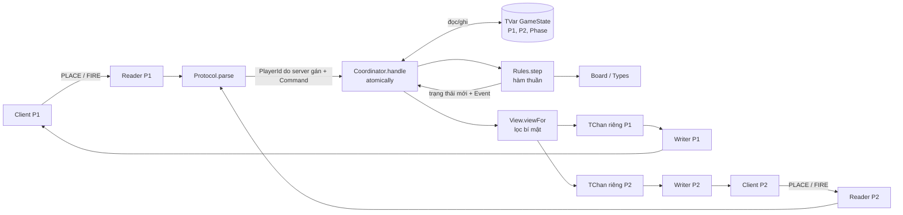

# Kiến trúc điều phối Battleship

Phạm vi: một server, hai client terminal, một trận. Server giữ trạng thái duy nhất; các module `Board`, `Rules` và `View` là hàm thuần. Các file `.hs` hiện còn trống; sơ đồ dưới đây là hợp đồng triển khai dự kiến.

## Luồng đặt tàu

1. Reader nhận một dòng, `Protocol` phân tích thành `PlaceFleet`; server gắn `PlayerId` của socket.
2. `Coordinator` đọc `GameState`, gọi `Rules.step` để kiểm tra đội tàu và tạo trạng thái mới.
3. Nếu mới một người đặt xong, giai đoạn vẫn là `Placing`; gửi `Waiting` cho người đó.
4. Khi người thứ hai đặt xong, giai đoạn chuyển thành `Turn P1`; gửi `Start P1` và góc nhìn riêng cho từng người.

## Luồng bắn và giữ lượt

1. Client đang có lượt gửi `Fire Coord`.
2. Trong một giao dịch STM, coordinator đọc trạng thái cũ, gọi `step`, ghi trạng thái mới và xếp thông báo vào kênh riêng. Socket writer gửi thông báo sau giao dịch.
3. `Miss` chuyển lượt sang đối thủ. `Hit` và `Sunk` **giữ nguyên lượt của người bắn**. `Win` chuyển sang `Finished` ngay.
4. Lệnh sai tạo `Error` cho người gửi, không ghi trạng thái và không đổi lượt. Hai lệnh đến gần như cùng lúc phải được xét trên các phiên bản trạng thái nhất quán.

## Ranh giới module

| Module | Người | Trách nhiệm |
|---|---|---|
| `Types.hs`, `Board.hs` | A | ADT và kiểm tra đội tàu hợp lệ |
| `Rules.hs`, `View.hs` | B | Luật thuần và dữ liệu được phép thấy |
| `Coordinator.hs`, `Server.hs` | C | STM, kết nối, định tuyến thông báo, ngắt kết nối |
| `Protocol.hs`, `Client.hs` | D | Parse/encode và giao diện terminal |
| `docs/` | R | Luật, kiến trúc, báo cáo, minh chứng |

Chữ ký hàm lõi dự kiến: `step :: PlayerId -> Command -> GameState -> Either GameError (GameState, [Event])` và `viewFor :: PlayerId -> GameState -> PlayerView`. Chốt kiểu chi tiết ở S-01. Client không nhận `GameState` thô hoặc tàu đối thủ chưa lộ.
