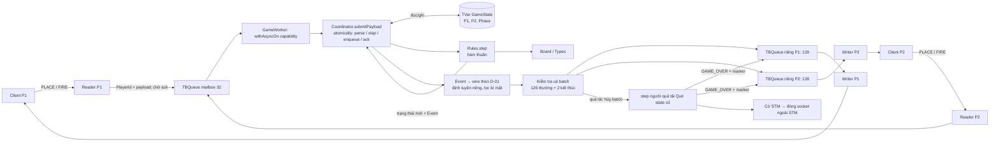
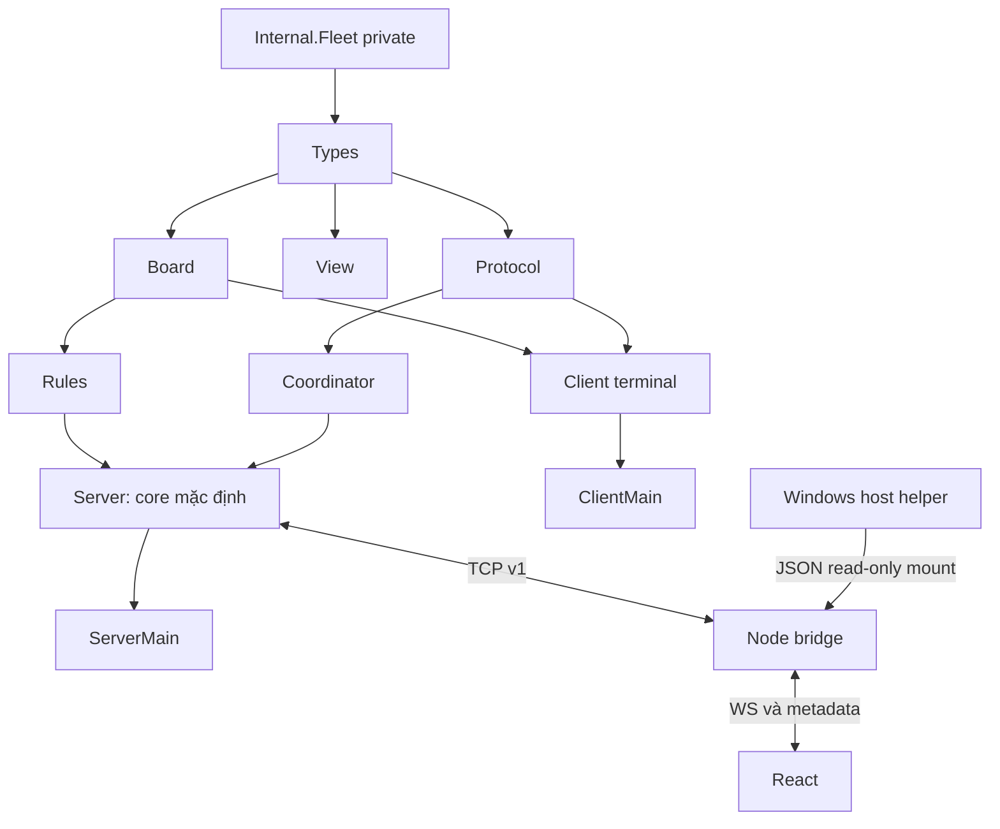
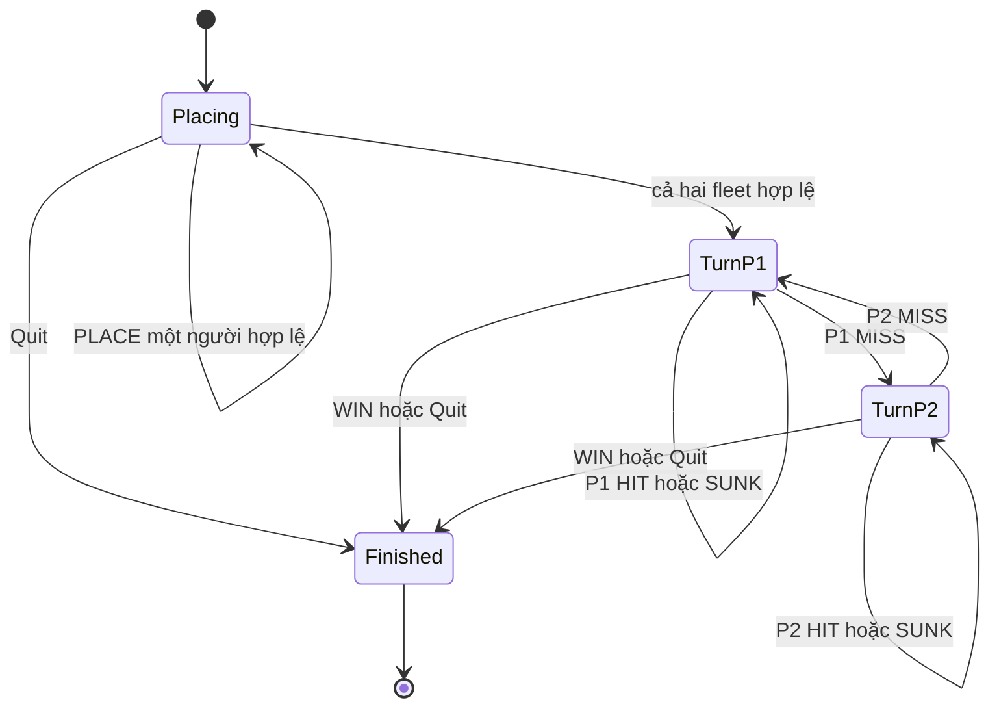

# Kiến trúc điều phối Battleship

Hiện trạng NM-05 ngày 2026-10-12 trên `Update_NUMA`: một core Haskell, hai người, một trận/lần chạy. Reader gửi mailbox hữu hạn tới worker xử lý trên capability chọn trước; worker khởi tạo coordinator và là nơi duy nhất submit gameplay trong server. Một TVar GameState, hai outbox hữu hạn và writer riêng; bridge giữ phiên web/replay/LAN, không quyết định luật. Cài đặt UI/LAN/Docker bên dưới tiếp tục áp dụng. Phân tích locality và bằng chứng mới xem [NM-05](worker_locality.md); hồ sơ `8bd7da9` và báo cáo cũ là snapshot theo thời điểm.

## Transport C-02 và điều phối C-03/C-04 hiện tại

Đợt tích hợp từ `frontend-ui` bổ sung React qua WebSocket–TCP; sau đó có LAN, resume 5 phút và Docker. Server/giao dịch STM tiếp tục cùng lõi luật. Hồ sơ theo thời điểm ở [frontend_integration.md](frontend_integration.md), cấu hình hiện hành ở [docker_deployment.md](docker_deployment.md).

ServerMain đọc port/môi trường, parseServerConfig và parseGameRuntimeConfig rồi gọi runServerWithRuntime. Native mặc định `127.0.0.1`; Docker cấu hình `0.0.0.0`. API runServer/runServerWith/runServerConfigured vẫn tương thích, chọn worker capability 0. Worker được tạo/kiểm tra trước listener; marker sau listen và callback báo port thực. Socket/reader/writer vẫn trong bracket/withAsync/link; worker dùng withAsyncOn và watcher lỗi có phạm vi. Đủ hai slot thì từ chối socket thứ ba trực tiếp. WELCOME đi qua worker trước khi mở reader/writer của slot.

Coordinator giữ đúng một TVar GameState và hai TBQueue (Maybe ByteString). Worker gọi atomically cho mỗi request: đọc state, parse/gọi step, encode toàn bộ batch, kiểm tra chỗ rồi commit state/frame/ack. Parser/luật lỗi chỉ xếp lỗi actor-only và giữ state nếu đủ chỗ; quá tải hủy batch gốc, áp dụng Quit theo C-07. Encode/hợp đồng lỗi rollback và supervisor dừng phiên. State và strict frame buffer được buộc tính trước publication. API STM cũ vẫn dùng trực tiếp trong test/benchmark; STM vẫn revalidate với writer/control, không có IO mạng hoặc unsafeIOToSTM.

Reader dùng `Protocol.feedFrames`, giữ buffer tối đa 256 byte hoặc 257 nếu cuối là CR chờ LF; mỗi recv lấy tối đa phần còn lại của frame 258 byte. Frame đủ LF gửi Payload vào mailbox 32 request rồi chờ ack xử lý; worker thực hiện parse/step/encode. Wire QUIT đi FIFO; EOF bỏ tail và thêm actor vào control Set độc lập với mailbox. Dòng quá dài được worker xếp lỗi trước control disconnect. Reader không submit coordinator trực tiếp. Mỗi writer lấy frame bằng atomically nextWorkerFrame, rồi sendAll ngoài STM; một writer/socket giữ nguyên thứ tự byte. Send lỗi đóng socket và báo disconnect actor qua control, không cản writer đối thủ.

`runServer = runServerWith Rules.step initialGameState` vẫn nối lõi thật. runServerWith giữ chữ ký để test dùng fixture; worker tạo coordinator trong phạm vi capability đã chọn. Lobby không giữ GameState. MVar bảo vệ registry socket, writer đã drain và cờ stopped, không quyết định lượt/winner. Hai API coordinate/applyCommand thuần vẫn dùng chung prepare/encode với API STM; không viết lại luật.

WELCOME được xếp đầu kênh khi admission trong STM; frame trước đó cho socket chưa có bị bỏ. Admission kiểm tra Finished nên không tạo người thay thế sau khi kết thúc. Transaction cuối xếp SHOT WIN/GAME_OVER trước marker Nothing cho mỗi queue. Supervisor chỉ dừng khi mọi writer đã được admission drain marker; nếu admission muộn đụng Finished, acceptor chờ writer hiện hữu thay vì hủy batch cuối. EOF/QUIT sau Finished không tạo thêm event hoặc đổi winner. Cleanup shutdown/close socket trước khi join worker để đánh thức IO Windows.

C-05: khi writer gặp marker cuối, nó shutdown chiều gửi để gửi FIN sau batch cuối; reader hiện hữu đọc bỏ phần input còn lại bằng buffer 4096 byte, không parse/gọi step nữa. Writer chờ thông báo readerDone tối đa 200 ms rồi shutdown Both/close để đánh thức recv nếu peer vẫn giữ kết nối. Chỉ sau đó writer báo đã dọn xong. MVar readerDone chỉ đồng bộ vòng đời socket, không giữ trạng thái trận. Cách đóng này tránh reset do còn lệnh TCP chưa đọc làm mất GAME_OVER; test QUIT kèm 2.000 lệnh đã tái hiện lỗi trước sửa và xanh sau sửa. Send hỏng vẫn đóng ngay và xử lý Quit cho đúng actor.

Mỗi send vẫn có deadline/watchdog 2 giây. C-07 giới hạn mỗi TBQueue ở 128 phần tử: tối đa 126 frame thường, dự trữ một GAME_OVER và một marker Nothing. Kiểm tra cả batch trước khi ghi, nên writeTBQueue không phải chờ writer lấy dữ liệu. Nếu thiếu chỗ, gọi cùng core với Quit cho người nhận quá tải từ state trước lệnh, hủy toàn bộ chuyển trạng thái/batch dự kiến. Nếu cả hai quá tải trong cùng batch, P1 Quit trước và đánh dấu cả hai socket. TVar cờ transport chỉ giữ danh tính cần ngắt; worker chờ cờ đóng socket ngoài STM, đánh thức IO và để writer bỏ phần FIFO còn lại đến marker. Socket chậm không giữ TVar hoặc chặn writer đối thủ; người còn đọc nhận GAME_OVER. Sau Finished, các finalizer không tạo kết quả mới. Không đổi R-01 hoặc wire v1; khoảng nối lại web 5 phút vẫn thuộc bridge. Dung lượng nhỏ cho test/API và chính sách đầy đủ tại [shared_contract.md](shared_contract.md#giới-hạn-và-chính-sách-client-chậm-c-07).

## Codec và client D-02 hiện tại

Protocol là module thuần: parse payload thành Command/Response, encode thành frame LF, dùng Either để trả lỗi tường minh. Command/Coord dùng Types chung. Response khác Event vì ShotResolved tạo hai thông điệp có hai người nhận; WireError chỉ giữ dữ liệu xuất hiện trong grammar. `encodeEvent` nhận phase sau step để thêm WAITING đúng lúc; Coordinator xếp frame vào đúng outbox P1/P2, Server chỉ tạo writer cho socket đã được admission và mỗi writer chỉ đọc outbox của mình. Không có serializer GameState hoặc fleet đối thủ.

ClientMain đọc CLI và chuyển cho Client.runClient. Client dùng bracket quản lý socket, chờ WELCOME v1, gửi một lệnh đã encode, dùng framer/parser đọc phản hồi và chuyển Response cho callback tiếng Việt. Kết thúc trên OK/SHOT tương ứng, ERROR hoặc GAME_OVER; có deadline 10 giây, chưa phải client tương tác chờ lượt lâu. Windows dùng shutdown Both/close để đánh thức foreign IO và stdout/stderr UTF-8. Client được test với server đã tích hợp và peer có kịch bản.

### Nhập đặt tàu D-03

ClientMain mặc định/`--place [PORT]` gọi runPlacementClient với stdin/stdout UTF-8; Main chỉ chọn chế độ/port và báo lỗi. promptFleet dựng draft offline theo năm ShipId, parsePlacementInput chuẩn hóa cú pháp địa phương `A1 H`, dùng parseCoord/Board.shipCells để kiểm tra. Chồng lấn xét các tập ô đã kiểm tra; Board.placeFleet kiểm tra trọn fleet lần cuối. renderFleet chỉ nhận Fleet của người chơi, in 10×10; SUA thay một tàu, giữ bốn tàu còn lại, GUI mới trả request hoàn chỉnh. HUY/EOF không kết nối.

Sau GUI: dùng cùng helper socket/framer/codec với D-02, nhận WELCOME rồi gửi một PLACE canonical. Deadline 10 giây chỉ bao phủ connect/handshake/ACK. OK PLACE chuyển sang phiên chơi D-04, không tự gửi lại PLACE và không truy vấn fleet đối thủ. Reader chạy dưới withAsync; supervisor đóng socket trước khi join khi cancel để tránh kẹt recv Windows. Chờ đối thủ không có deadline của khung một lệnh.

### Nhập bắn và hiển thị D-04

Client giữ PlayerId từ WELCOME. Một reader decode Response bằng Protocol, đưa vào TQueue; vòng UI duy nhất đọc queue, in tiếng Việt và gửi command đã encode. waitCatchSTM truyền lỗi reader khi queue đã hết dữ liệu; xử lý frame hợp lệ trước lỗi/EOF. Không lưu GameState, không gọi step và không tự tính hit/sunk/win.

InputStage chỉ quản lý tương tác: Waiting, YourTurn, AwaitShot Coord, AwaitTurn, Leaving. TURN của mình mở input; gửi FIRE chuyển sang AwaitShot; SHOT phải khớp tọa độ đang chờ, ghi vào outgoingShotsView rồi chờ TURN/GAME_OVER. Không suy ra quyền bắn tiếp từ HIT/SUNK. ERROR cho phép sửa input; NOT_YOUR_TURN chuyển sang lượt được server chỉ rõ, FLEETS_NOT_READY chờ, GAME_FINISHED chờ thông báo kết thúc. Lệnh bắn sai ở parser địa phương hoặc ô đã bắn không gửi ra mạng.

hWaitForInput chờ tối đa 100 ms rồi đọc một ký tự, ưu tiên queue mạng giữa các ký tự. Không dùng hGetLine chặn cả dòng khi chơi, để GAME_OVER được hiển thị cả khi stdin mở và dòng chưa hoàn chỉnh. Buffer input giữ tối đa 257 ký tự để phát hiện vượt giới hạn 256 mà không tăng vô hạn; Backspace/DEL xóa ký tự, input vượt buffer không được echo thêm trong terminal. EOF lúc đến lượt gửi QUIT; Waiting/AwaitShot không đọc input. Ctrl+C đóng socket ở mọi giai đoạn. renderResponseFor thêm thông báo chờ/đến lượt/thắng/thua theo PlayerId; các token/mã lỗi TCP vẫn do Protocol encode/parse, Main chỉ chọn CLI và báo lỗi.

Với terminal, withKeyboard dùng NoBuffering, tắt echo của hệ thống để UI echo ký tự, tắt dịch newline (Enter raw là CR trên Windows), rồi khôi phục mode trong bracket. System.IO chưa có getter newline; dùng withHandle_/haInputNL/haOutputNL từ base để đọc mode cũ dưới khóa handle; cần kiểm tra lại khi đổi toolchain khỏi GHC 9.10.3 đã chốt. File/pipe không bị đổi mode. Riêng Windows, withConsoleInput mở CONIN$ với read/write và lưu/khôi phục console mode, bỏ ENABLE_LINE_INPUT/ENABLE_ECHO_INPUT bằng binding Win32. Chỉ NoBuffering chưa đủ trên console đã thử: hGetChar vẫn chờ Enter dù hWaitForInput báo có phím. CPP và dependency os(windows) giữ phần này ngoài build nền tảng khác. Ý nghĩa đọc nguyên dòng của ENABLE_LINE_INPUT được mô tả trong [Microsoft Console API](https://learn.microsoft.com/windows/console/getconsolemode).

### Hai bàn terminal D-05

Sau OK PLACE, client giữ PlayerView gồm PlayerId được gán, fleet của mình đã kiểm tra bằng Board, phase/readiness công khai và hai Map lịch sử bắn. updatePlayerView là hàm thuần: SHOT cập nhật outgoingShotsView, INCOMING cập nhật incomingShotsView, START/TURN/GAME_OVER cập nhật phase công khai. Lỗi không thêm phát bắn; nếu lỗi cho biết trạng thái chờ hoặc chủ lượt thì UI dùng thông tin đó để sửa giai đoạn nhập. Không tạo GameState phía client hoặc gọi Rules.step. Tập ô chống bắn lặp lấy trực tiếp từ outgoingShotsView, không lưu Set thứ hai.

renderBoards chỉ nhận PlayerView, dùng cùng renderGrid với preview renderFleet. Bàn mình có CV/BB/CR/SB/DD và nước, các phát đã nhận đè bằng o/X/#/*. Bảng mục tiêu chỉ có các kết quả SHOT và ? ở ô chưa bắn. SUNK chỉ đánh dấu phát cuối bằng #; không suy ra hình tàu đối thủ hoặc thay các Hit cũ. Hai bàn in cạnh nhau sau ACK, từng SHOT/INCOMING và kết thúc; thông báo thắng/thua in cuối để dễ thấy. Ký hiệu có chú giải ngay trên terminal. Không thêm UI đồ họa hoặc thông điệp snapshot vào wire v1.

ClientMain không tham số, [PORT], --play [PORT] hoặc --place [PORT] đều mở phiên tương tác. Chế độ một lệnh vẫn dùng [PORT] "COMMAND". Người chơi nhập A1 H cho tàu và chỉ A6 cho phát bắn; Protocol tự encode thông điệp TCP.

## Kiến trúc STM qua worker NM-05



## Luồng đặt tàu

1. Reader nhận một dòng, `Protocol` phân tích thành `PlaceFleet`; server gắn `PlayerId` của socket.
2. `Coordinator` đọc `GameState`, gọi `Rules.step` để kiểm tra đội tàu và tạo trạng thái mới.
3. Nếu mới một người đặt xong, giai đoạn vẫn là `Placing`; gửi `OK PLACE` rồi `WAITING OPPONENT` cho người đó.
4. Khi người thứ hai đặt xong, giai đoạn chuyển thành `Turn P1`; người đó nhận `OK PLACE`, cả hai nhận `START P1` rồi `TURN P1`.

D-01 tại `docs/protocol.md` là hợp đồng wire v1: không gửi snapshot `PlayerView`. Client dựng bàn từ đội tàu của mình đã được xác nhận và các event được phép thấy. `View.viewFor` B-03 là phép chiếu thuần để sử dụng phía server; không gửi nguyên `GameState` hay đội tàu đối thủ. Định tuyến `ShotResolved` thành `SHOT` cho người bắn và `INCOMING` cho người bị bắn; mỗi người nhận kết quả trước `TURN` hoặc `GAME_OVER`.

## Luồng bắn và giữ lượt

B-02 đã cài luật thuần theo R-01/D-01: kiểm tra readiness → lượt → tọa độ → bắn lặp, tra ô trong fleet đối thủ để xác định Miss/Hit/Sunk/Win. Lịch sử lưu một lần ở playerShots của người bắn; `shotsReceived player state` đọc lịch sử người kia cho bàn của player. Thêm tọa độ mới vào tập ô đã bắn để kiểm tra tàu chìm/toàn bộ fleet; Win ưu tiên trước Sunk ở ô cuối cùng. Tàu chạm cạnh vẫn là các ShipId riêng, không gom theo vùng liên thông. Giữ các Outcome lịch sử, không sửa Hit cũ thành Sunk/Win.

step chỉ đổi lịch sử người bắn và phase; giữ nguyên hai fleet và lịch sử bắn ra của đối thủ. Mỗi Right trả ShotResolved rồi TurnReady hoặc GameEnded. Lỗi trả Left, Coordinator giữ state cũ nếu phản hồi đủ chỗ; quá tải kích hoạt chuyển trạng thái Quit riêng theo C-07. C-03/C-04 đã nối lõi vào server; C-04/C-07 dùng STM và writer riêng theo luồng sau.

1. Client đang có lượt gửi `Fire Coord`.
2. Trong một giao dịch STM, coordinator đọc trạng thái cũ, gọi `step`, ghi trạng thái mới và xếp thông báo vào kênh riêng. Socket writer gửi thông báo sau giao dịch.
3. `Miss` chuyển lượt sang đối thủ. `Hit` và `Sunk` **giữ nguyên lượt của người bắn**. `Win` chuyển sang `Finished` ngay.
4. Lệnh sai tạo `Error` cho người gửi, không ghi trạng thái và không đổi lượt nếu queue đủ chỗ; nếu không, C-07 kết thúc bằng Quit của người quá tải. Hai lệnh đến gần như cùng lúc được xét trên các phiên bản trạng thái nhất quán.

## Ranh giới module

| Module | Người | Trách nhiệm |
|---|---|---|
| `Types.hs`, `Board.hs` | A | ADT và kiểm tra đội tàu hợp lệ |
| `Rules.hs`, `View.hs` | B | Luật thuần và dữ liệu được phép thấy |
| `Coordinator.hs`, `Server.hs` | C | STM, kết nối, định tuyến thông báo, ngắt kết nối |
| `Protocol.hs`, `Client.hs` | D | Parse/encode và giao diện terminal |
| `docs/` | R | Luật, kiến trúc, báo cáo, minh chứng |

## Hợp đồng A-01 để A/B/C/D review

Các chữ ký đầy đủ đã công bố trong Haddock của `src/Battleship/Types.hs`:

```haskell
-- A-02: Battleship.Board
placeFleet :: FleetPlacement -> Either GameError Fleet

-- B: Battleship.Rules
step :: PlayerId -> Command -> GameState
     -> Either GameError (GameState, [Event])

-- B: Battleship.View
viewFor :: PlayerId -> GameState -> PlayerView
```

`Types` xuất type alias `PlaceFleetFn`, `Step`, `ViewFor` tương ứng. Khi viết cài đặt có thể dùng `placeFleet :: PlaceFleetFn`, `step :: Step`, `viewFor :: ViewFor`. A-01 công bố hợp đồng; chưa tạo các hàm nghiệp vụ giả hoặc cài đặt luật trong `Main`.

- `Coord` dùng cột/hàng bắt đầu từ 1; `A1 = Coord 1 1`, `J10 = Coord 10 10`. Giá trị ngoài bàn vẫn biểu diễn được để trả `InvalidCoordinate`; A-02/Rules phải kiểm tra trước khi dùng.
- `ShipPlacement` gồm ID, điểm đầu, hướng; độ dài lấy từ `shipLength`, không nhận độ dài tự chọn. `FleetPlacement` là danh sách để không mất tàu trùng ID trước bước kiểm tra.
- `Fleet` giữ `Map ShipId (Set Coord)` và, từ NM-06, tập 17 ô tính sẵn cùng bảng UArray Int Word8 100 ô. `Board.placeFleet` tạo cả geometry/metadata sau khi kiểm tra đủ năm tàu, đúng độ dài/hình dạng, trong bàn, không chồng. Cho phép chạm cạnh/góc như R-01. Types chỉ xuất type Fleet/hàm đọc fleetShips; Board có fleetCells/shipAt đọc có kiểm tra. Constructor/record update nằm trong module private Internal.Fleet. Rules và fixture phải tạo qua placeFleet, không import Internal. Bảng tra cứu này là dữ liệu chương trình, không phải cache CPU; xem [NM-06](fleet_index.md).
- `PlayerState` giữ `Maybe Fleet` và lịch sử bắn vào đối thủ `Map Coord Outcome`. `Nothing` nghĩa là chưa đặt tàu; chỉ `Right fleet` của `placeFleet` được gắn bằng `Just`. Các ô bị đối thủ bắn trên bàn mình lấy từ lịch sử của người kia qua `shotsReceived :: PlayerId -> GameState -> Map Coord Outcome`, tránh lưu hai bản dữ liệu có thể lệch nhau.
- `GameState` luôn có `gamePlayer1`, `gamePlayer2`, `gamePhase`. `setPlayerState` chỉ thay một record, không kiểm tra luật/chuyển giai đoạn. `Turn` đòi hỏi cả hai đội tàu đã hợp lệ; `Finished winner AllShipsSunk` không có lượt tiếp theo. `Finished winner OpponentLeft` cũng có thể xảy ra khi đang đặt tàu.
- `Left GameError` không trả trạng thái mới: C giữ nguyên toàn bộ trạng thái cũ, chỉ báo lỗi cho người gửi. `Right` trả trạng thái/sự kiện mới. Rules chọn thứ tự kiểm tra lỗi; A-01 chưa chốt ưu tiên nếu một lệnh mắc nhiều lỗi.
- C truyền `PlayerId` của socket vào `step`; D không parse danh tính trong `Command`. C chuyển ngắt kết nối bất thường thành `Quit` của người đó. Sau khi kết thúc, Rules từ chối mọi lệnh bằng `GameAlreadyFinished`.
- `View.viewFor` B-03 chiếu GameState thành PlayerView thuần: ownFleetView lấy đúng người nhận, outgoingShotsView lấy history người đó, incomingShotsView qua shotsReceived, cùng phase và readiness đối thủ. Không đọc/copy hình học fleet đối thủ; không tự reveal khi Finished. ViewSpec soát từng tọa độ đối thủ chưa bắn, đối chiếu toàn record và kiểm tra thay 72 bố trí bí mật vẫn cho cùng view nếu quan sát không đổi. Tọa độ trên bàn mình được phép trùng số tọa độ bí mật trên bàn đối thủ: hai bàn là hai miền khác nhau. Server tiếp tục gửi sự kiện đã lọc, wire v1 không thêm snapshot.

Luật R-01 giữ nguyên: đủ hai đội tàu thì `Turn P1`; `Miss` đổi lượt, `Hit`/`Sunk` giữ lượt; `Win` kết thúc ngay. BoardSpec A-02/A-03 kiểm tra đặt tàu; RulesSpec B-01/B-02/S-02 kiểm tra đặt tàu/bắt đầu/bỏ cuộc, mọi kết quả bắn và các nhánh lỗi giữ state. ViewSpec B-03 kiểm tra projection và bí mật; fixture chơi hợp lệ đi qua Rules/Board production theo S-02.

Trạng thái review chung tại [shared_contract.md](shared_contract.md), S-01 v2 cập nhật A-02: đã đối chiếu Types, Board, giao thức và hai Main; chưa có đủ xác nhận A/B/C/D để khóa mốc. Bảng chủ sở hữu tại S-01 gồm cả app/test/YAML và module private; bảng module ở đây chỉ là tóm tắt kiến trúc.

## Kiến trúc web, LAN và Docker hiện hành

### Phụ thuộc và nguồn dữ liệu



Mũi tên phụ thuộc thể hiện module nền được lớp phía sau sử dụng; không có Rules→Server/Coordinator hoặc Board→IO. Internal.Fleet dùng tham số kiểu để không import Types ngược lại. `View` là public projection thuần; production transport hiện gửi event đã lọc, không gửi snapshot view.

| Trạng thái | Nơi sở hữu | Ai được thay đổi? |
|---|---|---|
| Hai fleet/history/phase/winner | GameState trong một TVar ở Haskell | Coordinator commit kết quả Rules.step |
| FIFO/thông báo end/slow flags | Coordinator | Một transaction submit; writer chỉ lấy frame |
| Socket registry/drained/readerDone | Server MVar/lifecycle | Worker/supervisor IO, không tự quyết luật |
| Đội hình nháp | Terminal/UI | Người chơi trước xác nhận |
| Public view/pending | Terminal/UI | Fold response; own fleet từ request đã OK |
| Token/TCP/own PLACE/private frames/deadline | Bridge RAM | Bridge attach/disconnect/cleanup; Quit đi core |
| Origin LAN hiện tại/heartbeat | Windows JSON + bridge allowlist | Helper duy nhất ghi; bridge validate/poll |

Hai container không chia sẻ TVar. Bridge session không phải bản sao GameState: nó biết TCP/player và dữ liệu phiên được phép thấy, không chứa fleet đối thủ hay tự tính outcome.

### State machine và dữ liệu không bị lộ



Lệnh lỗi giữ node/state cũ; lệnh sau Finished bị từ chối. Web missing/connecting/pending là trạng thái giao diện/transport, không node mới của GameState. Queue quá tải tạo Quit riêng, không ghi nước gây tràn.

React `Board enemy fleet={[]}` chỉ dùng `view.outgoing`; own Board dùng own fleet + incoming. `game.ts` đổi UI `(row,col)` zero-based sang cột A..J/hàng 1..10 ở wire; Haskell Coord one-based. `connection.ts` validate metadata/replay/own PLACE; App ref khóa click ngay, đợi TURN để cho thao tác tiếp. Nháp không được chỉnh sau server đã chấp nhận.

### WebSocket và resume

HTTP phục vụ `frontend/dist`, `GET /healthz` chỉ kiểm tra HTTP, WS `/play` kiểm tra Origin/Host trước tạo TCP. TCP v1 không đổi. Bridge thêm SESSION/CONNECTION/RESUME_ERROR JSON chỉ ở WS, `connection.ts` xử lý riêng với parser frame.

Một session = một TCP player + token 32 byte random + own PLACE đã OK + FIFO lịch sử frame riêng (≤4096). WS mới không có token tạo TCP mới; resume hợp lệ gắn TCP đang giữ. WebSocket close/heartbeat mất tạo deadline 5 phút; timer cũ hủy khi resume; hết hạn QUIT. GAME_OVER có thể replay để xem kết quả trong thời gian giữ phiên sau kết thúc, không hồi sinh ván. Bridge restart/TCP bị core đóng thì không phục hồi state mới từ phiên cũ.

Bridge còn kiểm tra max WS payload 256 byte, pending TCP writable buffer/WS bufferedAmount ngưỡng 65.536 byte và pending commands 256. Đây là giới hạn ở các tầng khác nhau, không phải capacity TBQueue; threshold buffer được kiểm tra khi send/nhận command và có thể vượt ngưỡng một frame trước lượt kiểm tra tiếp theo. Không claim toàn RAM đã giới hạn ở 128 phần tử.

### Native và container network

| Thành phần | Native mặc định | Compose mặc định |
|---|---|---|
| Haskell bind | 127.0.0.1:4000 | 0.0.0.0:4000, không publish host |
| Bridge TCP đích | 127.0.0.1:4000 | haskell:4000 qua DNS mạng Compose |
| Bridge HTTP bind | Chạy CLI không setting: Auto LAN 0.0.0.0:8080 | 0.0.0.0:8080 |
| URL localhost người chơi | http://127.0.0.1:8080 | http://localhost:8081 |
| LAN IP source | node:os trên native host | Helper PowerShell Windows host, JSON mount |
| Terminal CLI | 127.0.0.1, port tùy chọn | Không được expose cổng core ra host để CLI vào |

Library Client có HostName parameter; ClientMain hiện chưa có flag remote host. LAN sản phẩm dùng UI web. `runServer` API library giữ loopback; `runServerConfigured` chọn bind validated. PUBLIC_ORIGIN/WEB_PUBLIC_PORT mô tả URL bên ngoài, không tự tạo forwarding; Compose ports tạo mapping.

### IP cập nhật và vòng đời deploy

Host helper lọc IPv4/up/nonloopback, loại 127/link-local/IPv6, cho chọn tên adapter. Không tự nhận VPN là sai nếu nó còn IPv4: chọn Wi-Fi/Ethernet để giới hạn đúng mạng. Một writer lock, temp+flush+atomic rename, heartbeat 2 giây. Bridge poll 2 giây, schema/file/port/TTL kiểm tra; origin cũ bị loại khi file đổi/lỗi/quá hạn, origin mới được phép nhưng Host phải trùng Origin. Phiên/TCP/deadline giữ nguyên khi hot reload allowlist.

Compose có đúng hai service, dependency healthy khi start, healthcheck không mở game TCP. Haskell nhận SIGTERM để unwinding bracket; Node bridge PID1 xử lý SIGTERM/SIGINT đóng WS/TCP/HTTP/timers. Stop grace 10 giây; restart no. Không volume lưu trận, không secret state trong health/log. Host tắt/Engine dừng làm cả dịch vụ dừng.

## Điểm kiểm chứng khi thay kiến trúc

API/ownership có fixture trong SharedContractSpec; wire transcript trong ProtocolSpec/frontend; fleet/view/rules có unit/property; TVar/batch/queue có CoordinatorSpec; worker/EOF/readiness có ServerSpec; mapped origin/resume/stop/new-match có bridge/runtime/Compose tests. Test xanh không thay nhóm review khi đổi contract. Chi tiết chọn phương án, rủi ro/giới hạn và lệnh ở design_decisions/testing/Docker contract.
