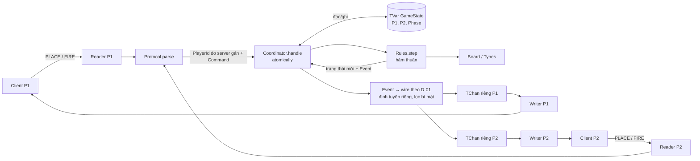

# Kiến trúc điều phối Battleship

Phạm vi: một server, hai client terminal, một trận. Types, Board, Rules, transport/Coordinator C-02/C-03, codec D-02 và client nhập đặt tàu D-03 đã có cài đặt. MVar giữ trạng thái duy nhất. View còn là khung; client đã xem trước fleet của mình, chưa nhập bắn/render diễn biến trận. Sơ đồ STM dưới đây là kiến trúc đích, chưa phải cài đặt hiện tại.

## Transport C-02 và điều phối C-03 hiện tại

ServerMain đọc port rồi gọi `Server.runServer`; bind IPv4 loopback `127.0.0.1` và accept theo thứ tự P1/P2. Hai socket tồn tại trong bracket lồng nhau với worker reader có withAsync/link. Sau khi đủ hai slot, acceptor tiếp tục nhận để gửi `ERROR SERVER_FULL` và đóng ngay socket thứ ba. Một client không gửi dữ liệu không chặn việc nhận client tiếp theo.

MVar bảo vệ registry, GameState và cờ ended; welcome, parse/step, cập nhật state và batch phản hồi cùng khóa. Hai reader không thể cùng ghi từ một state cũ; các frame của một người nhận giữ thứ tự. QUIT/EOF/lỗi socket đi qua Rules.step Quit. Finished đánh dấu ended và đánh thức supervisor sau batch cuối; EOF tiếp theo không đổi winner/reason. Cleanup đóng socket trước khi join worker để đánh thức IO Windows; cancel không tự gán người thắng mới.

Reader dùng `Protocol.feedFrames`, giữ buffer tối đa 256 byte hoặc 257 nếu cuối là CR chờ LF; mỗi recv lấy tối đa phần còn lại của frame 258 byte. Frame đủ LF đi qua Coordinator.coordinate → parseCommand → Step → encodeEvent; EOF bỏ tail rồi applyCommand Quit. Lỗi parser không gọi Step, lỗi parser/Rules giữ state và phản hồi actor-only. Encode toàn bộ batch trước khi commit/gửi; lỗi encode nội bộ dừng session và truyền exception lên supervisor, không phát một phần batch hoặc bịa kết quả thắng. Send lỗi đóng đúng socket để finalizer xử lý Quit của người đó.

`runServer = runServerWith Rules.step initialGameState` là điểm nối lõi thật ở Đợt 6. `runServerWith :: Step -> GameState -> PortNumber -> (PortNumber -> IO ()) -> IO ()` cho phép test dùng stub/fixture mà không thay transport. A/B đã hoàn thiện nên production dùng lõi thật ngay; stub chỉ nằm trong test, không có bản sao luật thắng thua. Coordinator xuất coordinate (payload) và applyCommand (Command đã có, dùng cho EOF); cả hai thuần, trả Either ProtocolError (GameState, danh sách người nhận/frame).

Giới hạn hiện tại: write nằm trong MVar, mỗi send có deadline/watchdog 2 giây; peer chậm có thể trì hoãn peer kia đến khi hết deadline. Queue writer riêng/TVar GameState thuộc bước STM tiếp theo; không thực hiện socket IO trong transaction STM. Không thêm dependency cho C-03.

## Codec và client D-02 hiện tại

Protocol là module thuần: parse payload thành Command/Response, encode thành frame LF, dùng Either để trả lỗi tường minh. Command/Coord dùng Types chung. Response khác Event vì ShotResolved tạo hai thông điệp có hai người nhận; WireError chỉ giữ dữ liệu xuất hiện trong grammar. `encodeEvent` nhận phase sau step để thêm WAITING đúng lúc; Server lọc người nhận theo registry và gửi frame Coordinator tạo. Không có serializer GameState hoặc fleet đối thủ.

ClientMain đọc CLI và chuyển cho Client.runClient. Client dùng bracket quản lý socket, chờ WELCOME v1, gửi một lệnh đã encode, dùng framer/parser đọc phản hồi và chuyển Response cho callback tiếng Việt. Kết thúc trên OK/SHOT tương ứng, ERROR hoặc GAME_OVER; có deadline 10 giây, chưa phải client tương tác chờ lượt lâu. Windows dùng shutdown Both/close để đánh thức foreign IO và stdout/stderr UTF-8. Client được test với server đã tích hợp và peer có kịch bản.

### Nhập đặt tàu D-03

ClientMain mặc định/`--place [PORT]` gọi runPlacementClient với stdin/stdout UTF-8; Main chỉ chọn chế độ/port và báo lỗi. promptFleet dựng draft offline theo năm ShipId, parsePlacementInput chuẩn hóa cú pháp địa phương `A1 H`, dùng parseCoord/Board.shipCells để kiểm tra. Chồng lấn xét các tập ô đã kiểm tra; Board.placeFleet kiểm tra trọn fleet lần cuối. renderFleet chỉ nhận Fleet của người chơi, in 10×10; SUA thay một tàu, giữ bốn tàu còn lại, GUI mới trả request hoàn chỉnh. HUY/EOF không kết nối.

Sau GUI: dùng cùng helper socket/framer/codec với D-02, nhận WELCOME rồi gửi một PLACE canonical. Deadline 10 giây chỉ bao phủ connect/handshake/ACK. OK PLACE chuyển sang reader giữ kết nối, xử lý WAITING/START/TURN/INCOMING/GAME_OVER, không tự gửi lại PLACE và không truy vấn fleet đối thủ. Reader chạy dưới withAsync; supervisor đóng socket trước khi join khi cancel để tránh kẹt recv Windows. Chờ đối thủ không có deadline của khung một lệnh. Nhập FIRE thuộc bước tiếp theo; không sao chép luật vào Client hoặc Main.

## Kiến trúc STM đích



## Luồng đặt tàu

1. Reader nhận một dòng, `Protocol` phân tích thành `PlaceFleet`; server gắn `PlayerId` của socket.
2. `Coordinator` đọc `GameState`, gọi `Rules.step` để kiểm tra đội tàu và tạo trạng thái mới.
3. Nếu mới một người đặt xong, giai đoạn vẫn là `Placing`; gửi `OK PLACE` rồi `WAITING OPPONENT` cho người đó.
4. Khi người thứ hai đặt xong, giai đoạn chuyển thành `Turn P1`; người đó nhận `OK PLACE`, cả hai nhận `START P1` rồi `TURN P1`.

D-01 tại `docs/protocol.md` là hợp đồng wire v1: không gửi snapshot `PlayerView`. Client dựng bàn từ đội tàu của mình đã được xác nhận và các event được phép thấy. `View.viewFor` vẫn là hợp đồng hàm thuần phía server; không gửi nguyên `GameState` hay đội tàu đối thủ. Định tuyến `ShotResolved` thành `SHOT` cho người bắn và `INCOMING` cho người bị bắn; mỗi người nhận kết quả trước `TURN` hoặc `GAME_OVER`.

## Luồng bắn và giữ lượt

B-02 đã cài luật thuần theo R-01/D-01: kiểm tra readiness → lượt → tọa độ → bắn lặp, tra ô trong fleet đối thủ để xác định Miss/Hit/Sunk/Win. Lịch sử lưu một lần ở playerShots của người bắn; `shotsReceived player state` đọc lịch sử người kia cho bàn của player. Thêm tọa độ mới vào tập ô đã bắn để kiểm tra tàu chìm/toàn bộ fleet; Win ưu tiên trước Sunk ở ô cuối cùng. Tàu chạm cạnh vẫn là các ShipId riêng, không gom theo vùng liên thông. Giữ các Outcome lịch sử, không sửa Hit cũ thành Sunk/Win.

step chỉ đổi lịch sử người bắn và phase; giữ nguyên hai fleet và lịch sử bắn ra của đối thủ. Mỗi Right trả ShotResolved rồi TurnReady hoặc GameEnded. Lỗi trả Left, Coordinator giữ state cũ. C-03 đã nghiệm thu qua TCP thật. Phần STM/writer dưới đây vẫn là luồng đích; cài đặt hiện tại tuần tự hóa bằng MVar.

1. Client đang có lượt gửi `Fire Coord`.
2. Trong một giao dịch STM, coordinator đọc trạng thái cũ, gọi `step`, ghi trạng thái mới và xếp thông báo vào kênh riêng. Socket writer gửi thông báo sau giao dịch.
3. `Miss` chuyển lượt sang đối thủ. `Hit` và `Sunk` **giữ nguyên lượt của người bắn**. `Win` chuyển sang `Finished` ngay.
4. Lệnh sai tạo `Error` cho người gửi, không ghi trạng thái và không đổi lượt. Hai lệnh đến gần như cùng lúc phải được xét trên các phiên bản trạng thái nhất quán.

## Ranh giới module

| Module | Người | Trách nhiệm |
|---|---|---|
| `Types.hs`, `Board.hs` | A | ADT và kiểm tra đội tàu hợp lệ |
| `Rules.hs`, `View.hs` | B | Luật thuần và dữ liệu được phép thấy |
| `Coordinator.hs`, `Server.hs` | C | STM, kết nối, định tuyến thông báo, ngắt kết nối |
| `Protocol.hs`, `Client.hs` | D | Parse/encode và giao diện terminal |
| `docs/` | R | Luật, kiến trúc, báo cáo, minh chứng |

## Hợp đồng A-01 để A/B/C/D review

Các chữ ký đầy đủ đã công bố trong Haddock của `src/Battleship/Types.hs`:

```haskell
-- A-02: Battleship.Board
placeFleet :: FleetPlacement -> Either GameError Fleet

-- B: Battleship.Rules
step :: PlayerId -> Command -> GameState
     -> Either GameError (GameState, [Event])

-- B: Battleship.View
viewFor :: PlayerId -> GameState -> PlayerView
```

`Types` xuất type alias `PlaceFleetFn`, `Step`, `ViewFor` tương ứng. Khi viết cài đặt có thể dùng `placeFleet :: PlaceFleetFn`, `step :: Step`, `viewFor :: ViewFor`. A-01 công bố hợp đồng; chưa tạo các hàm nghiệp vụ giả hoặc cài đặt luật trong `Main`.

- `Coord` dùng cột/hàng bắt đầu từ 1; `A1 = Coord 1 1`, `J10 = Coord 10 10`. Giá trị ngoài bàn vẫn biểu diễn được để trả `InvalidCoordinate`; A-02/Rules phải kiểm tra trước khi dùng.
- `ShipPlacement` gồm ID, điểm đầu, hướng; độ dài lấy từ `shipLength`, không nhận độ dài tự chọn. `FleetPlacement` là danh sách để không mất tàu trùng ID trước bước kiểm tra.
- `Fleet` bọc `Map ShipId (Set Coord)`, được `Board.placeFleet` A-02 tạo sau khi kiểm tra đủ năm tàu, đúng độ dài/hình dạng, trong bàn, không chồng. Cho phép chạm cạnh/góc như R-01. Types chỉ xuất type Fleet và hàm đọc fleetShips; constructor/record update nằm trong module private Internal.Fleet. Rules và fixture phải tạo qua placeFleet, không import Internal.
- `PlayerState` giữ `Maybe Fleet` và lịch sử bắn vào đối thủ `Map Coord Outcome`. `Nothing` nghĩa là chưa đặt tàu; chỉ `Right fleet` của `placeFleet` được gắn bằng `Just`. Các ô bị đối thủ bắn trên bàn mình lấy từ lịch sử của người kia qua `shotsReceived :: PlayerId -> GameState -> Map Coord Outcome`, tránh lưu hai bản dữ liệu có thể lệch nhau.
- `GameState` luôn có `gamePlayer1`, `gamePlayer2`, `gamePhase`. `setPlayerState` chỉ thay một record, không kiểm tra luật/chuyển giai đoạn. `Turn` đòi hỏi cả hai đội tàu đã hợp lệ; `Finished winner AllShipsSunk` không có lượt tiếp theo. `Finished winner OpponentLeft` cũng có thể xảy ra khi đang đặt tàu.
- `Left GameError` không trả trạng thái mới: C giữ nguyên toàn bộ trạng thái cũ, chỉ báo lỗi cho người gửi. `Right` trả trạng thái/sự kiện mới. Rules chọn thứ tự kiểm tra lỗi; A-01 chưa chốt ưu tiên nếu một lệnh mắc nhiều lỗi.
- C truyền `PlayerId` của socket vào `step`; D không parse danh tính trong `Command`. C chuyển ngắt kết nối bất thường thành `Quit` của người đó. Sau khi kết thúc, Rules từ chối mọi lệnh bằng `GameAlreadyFinished`.
- `PlayerView` có fleet của chính người nhận, lịch sử bắn ra/bắn vào, phase và readiness của đối thủ. Không có field fleet đối thủ. B phải kiểm tra `ownFleetView` lấy đúng người; A-01 chưa chứng minh cài đặt `viewFor` lọc bí mật đúng.

Luật R-01 giữ nguyên: đủ hai đội tàu thì `Turn P1`; `Miss` đổi lượt, `Hit`/`Sunk` giữ lượt; `Win` kết thúc ngay. BoardSpec A-02/A-03 kiểm tra đặt tàu; RulesSpec B-01/B-02 kiểm tra đặt tàu/bắt đầu/bỏ cuộc, mọi kết quả bắn và các nhánh lỗi giữ state. View.viewFor/lọc bí mật vẫn chờ task B tiếp theo. TypesSpec A-01 dùng fleet fixture tạo qua placeFleet.

Trạng thái review chung tại [shared_contract.md](shared_contract.md), S-01 v2 cập nhật A-02: đã đối chiếu Types, Board, giao thức và hai Main; chưa có đủ xác nhận A/B/C/D để khóa mốc. Bảng chủ sở hữu tại S-01 gồm cả app/test/YAML và module private; bảng module ở đây chỉ là tóm tắt kiến trúc.
