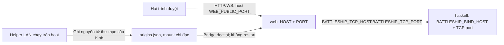

# Hợp đồng triển khai Docker — DK-01 v1

Ngày lập: **2026-10-10**. Nhánh: `Update_using_docker`, nền `0a7c250`.
Chủ trì: R. C/D review cấu hình, healthcheck và vòng đời phiên trước hợp nhất.

**Trạng thái: DK-01..DK-07 đã triển khai và kiểm thử kỹ thuật; chưa có xác nhận C/D/R thay người phụ trách.** DK-01 tạo tài liệu, `.env.example` và test artifact. DK-02 thêm listener/readiness Haskell; DK-03 thêm TCP host, public port, kiểm tra Origin/Host, reader file LAN và healthcheck bridge. DK-04 nghiệm thu [image Haskell](../docker/README.md) Linux amd64: 908 ví dụ Haskell với `-Werror`, 5/5 test runtime. DK-05 nghiệm thu [image web](../docker/README.md#image-web--dk-05): TypeScript/build, 36 unit test và 6/6 test runtime. DK-06 triển khai helper Windows và kiểm thử producer/mount chỉ đọc/resume. DK-07 thêm Compose production, build cả hai image và kiểm thử readiness/health/stop/start/down bằng server thật; xem mục 6 và docker/README. Mẫu localhost dùng được với compose.yaml sau khi tạo thư mục LAN_CONFIG_DIR và build; LAN động dùng helper. Nghiệm thu gameplay đầy đủ và hai thiết bị LAN vật lý thuộc DK-08.

Nguồn phải giữ đúng: [luật R-01](game_spec.md), [wire v1](protocol.md), [hợp đồng chung](shared_contract.md), [bridge và GUI hiện tại](frontend_integration.md). Không đổi Types, luật, người nhận sự kiện hoặc nguồn sự thật `TVar GameState` để phục vụ Docker.

## 1. Phạm vi và cấu trúc cố định

Hai service production là **`haskell`** và **`web`**. `web` gồm giao diện React đã build và Node bridge; Haskell vẫn quyết định toàn bộ luật. Không thêm database, GUI mới, nhiều phòng hoặc phục hồi trận sau restart trong đợt Docker này.

| Thành phần | Trong container | Máy chủ/người chơi | Quy định |
|---|---|---|---|
| `haskell` | Bind `0.0.0.0:4000` mặc định Docker | Không publish TCP | Bridge gọi `haskell:4000` bằng tên service |
| `web` | Bind `0.0.0.0:8080` mặc định Docker | Publish `8081:8080` mặc định | HTTP và WebSocket `/play` cùng cổng |
| URL mặc định | Không dùng IP container làm URL | `http://localhost:8081` | Dành cho máy chủ; alias `127.0.0.1` được phép |
| URL LAN | Bridge nhận danh sách origin của host | `http://<IPv4-máy-chủ>:8081` | Thiết bị khác dùng IP host, không dùng localhost |

Hai service dùng một mạng Compose riêng của project, driver bridge; không dùng `network_mode: host`, `privileged` hoặc mount Docker socket. Không cần `container_name`; tên service là địa chỉ ổn định trong mạng Compose. Cổng TCP không có mục `ports`; `expose` nếu có chỉ mô tả cổng nội bộ, không phải cơ chế kiểm soát truy cập. Publish cổng web trên các giao diện host để localhost và LAN cùng truy cập; mạng/firewall của host vẫn phải cho phép cổng đó.



Compose chỉ yêu cầu Docker Engine và Compose v2 để chạy sản phẩm sau khi đã triển khai xong. GHC/Stack/Node/pnpm của image build phải được ghim và kiểm chứng ở DK-04/DK-05. Dùng snapshot hiện tại **lts-24.59 / GHC 9.10.3**, Node đáp ứng **>=24**, pnpm **11.25.0** và lockfile hiện tại; không tự đổi snapshot/dependency để Docker build thuận tiện hơn. Helper Windows dùng PowerShell có sẵn trên host, không yêu cầu Node ngoài container để chơi.

## 2. Biến cấu hình và nơi nhận

`.env.example` ở root là mẫu **giá trị Docker**, không phải mặc định cho chạy trực tiếp. `.env` phục vụ nội suy Compose; nó không tự trở thành môi trường của tất cả process. DK-07 phải dùng `environment` tường minh theo bảng, không `env_file: .env` chung cho hai service. Vì vậy `HOST`/`PORT` của web không thể vô tình đổi cấu hình Haskell.

| Biến | Docker mẫu | Nơi nhận | Kiểm tra và ý nghĩa |
|---|---|---|---|
| `BATTLESHIP_BIND_HOST` | `0.0.0.0` | Haskell | IPv4 hợp lệ hoặc alias `localhost`; không URL, DNS, port, whitespace. Trực tiếp mặc định `127.0.0.1` |
| `BATTLESHIP_TCP_PORT` | `4000` | Compose, Haskell qua đối số CLI, web | Compose truyền cùng giá trị vào CLI Haskell và bridge. Production 1..65535; CLI port 0 cho test native giữ nguyên |
| `BATTLESHIP_READY_FILE` | `/tmp/battleship-ready` | Haskell | Đường dẫn tuyệt đối trong container, ghi được bởi user runtime; không nằm trong thư mục LAN mount chỉ đọc. Native không đặt thì không tạo file |
| `BATTLESHIP_TCP_HOST` | `haskell` | Web | IPv4 hoặc tên DNS, ví dụ `haskell`; không rỗng, URL, credentials, port kèm theo hoặc whitespace. Trực tiếp mặc định `127.0.0.1` |
| `HOST` | `0.0.0.0` | Web | Địa chỉ listen trong container; IPv4 hoặc alias `localhost`. Không dùng IP Wi-Fi của host làm địa chỉ bind container |
| `PORT` | `8080` | Web, Compose | Cổng listen bên trong web; không phải cổng trong URL người chơi |
| `WEB_PUBLIC_PORT` | `8081` | Compose, web, helper host | Cổng host publish và cổng của mọi origin người chơi. Chạy trực tiếp không đặt thì bằng `PORT` |
| `PUBLIC_ORIGIN` | `http://localhost:8081` | Web | Chế độ origin thủ công; rỗng được xem là không đặt |
| `LAN_CONFIG_DIR` | `./.docker-runtime/lan` | Compose, helper host | Thư mục trên host, tương đối với root project; được tạo trước Compose và mount vào `/run/battleship-lan:ro` |
| `LAN_ORIGINS_FILE` | Rỗng | Web | Nếu dùng LAN tự động: `/run/battleship-lan/origins.json`; đường dẫn tuyệt đối bên trong container. Rỗng là không đặt |
| `LAN_INTERFACE` | Rỗng | Helper host | Tên adapter thực trên host, ví dụ `Wi-Fi`. Rỗng: lấy các IPv4 đủ điều kiện; tên không tồn tại lúc khởi động báo lỗi |

Các biến port phải là chuỗi thập phân canonical từ 1 đến 65535: không dấu, leading zero, số thực, rỗng hoặc `0` trong Compose. Giá trị rỗng của biến bắt buộc là lỗi cấu hình, không âm thầm dùng fallback. Chỉ ba biến tùy chọn `PUBLIC_ORIGIN`, `LAN_ORIGINS_FILE`, `LAN_INTERFACE` có nghĩa không đặt khi rỗng.

Mapping bắt buộc ở DK-07:

```text
haskell environment: BATTLESHIP_BIND_HOST, BATTLESHIP_READY_FILE
haskell command:     battleship-server <BATTLESHIP_TCP_PORT>
web environment:     BATTLESHIP_TCP_HOST, BATTLESHIP_TCP_PORT, HOST, PORT,
                     WEB_PUBLIC_PORT, PUBLIC_ORIGIN, LAN_ORIGINS_FILE
web bind mount:      <LAN_CONFIG_DIR> -> /run/battleship-lan (read-only)
web published port:  <WEB_PUBLIC_PORT> -> <PORT>, protocol TCP
host helper only:   LAN_CONFIG_DIR, LAN_INTERFACE, WEB_PUBLIC_PORT
```

`LAN_INTERFACE` không truyền vào bridge trong container để dò Wi-Fi: adapter host không phải adapter container. DK-05 đặt môi trường production cho web; origin Vite `5173` không được tự thêm vào allowlist Docker.

### Thứ tự ưu tiên

1. Khi nội suy Compose: biến shell > file chỉ định bằng `--env-file` (hoặc `.env` mặc định) > giá trị mặc định không rỗng của Compose. DK-07 phải báo lỗi nếu biến được cung cấp nhưng rỗng/sai, không che lỗi bằng `${VAR:-fallback}` cho biến bắt buộc.
2. C/D parse đúng các giá trị đã nhận; không tự đọc lại `.env` hoặc ghi đè giá trị bằng IP trong container. Chạy native giữ mặc định nêu ở bảng khi biến không tồn tại.
3. `PUBLIC_ORIGIN` và `LAN_ORIGINS_FILE` là hai chế độ **loại trừ nhau**. Cả hai không rỗng: lỗi trước listen. Một biến không rỗng: chọn chế độ đó. Không có cả hai mà `WEB_PUBLIC_PORT` đã được đặt (chế độ cổng công bố): lỗi trước listen.
4. Chạy native không đặt `WEB_PUBLIC_PORT`/`LAN_ORIGINS_FILE`: giữ chế độ LAN tự động khi không có HOST/PUBLIC_ORIGIN và chế độ localhost hiện có. Các thay đổi validator bên dưới áp dụng khi dùng cổng công bố, phải có regression test cho native.

DK-06 phải tạo một env-file hiệu lực cho LAN, làm rỗng `PUBLIC_ORIGIN`, đặt `LAN_ORIGINS_FILE`, rồi dùng `--env-file` đó; không sửa mẫu đã commit. Nếu shell còn PUBLIC_ORIGIN trái với chế độ được chọn, helper phải báo lỗi hoặc yêu cầu người dùng xóa biến; không âm thầm chạy với origin cũ. Giá trị port file và env-file hiệu lực phải thống nhất.

## 3. Origin, Host và cổng công bố

Chỉ HTTP cho MVP. Origin thủ công phải là `http://<IPv4-hoặc-localhost>:<WEB_PUBLIC_PORT>`, không credentials/path/query/fragment/whitespace. Cho phép dấu `/` cuối và bỏ nó khi canonicalize; port HTTP mặc định 80 được canonicalize theo URL chuẩn. Không chấp nhận `0.0.0.0`, địa chỉ broadcast `255.255.255.255`, `*`, IP container như một URL do helper tự tìm, hoặc tên service `haskell` làm origin trình duyệt. Validator địa chỉ chỉ xác định cú pháp; người vận hành/helper chịu trách nhiệm cung cấp IP host thật.

`HOST=0.0.0.0` được đi cùng origin localhost hoặc IP host bất kỳ đã cấu hình, vì đây là địa chỉ listen, không phải địa chỉ công bố. Nếu HOST là địa chỉ bind cụ thể, giữ kiểm tra tương ứng với origin thủ công như chế độ native; localhost/127.0.0.1 là alias. Cổng origin so với **WEB_PUBLIC_PORT**, không so với PORT. PORT 8080 và origin port 8081 là hợp lệ trong Docker; không được bỏ kiểm tra port hoàn toàn.

Allowlist Docker gồm hai origin localhost canonical ở WEB_PUBLIC_PORT và:

- Manual: một PUBLIC_ORIGIN đã kiểm tra, loại trùng.
- Dynamic LAN: danh sách origin hợp lệ và còn mới từ file ở mục 4.

Mỗi WebSocket upgrade phải có Origin canonical khớp một phần tử allowlist và authority `Host` khớp authority origin (hostname và port hiệu lực; port 80 có thể được lược bỏ). Thiếu Origin/Host, dữ liệu nhiều giá trị hoặc sai định dạng thì từ chối trước khi tạo TCP. Không tin `X-Forwarded-Host`/`X-Forwarded-Proto`: không có reverse proxy trong phạm vi này. Trong Docker không tự thêm localhost ở cổng nội bộ nếu cổng đó khác cổng công bố. HTTP `/healthz` không cần Origin và không tạo phiên chơi.

Ví dụ bắt buộc:

| Listen và public port | Origin / Host | Kỳ vọng |
|---|---|---|
| `0.0.0.0:8080`, public `8081` | `http://localhost:8081` / `localhost:8081` | Chấp nhận từ mẫu localhost |
| Như trên, manual origin là `http://192.168.1.126:8081` | Cùng origin / `192.168.1.126:8081` | Chấp nhận; đây chỉ là IP minh họa |
| Như trên | `http://localhost:8080` / `localhost:8080` | Từ chối: sai cổng công bố |
| Như trên | Origin hợp lệ / `untrusted.example:8081` | Từ chối trước khi tạo TCP |
| Như trên | `http://untrusted.example:8081` / cùng Host | Từ chối: ngoài allowlist |
| Listen `0.0.0.0:8080`, public `80` | `http://localhost` / `localhost:80` | Chấp nhận: cùng authority hiệu lực |

## 4. LAN tự động không làm mất phiên

Helper **chạy trên host**, mặc định Windows/PowerShell trong DK-06. Lọc IPv4 như logic LAN hiện tại: bỏ internal/loopback, IPv6, link-local `169.254.*`, địa chỉ không hợp lệ; loại trùng và cho chọn LAN_INTERFACE. Nếu có nhiều adapter, in tất cả link đủ điều kiện và nhắc chọn adapter thực. Không tự suy luận rằng VPN hoặc mạng Docker host là Wi-Fi người chơi; người vận hành chọn LAN_INTERFACE khi cần.

Helper và bridge đều kiểm tra lại mỗi **2.000 ms**. Helper ghi file UTF-8, không BOM, schema duy nhất:

```json
{
  "version": 1,
  "updatedAt": 1791586800000,
  "origins": ["http://192.168.1.126:8081"]
}
```

Timestamp/IP trên chỉ minh họa; helper phải dùng Unix milliseconds UTC và IP thực tại lúc ghi. Object có đúng ba field: version là số nguyên 1, updatedAt là số nguyên an toàn không âm, origins là mảng string; field thừa/thiếu hoặc kiểu sai là lỗi schema. `origins` chứa tối đa 16 origin LAN canonical, cùng WEB_PUBLIC_PORT, IPv4 non-loopback/non-link-local; không chứa localhost hoặc wildcard. Loại trùng trước khi ghi/đưa vào allowlist. Danh sách rỗng hợp lệ khi không có IPv4 LAN. File tối đa 8 KiB. Không chứa token, fleet, lịch sử hoặc GameState.

Helper ghi file tạm **trong cùng thư mục**, đóng file rồi rename/replace nguyên tử thành `origins.json`. Mount **cả thư mục** chỉ đọc vào web, không bind-mount riêng file: bridge phải nhìn thấy file mới sau khi thay thế. Helper ghi lại mỗi 2 giây kể cả IP không đổi để báo còn hoạt động. Mỗi host/project chỉ có một helper đang ghi thư mục đó; khởi chạy lần hai phải bị từ chối hoặc dùng project/thư mục khác.

Bridge đọc và validate toàn bộ file trước khi thay allowlist trong bộ nhớ; không dùng một phần danh sách. File được xem là còn mới nếu `now - updatedAt` thuộc **[-2.000, 10.000) ms** (dung sai đồng hồ host/container 2 giây). Khi bridge đang chạy, JSON/schema/origin sai, file quá lớn, bị mất hoặc quá hạn: xóa phần allowlist LAN ở lần đọc đó, log lỗi cấu hình không kèm dữ liệu phiên. Không giữ origin LAN cũ vô thời hạn. Hai origin localhost vẫn tồn tại; các phiên đang mở không bị kết thúc do lỗi file.

Lúc khởi động dynamic mode, file đầu tiên phải hợp lệ và còn mới trước khi HTTP listen; nếu không, báo lỗi rõ và thoát code 1. Danh sách rỗng hợp lệ cho phép khởi động với localhost. DK-06 phải ghi file đầu tiên và chạy helper trước Compose; bridge không tự tạo file trong mount chỉ đọc. Sau startup, file hợp lệ xuất hiện lại sẽ phục hồi allowlist LAN mà không restart.

Thay file hợp lệ cập nhật origin mới và loại origin cũ trong tối đa **4 giây** từ lần thay IP được host quan sát (2 giây helper + 2 giây bridge). Empty list làm LAN tạm thời không nhận upgrade mới. Cập nhật này không gọi QUIT, không đóng các socket đang hoạt động chỉ vì allowlist đổi, không đặt lại deadline và không restart process/container.

Khi kết nối thực sự mất vì Wi-Fi đổi, cơ chế hiện có tiếp tục hoạt động: heartbeat 10 giây, phiên giữ 300.000 ms từ lúc bridge phát hiện mất WebSocket, resume bằng token trước deadline qua origin mới. Người chơi vẫn cần link IP host mới và mã phiên của mình; không hứa origin mới tự có localStorage của origin cũ. Kết nối TCP `web -> haskell` trong mạng Compose giữ nguyên khi cập nhật cấu hình LAN.

Manual mode không tự đổi IP. Đổi PUBLIC_ORIGIN bằng recreate/restart web trong lúc chơi sẽ mất phiên; dùng dynamic mode nếu muốn đổi mạng giữa trận. Port publish WEB_PUBLIC_PORT được chốt **trước trận**; đổi port mapping cần recreate service nên không thuộc cập nhật IP nóng. Nếu thay Wi-Fi làm Docker Engine/VM restart hoặc mất mạng giữa các container, đó là gián đoạn backend, không phải ca chỉ đổi IP host được bảo đảm resume.

### DK-06: helper Windows đã triển khai

Nhánh `Auto_update_IP_on_docker`, nền `4c8a05d`. `scripts/Start-LanCompose.ps1` hỗ trợ Windows PowerShell 5.1+; dùng [NetworkInterface.GetAllNetworkInterfaces](https://learn.microsoft.com/en-us/dotnet/api/system.net.networkinformation.networkinterface.getallnetworkinterfaces) của máy host, không gọi bridge để dò IP container và không cần CIM/admin. Loại adapter down/loopback, IPv6, link-local, IPv4 sai và trùng. Mặc định lấy tất cả địa chỉ host đủ điều kiện, gồm VPN/virtual adapter nếu có; chọn `-LanInterface` để giới hạn đúng mạng người chơi. Adapter được chọn không tồn tại lúc khởi động là lỗi; biến mất trong khi chạy thì xuất danh sách rỗng và phục hồi khi xuất hiện lại.

Helper tạo `.docker-runtime/lan/origins.json`, `compose.env` và giữ `.helper.lock` bằng FileShare.None. Chạy thêm helper trên cùng thư mục bị từ chối. Không sửa `.env`, không ghi token/fleet/GameState, chỉ sao chép các khóa cấu hình trong `.env.example` vào env-file hiệu lực. Ghi file tạm cùng thư mục, UTF-8 không BOM, flush/đóng rồi [MoveFileExW](https://learn.microsoft.com/en-us/windows/win32/api/winbase/nf-winbase-movefileexw) với `REPLACE_EXISTING | WRITE_THROUGH`; không dùng delete-first hoặc copy giữa volume. Windows có thể giữ handle ngắn hạn, nên rename chỉ thử tối đa 10 lần, cách 20 ms, với lỗi sharing/access phù hợp; lỗi còn lại dừng rõ. Reader vẫn fail closed nếu một poll gặp lỗi mở file, không đọc/áp dụng JSON một phần và không làm mất phiên.

Chọn chế độ trước trận:

| Tham số | Hành vi |
|---|---|
| `-Mode Auto` (mặc định) | File LAN động, refresh 2 giây, PUBLIC_ORIGIN rỗng |
| `-Mode Localhost` | Origin localhost tại cổng public, LAN_ORIGINS_FILE rỗng; không cần watcher |
| `-Mode Manual -PublicOrigin <origin>` | Validate/canonicalize origin, đúng public port; không tự đổi IP |
| `-LanInterface 'Wi-Fi'` | Chọn tên adapter host, không truyền tên đó vào bridge để dò container |
| `-PublicPort 8081` | Cổng công bố dùng trong mọi URL/file; không đổi cổng đang chạy giữa trận |
| `-ConfigDir <dir>` | Thư mục cấu hình host; tương đối với root repo, được resolve tuyệt đối |
| `-EnvFile <file>` | Dùng file cấu hình riêng thay `.env`; mặc định `.env` nếu có, rồi `.env.example` |
| `-WatchOnly` | Chuẩn bị cấu hình; Auto tiếp tục theo dõi, static chuẩn bị rồi thoát; không gọi Docker |
| `-ComposeFile <file> -ProjectName <name>` | Chọn deployment rõ ràng; mặc định root `compose.yaml`, project `battleship` |
| `-DockerCommand <path>` | CLI tùy chọn; mặc định tìm PATH, Docker Desktop per-user rồi all-users |

Helper lấy cấu hình `.env.example` → `.env`/`-EnvFile` → shell → flag không xung đột. Chọn Mode có chủ đích thay origin mode trong **file**. Nếu shell còn giá trị khác với flag/chế độ, báo lỗi trước ghi/chạy Compose vì shell sẽ ưu tiên hơn env-file. Ví dụ chuyển từ manual sang Auto: xóa `$env:PUBLIC_ORIGIN` bằng `$env:PUBLIC_ORIGIN=$null`; cũng xóa `LAN_ORIGINS_FILE`/`WEB_PUBLIC_PORT` nếu muốn chọn giá trị khác. Không âm thầm sửa môi trường của terminal. Các file env cho helper dùng khai báo literal một dòng, hỗ trợ quote nhưng không hỗ trợ nội suy `${...}`; macro bị báo lỗi rõ, không tự suy đoán giá trị.

File JSON đầu và env-file được tạo trước `compose up`. Compose chỉ được gọi **một lần** bằng `--project-directory`, `--env-file`, `-f`, `-p`, `up -d --wait --wait-timeout 60`. Lệnh chạy trong PowerShell job để vòng refresh host không bị chặn khi build/readiness kéo dài. Lỗi Compose làm helper thoát và trả lỗi; cập nhật IP không gọi Docker nữa. Auto giữ terminal mở; Ctrl+C dọn job/lock, không tự `compose down`. Khi helper dừng, LAN hết TTL 10 giây, localhost còn hoạt động; TCP/phiên đang giữ không bị tắt do TTL. Bắt đầu lại helper sẽ phục hồi file/allowlist, không reset deadline trong bridge.

DK-07 đã thêm Compose production tại root `compose.yaml`. Sau khi build image, bỏ `-WatchOnly` để helper khởi chạy deployment thật; dùng cờ này khi chỉ muốn chuẩn bị/theo dõi. Fixture Compose của test DK-06 vẫn chỉ kiểm tra parser; bộ `scripts/test-compose.mjs` kiểm tra Compose production, readiness và vòng đời ở DK-07.

Gate DK-06 ngày 2026-10-10:

- Bộ unit PowerShell: **19 ca** về adapter, VPN, offline, canonical port/address, precedence/mode, UTF-8/schema, lock và lỗi ghi giữ nguyên dữ liệu.
- Bộ test host Node: **7/7 qua**, kiểm tra bộ unit trên Windows PowerShell 5.1, so sánh IP host với API Node độc lập, watcher/đổi IP/mất mạng, 200 rename đồng thời với reader, giữ TCP/token/deadline, Compose khởi động chậm và lỗi Compose. Lệnh: `pnpm --dir frontend test:lan-helper`.
- Integration Docker: **2/2 qua**, Compose đọc env-file có path chứa space/apostrophe, mount thư mục `RW=false`; helper Windows đổi IP, web nhận origin mới/loại origin cũ, file JSON hỏng fail closed; Haskell thật và web không restart, resume giữ P1/đội tàu riêng, deadline 300.000 ms không bị kéo dài, Quit kết thúc đúng P2 và Haskell exit 0. Lệnh: `node --test docker/test/lan-runtime.test.mjs`; cần hai image DK-04/05 và Docker Linux.
- TypeScript/build và bộ frontend/bridge hiện có **36/36 qua**, cả native và Linux test stage `battleship-web-test:dk06`; Linux cài dependency bằng `--frozen-lockfile`. Không thay source Haskell/bridge, luật, wire protocol hoặc snapshot.

Log ignored ở `.stack-work/dk06/`: `powershell-unit.log`, `lan-helper-test.log`, `lan-runtime-test.log`, `frontend-build.log`, `frontend-test.log`, `web-linux-test.log`. Test IP thay đổi dùng adapter giả lập qua chính producer PowerShell thật; đã đối chiếu API host thật nhưng chưa đổi Wi-Fi vật lý/hai thiết bị, chưa nghiệm thu Compose production DK-07/DK-08 và chưa ghi xác nhận thay C/D.

## 5. Vòng đời trận, dừng và restart

Haskell vẫn một trận/lần chạy. Hai service dùng **`restart: "no"`** ở bản Compose MVP: không tự tạo trận mới khi container thoát. Không thêm vòng lặp chơi vào Main hoặc đổi behavior server vì đóng gói.

| Tình huống | Hành vi phải giữ |
|---|---|
| Đủ hai người, chơi đến thắng | Events/GameOver theo Rules; writer dọn xong rồi Haskell thoát code 0; web tiếp tục phục vụ trang/kết quả |
| QUIT hoặc TCP rời đi | Rules quyết định winner, không dùng Docker để tính thắng; Haskell kết thúc như hiện tại |
| WebSocket rời đi | Bridge giữ TCP/token tối đa 5 phút; đặt/bắn tạm dừng; hết hạn gửi Quit đúng người |
| C-07 quá tải | Queue 128/126/2 và Quit cho đúng người nhận giữ nguyên; healthy peer nhận kết quả |
| Container Haskell crash/bị restart | TCP cũ mất, không phục hồi GameState; bridge kết thúc phiên cũ, không gán token cũ vào trận mới và không tự chế GAME_OVER |
| Container web crash/bị restart | Phiên/token/deadline trong RAM mất; TCP đóng dẫn đến đường rời trận hiện có nếu Haskell còn chạy |
| Host tắt/reboot | Cả hai process dừng, trận mất; hạn 5 phút không tồn tại độc lập với bridge đang chạy |

Sau GAME_OVER, người vận hành chờ Haskell ở trạng thái Exited, rồi **`docker compose start haskell`** và chờ healthy để mở trận mới; web đang chạy được giữ nguyên. Người chơi dùng phiên mới, không resume token của trận cũ. Token/kết quả cũ có thể chỉ được xem lại trong thời hạn lưu kết quả 5 phút hiện có, không có quyền đặt/bắn trong trận mới. `docker compose restart haskell` khi đang chơi là hành động ngắt trận; tài liệu thao tác phải nói rõ.

`docker compose up -d --wait` dùng cho lần khởi động deployment; `docker compose down` dừng toàn bộ. Các lệnh này chỉ dùng được **sau DK-07**, không phải kết quả DK-01. Mọi command/test phải chỉ rõ project khi chạy song song, không down project đang demo. Không dùng `depends_on.restart: true` để restart web cùng Haskell: sẽ xóa phiên/kết quả mà web đang giữ.

Tiến trình server/bridge là PID 1 của container bằng exec-form entrypoint, hoặc lớp init chỉ chuyển tín hiệu và thu child; không dùng shell background `server &` để Docker hiểu nhầm vòng đời. Đặt `stop_grace_period: 10s`; handler/finalizer phải đóng socket và worker trước hạn. DK-08 phải kiểm tra dừng thực tế, không coi SIGKILL cuối hạn là cleanup thành công. Khi down có cả hai service, web dừng trước Haskell theo dependency; không yêu cầu GAME_OVER tới browser đã bị đóng bởi thao tác down.

Không có volume lưu GameState. Thư mục LAN là cấu hình, không phải lưu trận. Nếu sau này cần tự restart/luôn mở trận mới hoặc phục hồi sau lỗi, phải bổ sung task và review vòng đời riêng; không bật `always`/`unless-stopped` để ngầm đổi chính sách này.

## 6. Readiness và healthcheck không chiếm slot

**Cấm** `nc`, `telnet`, `curl telnet://...`, `net.createConnection`, connect/recv hoặc kiểm tra WELCOME vào cổng 4000 cho healthcheck/readiness. Chúng tạo client thật và có thể chiếm P1, gây Quit hoặc làm kết thúc trận. Test gameplay mới được kết nối TCP, sau khi kiểm tra readiness bằng phương thức không chiếm slot.

### Haskell

- DK-02 hỗ trợ BATTLESHIP_READY_FILE tùy chọn. Khi có: xóa marker cũ trước bind; callback sau listen tạo nguyên tử marker chứa đúng `ready\n`; finally xóa marker khi listener dừng. Trạng thái cleanup và marker không được viết trong STM.
- File không được dùng lại từ lần chạy trước; lỗi tạo/xóa marker làm startup/runtime báo lỗi rõ, không báo ready giả. Container dùng `/tmp/battleship-ready`; user không root vẫn phải ghi được.
- Healthcheck đọc marker (không mở TCP). Container chỉ Running khi PID 1 còn chạy; marker chứng minh listener đã qua callback readiness. Exited sau một trận là kết quả bình thường, không phải container đang healthy cho trận mới.
- Interval 2s, timeout 1s, start_period 10s, retries 5. Đây là chính sách MVP, không kiểm chứng luật hoặc tình trạng đối thủ.

### Web

- DK-03 thêm `GET /healthz`: code 200, JSON `{"status":"ok"}` khi HTTP/bridge đã khởi tạo với cấu hình hợp lệ. Không tạo TCP, token, WebSocket hoặc player slot. Method khác GET trả 405; endpoint không đòi Origin.
- Healthcheck HTTP trong container gọi `http://127.0.0.1:<PORT>/healthz`. Dùng Node/runtime có sẵn; không thêm công cụ chỉ để dò cổng chơi.
- Interval 2s, timeout 1s, start_period 10s, retries 5. Backend dừng sau trận không biến HTTP thành lỗi: web vẫn cần phục vụ kết quả. File LAN mất/quá hạn cũng không có nghĩa process HTTP chết; từ chối LAN upgrade như mục 4 và log lỗi.

DK-07 cấu hình web phụ thuộc `haskell` với `condition: service_healthy`. Deadline chờ deployment ready là **60 giây sau khi image đã build**, không tính thời gian build/download. `depends_on` chỉ giải quyết readiness ban đầu, không tự nối lại TCP của trận khi Haskell restart và không chứng minh backend healthy mãi mãi.

### Triển khai Compose DK-07

Nhánh `Ghep_compose_readiless_va_vong_doi`, nền `4726b1f`. Compose định nghĩa đúng hai service với runtime target của Dockerfile DK-04/05, image local `battleship-haskell:local` và `battleship-web:local`. Default network của Compose tách project; chỉ publish cổng web, không đặt container_name hoặc truyền chung env_file vào ứng dụng. Haskell chỉ nhận hai biến bind/readiness và đối số port; web nhận bảy biến cấu hình riêng. LAN_INTERFACE chỉ thuộc helper host.

Các biến bắt buộc dùng `${VAR:?message}` để thiếu/rỗng báo lỗi trước tạo container; hai origin mode có thể rỗng trong Compose nhưng bridge vẫn kiểm tra đúng một mode trước listen. Cấu hình port/address/origin do validator ứng dụng kiểm tra như DK-02/03; `config --quiet` chỉ kiểm tra model/nội suy Compose, không thay runtime validation. Mount LAN là thư mục chỉ đọc với `create_host_path: false`: chuẩn bị LAN_CONFIG_DIR trước `up`, kể cả localhost, để lỗi đường dẫn không bị che bằng thư mục tự tạo.

Healthcheck Compose dùng đúng chính sách 2s/1s/10s/5 retries; Node abort HTTP sau 800ms trong deadline 1s. Web Dockerfile được đồng bộ với timeout này. Dấu dollar trong healthcheck Haskell dùng `$$` để shell **trong container** đọc BATTLESHIP_READY_FILE, không nội suy biến host thành nội dung marker. Healthcheck không chứa token/fleet hoặc tạo kết nối chơi. Readiness, SIGTERM và cleanup vẫn do code DK-02/DK-05 xử lý, không thêm shell nền vào entrypoint production.

Hai service dùng restart no, stop_signal SIGTERM, stop_grace_period 10s. Backend Exited sau một trận không tự mở trận tiếp theo. Dùng `start haskell` khi trận cũ đã kết thúc; web không restart. `stop`/`down` là dừng trận có chủ đích, dữ liệu RAM mất; thời hạn resume không tồn tại khi bridge dừng. Khi dùng helper, các lệnh ps/start/down phải dùng đúng env-file hiệu lực và project của helper. Ví dụ thao tác ở README và docker/README; nghiệm thu gameplay đầy đủ/LAN hai thiết bị vẫn thuộc DK-08.

## 7. Phân công và ca kiểm thử bắt buộc

| Task | Chủ trì / phụ thuộc | Sản phẩm và gate |
|---|---|---|
| DK-02 | C / DK-01 | Bind config + readiness Haskell; native/API regression, marker lifecycle, lỗi cấu hình và xử lý SIGTERM để cleanup khi Docker stop |
| DK-03 | D / DK-01 | TCP host, public port/origin, /healthz, reader origin file; unit config/framing/allowlist/error và không tạo phiên bởi health |
| DK-04 | A, C review / DK-02 | Image Haskell và test stage; stack build/test -Werror trên Linux cùng snapshot |
| DK-05 | D / DK-03 | Image web và test stage; lockfile, build GUI, unit test, tín hiệu dừng |
| DK-06 | C/D / DK-03 | Helper host LAN, env-file hiệu lực, ghi file nguyên tử; fake interfaces/clock/files và cập nhật nóng |
| DK-07 | C, R review / DK-04/05/06 | Compose đúng mapping/restart/health/readiness, hai service, không publish TCP |
| DK-08 | B/C/D, R nghiệm thu / DK-07 | Hai container chơi trọn trận, health không chiếm slot, restart/new match, C-07, resume/origin mới và LAN hai thiết bị thật |
| DK-09 | R / DK-08 | README, hợp đồng chung, bằng chứng chạy và xác nhận nhóm |

Các giá trị sau là vector test yêu cầu, không được coi là test đã chạy của implementation tương lai:

| Nhóm | Input/tình huống | Kỳ vọng cụ thể |
|---|---|---|
| Haskell config | Không có BATTLESHIP_BIND_HOST | Native bind 127.0.0.1; CLI/test port 0 vẫn dùng được |
| Haskell config | 0.0.0.0 / localhost / K1 / chuỗi rỗng / URL | Hai giá trị đầu hợp lệ; ba giá trị sau báo lỗi trước listen |
| TCP config | haskell / 127.0.0.1 / http://haskell / haskell:4000 / whitespace | Hai giá trị đầu hợp lệ; ba giá trị sau báo lỗi; DNS failure có deadline và cleanup |
| Ports | 1, 65535 / 0, 65536, -1, 01, 8.5, rỗng | Production nhận hai giá trị đầu, từ chối phần còn lại |
| Public URL | PORT=8080, WEB_PUBLIC_PORT=8081, PUBLIC_ORIGIN=http://localhost:8081 | Cấu hình hợp lệ; WS đúng Origin/Host được nhận |
| Public URL | URL dùng 8080 hoặc path/query/credentials/0.0.0.0 | Báo lỗi cấu hình; không bỏ validation vì port mapping |
| Origin modes | Manual duy nhất / file duy nhất / cả hai / cả hai rỗng với public port | Hai ca đầu hợp lệ; hai ca sau báo lỗi trước listen |
| Origin routing | Origin đúng + Host sai, thiếu Origin, Vite 5173, origin ngoài allowlist | Upgrade bị từ chối, không mở TCP hoặc chiếm slot |
| Health | Chạy marker probe và GET /healthz 100 lần trước gameplay | Sau đó hai client vẫn nhận WELCOME P1/P2, không có phiên/token do health tạo |
| Readiness | Marker cũ + bind thất bại; marker không ghi được | Không ready; process báo lỗi/cleanup; web không khởi động dựa trên marker giả |
| LAN file | Schema hợp lệ, rỗng, duplicate, sai version, quá 8 KiB, thiếu file | Hợp lệ/rỗng được dùng, duplicate canonical bị loại trùng; các ca sai không giữ LAN allowlist cũ |
| LAN startup | File thiếu/sai/quá hạn trước listen; file hợp lệ với origins rỗng | Các ca lỗi thoát code 1, không listen; file rỗng hợp lệ khởi động được với localhost |
| LAN time | now-updatedAt = 9999 / 10000 / -2000 / -2001 ms | Nhận / từ chối / nhận / từ chối freshness, dùng clock fixture |
| LAN update | File chuyển origin IP A -> IP B khi đang giữ phiên | B được nhận, A bị từ chối trong bound; token/TCP/history/deadline không bị đặt lại |
| LAN writer | Helper thay file bằng rename trong thư mục mount | Reader thấy bản mới nguyên vẹn; không phải nội dung cũ của bind mount một file |
| LAN env | Shell PUBLIC_ORIGIN trái chế độ file/helper hoặc public port không khớp file | Báo lỗi rõ; không chạy với IP/port âm thầm bị ghi đè |
| Resume | Mất WS, resume trước hạn / hết hạn | Giữ người/fleet/history riêng; hết 300000 ms gửi Quit theo Rules; heartbeat/grace hiện có giữ nguyên |
| Restart | Kết thúc trận rồi start Haskell; crash/restart một service giữa trận | Trận mới dùng initialGameState và token mới; không phục hồi hoặc bịa winner cho trận cũ |
| Cleanup | Stop/down khi chờ đặt tàu, đang chơi và client chậm | Dọn trong 10s; bind lại được; không còn worker/socket/marker cũ, không dựa vào SIGKILL |

Mỗi test mạng/worker có deadline riêng; gate/clock điều khiển được dùng cho race/thời gian, không sleep để đoán thứ tự. Chạy lại bộ test hiện tại gồm A-06/B-06/C-07. Test cấu hình không thay test hai container; test qua IP host không thay nghiệm thu hai thiết bị Wi-Fi vật lý.

Lệnh gate sau khi các task tương ứng đã có mã:

```sh
stack build
stack test --ghc-options=-Werror
pnpm --dir frontend test
pnpm --dir frontend build
docker build -f docker/haskell.Dockerfile --target test .
docker build -f docker/web.Dockerfile --target test .
docker compose --env-file .env config --quiet
docker compose --env-file .env build
docker compose --env-file .env up -d --wait --wait-timeout 60
node scripts/test-compose.mjs
```

Helper tạo LAN env-file thì thay `.env` bằng file hiệu lực đó; project/test runner dùng đúng cùng file, project name và port. Kiểm tra Compose model đã render để phát hiện shell ghi đè .env. Các lệnh/test stage/runner trên là sản phẩm DK-04..DK-08, chưa có trong DK-01. Gate Docker không được đánh dấu xanh nếu Docker Engine chưa chạy hoặc test chỉ chạy native.

## 8. Kiểm tra artifact DK-01

`frontend/test/docker-contract.test.mjs` dùng parser env có sẵn của Node, URL/IPv4 và các invariant giữa tài liệu/mẫu. Nó kiểm tra declaration trùng/sai, listener/service DNS, port production, origin trỏ cổng host, một chế độ origin, đường dẫn readiness không thuộc mount chỉ đọc, bảng cấu hình không lệch mẫu và JSON LAN parse được. Đây là test artifact của hợp đồng, **không phải** test validator/runtime DK-02/DK-03 hoặc mạng Docker.

```sh
pnpm --dir frontend test:docker-contract
pnpm --dir frontend test
```

DK-05 test stage phải có `.env.example` và `docs/docker_deployment.md` ở cùng vị trí tương đối với test; runtime không cần chứa test/tài liệu. Test này không đọc `.env` thật, không tải env vào process và không mở TCP. `.env`/env-file cục bộ và `.docker-runtime` được Git ignore; `.env.example` vẫn được theo dõi.

Kết quả chạy tại workspace Windows ngày **2026-10-10**, Node **v24.19.0**:

| Lệnh | Kết quả thực tế |
|---|---|
| `node --test frontend/test/docker-contract.test.mjs` | 6/6 test qua |
| `pnpm --dir frontend test` | 25/25 test qua, gồm 6 test DK-01 và bộ unit/connection/bridge hiện có |
| `git diff --check` | Không có lỗi whitespace |

Log bộ frontend: `.stack-work/dk01/frontend-test.log` (artifact cục bộ, không commit). Không sửa Haskell trong DK-01; chưa chạy test Docker runtime hoặc nghiệm thu hai container ở bước này.

### Kết quả triển khai Haskell DK-02

Nhánh `Cho_Haskell_cau_hinh_lang_nghe` tách từ `Update_using_docker` tại `e709bea`. Kiểm tra trên Windows ngày **2026-10-10**, Stack **3.11.1**, snapshot **lts-24.59**, GHC **9.10.3**:

| Lệnh | Kết quả thực tế |
|---|---|
| `stack build` | Qua, exit 0 |
| `stack test --ghc-options=-Werror --test-arguments="--match DK-02"` | 51 ví dụ, 0 lỗi |
| `stack test --ghc-options=-Werror` | 907 ví dụ, 0 lỗi; gồm QuickCheck A-06/B-06, C-06/C-07 và trận CLI đầy đủ |
| `node --test frontend/test/docker-contract.test.mjs` | 6 test, 0 lỗi |

Log cục bộ: `.stack-work/dk02/build-final.log`, `targeted-fixed.log`, `full-test.log` trong cùng thư mục. Test chứng minh listener native/default/localhost/wildcard nhận đúng P1/P2 và từ chối P3; đọc marker 100 lần không chiếm slot; cấu hình sai bị chặn trước bind/readiness IO; marker được thay sau listen và dọn khi Quit, callback lỗi, bind lỗi hoặc cancellation. Lỗi ghi marker không gọi callback và listener được giải phóng. Main giữ CLI/luật hiện tại, đọc môi trường bằng enumeration để phân biệt biến rỗng trên Windows.

Windows dùng [SO_EXCLUSIVEADDRUSE](https://learn.microsoft.com/en-us/windows/win32/winsock/so-exclusiveaddruse) trước bind để tránh listener wildcard/loopback tranh cổng; không chỉ bỏ ReuseAddr. Linux thêm handler [SIGTERM qua System.Posix.Signals](https://hackage-content.haskell.org/package/unix-2.8.1.0/docs/System-Posix-Signals.html) để owner thread chạy finalizer. Test SIGTERM chỉ được biên dịch/chạy trên Unix, **chưa được chạy ở workspace Windows này**; máy hiện chưa có WSL/Docker. DK-04/DK-08 phải chạy gate Linux/container, gồm test này, trước nghiệm thu Docker. Không dùng kết quả wildcard native để khẳng định hai container đã kết nối được.

### Kết quả triển khai bridge DK-03

Nhánh `Bridge_connect_server_URL` tách từ `Cho_Haskell_cau_hinh_lang_nghe` tại `761f29c`. Kiểm tra trên Windows ngày **2026-10-10**, Node **v24.19.0**:

| Lệnh | Kết quả thực tế |
|---|---|
| `pnpm --dir frontend test` | 36/36 test qua; gồm 22 test bridge và 6 test artifact DK-01 |
| `pnpm --dir frontend build` | Qua TypeScript và Vite, exit 0 |
| `stack build` | Qua, exit 0 |
| `stack test --ghc-options=-Werror` | 907 ví dụ, 0 lỗi |
| `stack exec -- node --test frontend/test/integration.test.mjs frontend/test/reconnect.test.mjs` | 11/11 test qua, không bỏ qua |
| `stack exec -- node --test frontend/test/lan.test.mjs` với `BATTLESHIP_LAN_TEST_HOST` là IP LAN hiện tại | 8/8 test qua, không bỏ qua |

Log cục bộ ở `.stack-work/dk03/`: `frontend-test.log`, `frontend-build.log`, `integration-reconnect.log`, `lan-test-final.log`, `haskell-test.log`. Test kiểm tra host TCP/URL sai, public port khác listener, Origin đúng nhưng Host sai, origin chưa cấu hình, DNS ENOTFOUND và ECONNREFUSED, phục hồi khi backend chạy lại. Healthcheck được gọi 100 lần trước khi P1/P2 kết nối mà không chiếm slot. Test LAN chơi một trận thật đến thắng qua hai cổng khác nhau; TCP forwarder giữ nguyên Host/Origin mô phỏng mapping cổng, không thay luật hoặc response Haskell.

Tên service `haskell` được kiểm tra bằng resolver điều khiển trong test và socket TCP thật; CLI kiểm tra DNS `localhost` với Haskell thật. **Chưa chạy DNS của mạng Docker hoặc hai container.** Test qua `192.168.1.126` dùng IP LAN của chính máy chủ tại thời điểm chạy, không thay nghiệm thu từ hai thiết bị vật lý. Reader file LAN được kiểm tra đổi IP, file sai/quá hạn/xóa, phục hồi allowlist và resume qua origin mới; giữ TCP, lịch sử riêng và deadline 300.000 ms. Đây là thay đổi file/clock kiểm soát trong test, không phải đổi Wi-Fi vật lý.

Không đổi Haskell, API luật hoặc giao thức v1 ở DK-03. Bộ reconnect kiểm tra ranh giới 299.999/300.000 ms vẫn xanh. Dockerfile/Compose và helper xuất file LAN chưa triển khai; DK-06/DK-07/DK-08 cần hoàn thiện và chạy gate container trước nghiệm thu.

Rà soát DK-03 phát hiện Host có dấu `/` cuối được parser URL chuẩn hóa và chấp nhận. Đã chặn `/` trong Host trước parse; regression test từ chối `localhost:8081/`, `localhost/`, `localhost:80/` trước khi tạo TCP, đồng thời vẫn nhận Host hợp lệ ở port 80. PUBLIC_ORIGIN cấu hình có dấu `/` cuối vẫn được chuẩn hóa theo hợp đồng.

## 9. Tác động và xác nhận

Sau DK-02, `runServer`/`runServerWith` vẫn bind loopback; ServerMain có thể chọn IPv4/localhost qua BATTLESHIP_BIND_HOST và readiness qua BATTLESHIP_READY_FILE. DK-03 giữ TCP host mặc định loopback, cho phép chọn BATTLESHIP_TCP_HOST; PUBLIC_ORIGIN dùng WEB_PUBLIC_PORT nếu có, nếu không dùng PORT. Chạy native mặc định tiếp tục tự dò IP của process; container dùng PUBLIC_ORIGIN cố định hoặc LAN_ORIGINS_FILE được helper DK-06 cập nhật. Hai chế độ này không được khai báo cùng lúc. Các biến ứng dụng không tự tạo mapping cổng; Compose DK-07 phải publish cổng tương ứng. `.env.example` phải được cập nhật cùng hợp đồng khi biến/giá trị đổi.

Tiêu chí kỹ thuật DK-01: service/port/mapping, precedence/validation, hai chế độ origin, schema/freshness LAN, hot update, restart và healthcheck đã xác định; C/D có vector test và phân công để triển khai độc lập. Chưa ghi tên/chữ ký hoặc chứng nhận review thay người phụ trách.

| Vai trò | Phần cần duyệt | Người/commit/bằng chứng | Trạng thái |
|---|---|---|---|
| R | Phạm vi, vòng đời, phụ thuộc và gate | Chưa có xác nhận người phụ trách | CHỜ XÁC NHẬN |
| C | Haskell, mạng Compose, readiness, helper và cleanup | Chưa có xác nhận người phụ trách | CHỜ REVIEW |
| D | Bridge, public port, Origin/Host, file LAN và resume | Chưa có xác nhận người phụ trách | CHỜ REVIEW |

DK-02/DK-03 có thể làm sau bản hợp đồng này; thay đổi hợp đồng phải được ghi và C/D review trước hợp nhất. Việc chốt thông số trong tài liệu không thay xác nhận nhóm hoặc nghiệm thu Docker runtime DK-08.

## 10. Nguồn Docker tham khảo

- [Networking in Compose](https://docs.docker.com/compose/how-tos/networking/): mạng riêng, tên service, phân biệt cổng container và cổng host.
- [Variable interpolation](https://docs.docker.com/compose/how-tos/environment-variables/variable-interpolation/): .env, --env-file, ưu tiên shell và biến truyền vào container.
- [Startup/shutdown order](https://docs.docker.com/compose/how-tos/startup-order/): depends_on/service_healthy và readiness ban đầu.
- [Restart policies](https://docs.docker.com/engine/containers/start-containers-automatically/): policy là vòng đời container, không phục hồi GameState trong RAM. DK-01 chọn no cho MVP.
