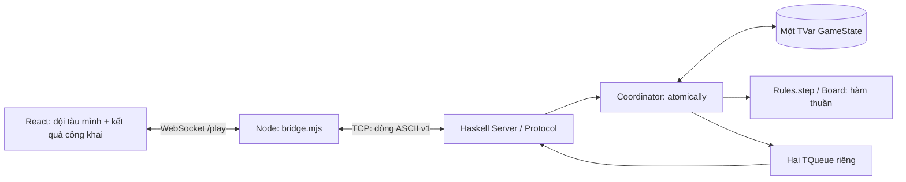

# Tích hợp giao diện frontend-ui

## Phạm vi và nhánh

- Nhánh gốc của thành viên: `frontend-ui`, commit `a6ca31f` (Add frontend UI).
- Nhánh bàn giao: `Connect_ui_backend`, được tạo trực tiếp từ `origin/frontend-ui`; tên làm việc ban đầu là `codex/frontend-ui-integration`, sau đó đổi theo yêu cầu trước khi commit/push.
- Ngày kiểm tra: 2026-10-05. GUI được bổ sung theo yêu cầu hiện tại; hồ sơ S-04 vẫn mô tả bản terminal tại mốc trước.

## Những vấn đề của prototype

1. Chỉ có App/main/CSS/ảnh; thiếu manifest, entry HTML, cấu hình TypeScript, công cụ build và lockfile. Thành viên khác chưa có lệnh cài/build tái lập.
2. Nhấn Bắt đầu trận chỉ đổi màn hình. Bàn đối thủ bị khóa; không gửi PLACE/FIRE, không nhận lượt hoặc kết quả thật.
3. Hàng được gắn A..J, cột 1..10, ngược hợp đồng `Coord column row`. Ví dụ bấm B1 có nguy cơ gửi A2 nếu ghép trực tiếp.
4. Mã trang trí CG/SS khác mã wire CR/SB. Đã đổi đồng nhất để tránh gửi sai tàu dài 3.
5. Màn sẵn sàng cho chỉnh đội hình sau xác nhận; trái luật không đặt lại. Trinh sát và nút âm thanh tạo cảm giác có tính năng chưa được cài. Đã khóa Trinh sát, bỏ nút âm thanh chưa hoạt động và chỉ cho sửa tàu trước xác nhận.
6. Chưa xử lý mất kết nối, phòng đầy, lỗi server, đóng tab, thắng/thua hoặc bấm bắn lặp nhanh.
7. Khi ghép màn chiến đấu, so sánh hai giá trị undefined làm ô trống mang class selected. Đã sửa điều kiện và thêm regression test trình duyệt; đồng thời căn ký hiệu bắn và nhật ký cho dễ đọc.

## Kiến trúc hiện tại



Trình duyệt không mở được TCP trực tiếp. Cầu dùng `node:http`, `node:net` và `ws`, phục vụ bản build Vite cùng origin với `/play`; mỗi WebSocket tạo đúng một kết nối TCP tới localhost. Server Haskell vẫn gán P1/P2, nhận hai người, từ chối người thứ ba và quyết định luật. Cầu ghép frame TCP bị chia chunk, bỏ CR trong CRLF, thêm đúng một LF vào lệnh, giới hạn 256 byte và chặn newline/binary/origin ngoài ứng dụng. Buffer gửi có giới hạn; đóng một phía sẽ dọn kết nối phía kia. Không ghi IO vào STM hoặc thêm bản sao GameState/luật thắng thua trong Node.

`game.ts` chứa thao tác đội tàu nháp, encoder PLACE, parser wire v1 và phép cập nhật góc nhìn công khai. Kiểm tra đặt tàu ở UI giúp sửa input sớm; Haskell vẫn kiểm tra lại qua Board/Rules trước chấp nhận. Đội tàu hoàn chỉnh chỉ gửi sau WELCOME. START chưa cấp quyền bắn: UI đợi TURN đúng danh tính. Ref khóa phát bắn ngay trong handler, tránh hai click dùng cùng lượt; ERROR không thêm kết quả vào lịch sử. GAME_OVER giữ kết quả khi socket đóng sau đó.

Bàn mình dùng đội tàu đã chọn và INCOMING. Bàn đối thủ luôn truyền fleet rỗng, chỉ hiện SHOT ở tọa độ được bắn; SUNK không suy ra các ô tàu chưa lộ. Không có serializer GameState. Hình tàu và lịch sử được giữ khi mất kết nối để người chơi đọc lỗi; không tự nối lại vào slot đã tiêu.

## Cài đặt và chạy

Node >=24, pnpm 11.25.0; Stack dùng GHC 9.10.3 / LTS 24.59. Xem lệnh tại đầu README. `pnpm install --frozen-lockfile` dùng lockfile đã ghi để thống nhất dependency.

Production: Haskell TCP 4000 và `node frontend/bridge.mjs` phục vụ HTTP/WebSocket 8080. Chỉ bind `127.0.0.1`. Hai người dùng hai tab trên cùng máy; mở rộng LAN không nằm trong bản này.

Development: vẫn chạy hai server trên, thêm `pnpm --dir frontend dev` rồi mở `http://127.0.0.1:5173`; Vite proxy `/play` về 8080. Bản production cần `pnpm --dir frontend build` lại sau khi sửa source.

Đổi port trong PowerShell nếu cần:

```powershell
# Terminal Haskell
stack exec battleship-server -- 4500
# Terminal cầu web
$env:BATTLESHIP_TCP_PORT = '4500'
$env:PORT = '8081'
node frontend/bridge.mjs
```

Mở `http://127.0.0.1:8081`. Không cho client tự chọn host TCP hoặc danh tính. Sau kết thúc cần khởi động lại server Haskell để có trận mới. Đóng tab/rời trận được tính là bỏ cuộc theo luật hiện có.

## Kiểm thử

Minh chứng lệnh và output thật: [demo/frontend/test-evidence.log](demo/frontend/test-evidence.log). Header log ghi tên nhánh và trạng thái working tree tại thời điểm chạy test, trước khi đổi tên và commit. Ảnh trình duyệt được tạo lại bằng `test:browser`, lưu ở `frontend/test-results/` (ignored).

| Bộ kiểm tra | Kết quả | Nội dung |
|---|---:|---|
| `pnpm --dir frontend build` | Thành công | TypeScript strict và Vite production, ảnh hero được bundle |
| `pnpm --dir frontend test` | 11/11 | Tọa độ A1/B1/A2/J10, góc/biên/chồng, 17 ô, RNG hết lượt thử, transcript thật, lỗi codec, lượt và riêng tư; bridge chia frame/CRLF, newline/binary/oversize, origin và dọn socket |
| `stack exec -- node --test frontend/test/integration.test.mjs` | 3/3 | Server production: đặt sai/đúng, chờ, sai lượt, sai tọa độ, bắn lặp, trượt/trúng/chìm/thắng, người thứ ba, ngắt kết nối khi chờ và giữa trận, exit 0 và port được giải phóng |
| `stack exec -- node --test frontend/test/browser.test.mjs` | 6/6 | Chromium: nhập tàu bằng click, input vượt biên, hai người chơi hết trận, người thứ ba không gửi PLACE, click lặp chỉ gửi một FIRE, khóa lượt/đội hình, không lộ tàu, đóng tab/bỏ cuộc, server unavailable, mobile 390px, xoay sát J10, hướng dẫn bằng bàn phím |
| `stack test --ghc-options=-Werror` | 815/815 | Toàn bộ unit/STM/TCP/terminal/integration Haskell; không có warning biên dịch |

Các test tích hợp dùng port OS cấp và process server mới, không dùng stub luật hoặc sửa state trình duyệt. Test browser điều khiển DOM/giao diện như người chơi; kiểm tra frame quan sát được, không gọi trực tiếp core thay cho thao tác UI. Nhánh đã kiểm tra trên Windows; chưa tuyên bố kiểm tra các trình duyệt Safari/Firefox hoặc sử dụng LAN. Chưa có xác nhận nhóm cho một revision GUI dùng nộp báo cáo.

## File chính

- `frontend/App.tsx`, `styles.css`: dùng thiết kế của thành viên, ghép màn chơi và thông báo tiếng Việt.
- `frontend/game.ts`: kiểu góc nhìn công khai, helpers nháp và codec v1.
- `frontend/bridge.mjs`: HTTP/static và cầu WebSocket–TCP, quản lý vòng đời kết nối.
- `frontend/package.json`, `pnpm-lock.yaml`, `index.html`, `tsconfig.json`, `vite.config.ts`: cài/build/test có thể tái lập.
- `frontend/test/*`: unit, bridge, tích hợp production và Chromium đầu cuối.

Phần backend Haskell và hợp đồng wire v1 được dùng nguyên cài đặt hiện tại. Không thêm AI, radar, nhiều phòng hoặc lưu trận.
