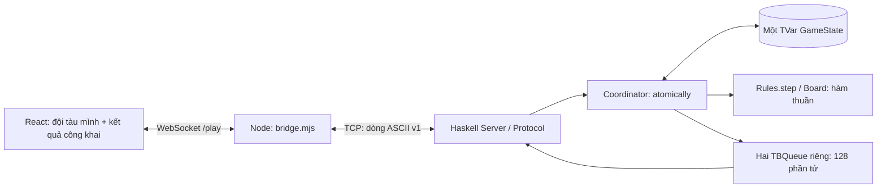

# Tích hợp giao diện frontend-ui

**Cách đọc:** đây là hồ sơ tích hợp/UI và các lần kiểm tra 2026-10-05; các bảng số test giữ ngày/phạm vi lịch sử. Hiện trạng sau QuickCheck/C-07/Docker (nền `8bd7da9`, 2026-10-10) xem [architecture.md](architecture.md), [docker_deployment.md](docker_deployment.md), [DK-08](dk08_acceptance.md), [DK-09](dk09_handover.md). Lý do chọn bridge/pending/replay/allowlist ở [design_decisions.md](design_decisions.md); số test frontend gate mới nhất được ghi ở DK-09.

## Phạm vi và nhánh

- Nhánh gốc của thành viên: `frontend-ui`, commit `a6ca31f` (Add frontend UI).
- Nhánh bàn giao: `Connect_ui_backend`, được tạo trực tiếp từ `origin/frontend-ui`; tên làm việc ban đầu là `codex/frontend-ui-integration`, sau đó đổi theo yêu cầu trước khi commit/push.
- Ngày kiểm tra: 2026-10-05. GUI được bổ sung theo yêu cầu hiện tại; hồ sơ S-04 vẫn mô tả bản terminal tại mốc trước.

## Những vấn đề của prototype

1. Chỉ có App/main/CSS/ảnh; thiếu manifest, entry HTML, cấu hình TypeScript, công cụ build và lockfile. Thành viên khác chưa có lệnh cài/build tái lập.
2. Nhấn Bắt đầu trận chỉ đổi màn hình. Bàn đối thủ bị khóa; không gửi PLACE/FIRE, không nhận lượt hoặc kết quả thật.
3. Hàng được gắn A..J, cột 1..10, ngược hợp đồng `Coord column row`. Ví dụ bấm B1 có nguy cơ gửi A2 nếu ghép trực tiếp.
4. Mã trang trí CG/SS khác mã wire CR/SB. Đã đổi đồng nhất để tránh gửi sai tàu dài 3.
5. Màn sẵn sàng cho chỉnh đội hình sau xác nhận; trái luật không đặt lại. Trinh sát và nút âm thanh tạo cảm giác có tính năng chưa được cài. Đã khóa Trinh sát, bỏ nút âm thanh chưa hoạt động và chỉ cho sửa tàu trước xác nhận.
6. Chưa xử lý mất kết nối, phòng đầy, lỗi server, đóng tab, thắng/thua hoặc bấm bắn lặp nhanh.
7. Khi ghép màn chiến đấu, so sánh hai giá trị undefined làm ô trống mang class selected. Đã sửa điều kiện và thêm regression test trình duyệt; đồng thời căn ký hiệu bắn và nhật ký cho dễ đọc.

## Kiến trúc hiện tại



Trình duyệt không mở được TCP trực tiếp. Cầu dùng `node:http`, `node:net` và `ws`, phục vụ bản build Vite cùng origin với `/play`; mỗi phiên người chơi tạo một TCP tới `BATTLESHIP_TCP_HOST` (mặc định `127.0.0.1`, Compose dùng `haskell`). WebSocket nối lại bằng mã của phiên sẽ dùng lại TCP đó. Server Haskell vẫn gán P1/P2, nhận hai người, từ chối người thứ ba và quyết định luật. Cầu ghép frame TCP bị chia chunk, bỏ CR trong CRLF, thêm đúng một LF vào lệnh, giới hạn 256 byte và chặn newline/binary/origin ngoài ứng dụng. Không ghi IO vào STM hoặc thêm bản sao GameState/luật thắng thua trong Node. Mất WebSocket giữ TCP 5 phút; hết hạn gửi QUIT. Dừng process cầu hoặc TCP kết thúc sẽ dọn socket.

`game.ts` chứa thao tác đội tàu nháp, encoder PLACE, parser wire v1 và phép cập nhật góc nhìn công khai. Kiểm tra đặt tàu ở UI giúp sửa input sớm; Haskell vẫn kiểm tra lại qua Board/Rules trước chấp nhận. Đội tàu hoàn chỉnh chỉ gửi sau WELCOME. START chưa cấp quyền bắn: UI đợi TURN đúng danh tính. Ref khóa phát bắn ngay trong handler, tránh hai click dùng cùng lượt; ERROR không thêm kết quả vào lịch sử. GAME_OVER giữ kết quả khi socket đóng sau đó.

Bàn mình dùng đội tàu đã được Haskell chấp nhận và INCOMING. Bàn đối thủ luôn truyền fleet rỗng, chỉ hiện SHOT ở tọa độ được bắn; SUNK không suy ra các ô tàu chưa lộ. Không có serializer GameState. Cầu chỉ lưu PLACE đã được OK cùng các frame riêng mà server gửi cho đúng phiên đó; tối đa 4096 frame/phiên. Phát lại khôi phục góc nhìn, không chạy lại lệnh hay tạo slot mới. Khi một phiên mất kết nối, cầu khóa lệnh PLACE/FIRE của cả hai người chơi web; QUIT vẫn được chuyển vào lõi thật.

## Cài đặt và chạy

Node >=24, pnpm 11.25.0; Stack dùng GHC 9.10.3 / LTS 24.59. Xem lệnh tại đầu README. `pnpm install --frozen-lockfile` dùng lockfile đã ghi để thống nhất dependency.

Production mặc định: Haskell TCP 4000 và `node frontend/bridge.mjs` phục vụ HTTP/WebSocket 8080 tại `0.0.0.0`, tự nhận IP LAN. IP hiện tại được kiểm tra ở từng handshake, log được cập nhật mỗi 2 giây. Đặt HOST/PUBLIC_ORIGIN để ghi đè thủ công; LAN_INTERFACE để giới hạn giao diện khi có nhiều mạng. Xem hướng dẫn nhận IP/khôi phục 5 phút trong README. Haskell vẫn nhận TCP nội bộ từ cầu. Nghiệm thu hai thiết bị vật lý cần thực hiện riêng ở LAN-06.

Development: vẫn chạy hai server trên, thêm `pnpm --dir frontend dev` rồi mở `http://127.0.0.1:5173`; Vite proxy `/play` về 8080. Bản production cần `pnpm --dir frontend build` lại sau khi sửa source.

Đổi port trong PowerShell nếu cần:

```powershell
# Terminal Haskell
stack exec battleship-server -- 4500
# Terminal cầu web
$env:BATTLESHIP_TCP_PORT = '4500'
$env:PORT = '8081'
node frontend/bridge.mjs
```

Mở link LAN được in hoặc `http://127.0.0.1:8081`. Không cho client tự chọn host TCP hoặc danh tính. Sau kết thúc cần khởi động lại server Haskell để có trận mới. Đóng tab/mất mạng có 5 phút khôi phục; nút rời trận gửi QUIT tức thời khi đang kết nối.

## Thông báo khôi phục riêng của cầu web

Giao thức TCP v1 của Haskell trong protocol.md được giữ nguyên. Cầu thêm thông báo JSON ở WebSocket, xử lý bằng connection.ts thay vì trộn vào parseFrame v1:

- `SESSION`: `{type, token, fleet, frames}`. Token là 32 byte ngẫu nhiên (64 ký tự hex), chỉ gửi cho chủ phiên. Fleet là PLACE riêng được OK hoặc null. Frames là null khi cập nhật metadata ban đầu, hoặc mảng frame riêng để phát lại khi khôi phục.
- `CONNECTION`: `{type, missing: [{player, deadline}]}`. Deadline là epoch millisecond theo đồng hồ máy chủ. Mảng rỗng nghĩa là cả hai phiên đã nối lại; không chứa thông tin đội tàu.
- `RESUME_ERROR`: `{type, code, message}`, code INVALID_SESSION hoặc SESSION_ACTIVE. SESSION_ACTIVE được tự thử lại để chờ heartbeat dọn kết nối cũ.

Trình duyệt nối lại tại `/play?resume=<token>`; máy chủ không tạo TCP mới. Link chuyển IP dùng fragment `/#resume=<token>` (fragment không gửi trong HTTP request tải trang), rồi giao diện xóa fragment sau khi đọc. Mã được nhớ bằng sessionStorage riêng mỗi tab/origin; mở IP khác cần mã đã lưu hoặc link khôi phục. Phiên hết hạn không được nối lại để chơi, nhưng có thể xem GAME_OVER đã nhận từ Haskell trong 5 phút sau kết thúc. Các phiên chỉ nằm trong RAM, không tồn tại qua khởi động lại bridge/server. Ping mỗi 10 giây phát hiện mất mạng im lặng trong tối đa khoảng 20 giây; deadline 5 phút bắt đầu khi cầu phát hiện mất WebSocket.

## Kiểm thử

Minh chứng lệnh và output thật: [demo/frontend/test-evidence.log](demo/frontend/test-evidence.log). Header log ghi tên nhánh và trạng thái working tree tại thời điểm chạy test, trước khi đổi tên và commit. Ảnh trình duyệt được tạo lại bằng `test:browser`, lưu ở `frontend/test-results/` (ignored).

| Bộ kiểm tra | Kết quả | Nội dung |
|---|---:|---|
| `pnpm --dir frontend build` | Thành công | TypeScript strict và Vite production, ảnh hero được bundle |
| `pnpm --dir frontend test` | 11/11 | Tọa độ A1/B1/A2/J10, góc/biên/chồng, 17 ô, RNG hết lượt thử, transcript thật, lỗi codec, lượt và riêng tư; bridge chia frame/CRLF, newline/binary/oversize, origin và dọn socket |
| `stack exec -- node --test frontend/test/integration.test.mjs` | 3/3 | Server production: đặt sai/đúng, chờ, sai lượt, sai tọa độ, bắn lặp, trượt/trúng/chìm/thắng, người thứ ba, ngắt kết nối khi chờ và giữa trận, exit 0 và port được giải phóng |
| `stack exec -- node --test frontend/test/browser.test.mjs` | 6/6 | Chromium: nhập tàu bằng click, input vượt biên, hai người chơi hết trận, người thứ ba không gửi PLACE, click lặp chỉ gửi một FIRE, khóa lượt/đội hình, không lộ tàu, đóng tab/bỏ cuộc, server unavailable, mobile 390px, xoay sát J10, hướng dẫn bằng bàn phím |
| `stack test --ghc-options=-Werror` | 815/815 | Toàn bộ unit/STM/TCP/terminal/integration Haskell; không có warning biên dịch |

Các test tích hợp dùng port OS cấp và process server mới, không dùng stub luật hoặc sửa state trình duyệt. Test browser điều khiển DOM/giao diện như người chơi; kiểm tra frame quan sát được, không gọi trực tiếp core thay cho thao tác UI. Hồ sơ bảng trên là kết quả bản tích hợp GUI trước LAN-01. Nhánh LAN có thêm test cấu hình và CLI qua IP Wi-Fi từ chính máy chủ; chưa xác nhận hai thiết bị vật lý hoặc Safari/Firefox. Chưa có xác nhận nhóm cho một revision GUI dùng nộp báo cáo.

### Kiểm tra bản tự nhận IP / khôi phục 5 phút (2026-10-05)

| Lệnh / nhóm | Kết quả mới | Phạm vi |
|---|---:|---|
| `pnpm --dir frontend build` | Thành công | TypeScript strict, Vite production |
| Unit/game/connection/bridge | 19/19 | Tọa độ, fleet, replay, link fragment, IP đổi/biến mất, Host/Origin |
| Integration + reconnect | 11/11 | Lõi Haskell thật, giữ TCP/P1/P2, bí mật, tạm dừng, mã sai/kết nối trùng, hủy timer cũ, timeout, heartbeat |
| LAN CLI | 5/5 | Cấu hình lỗi, interface sai, port bận, HTTP/WS qua Wi-Fi IP, tự nhận IP và nối lại từ localhost sang LAN origin |
| Chromium | 9/9 | Trọn trận, bỏ cuộc, mobile, reload không gửi lại lệnh, đổi origin nhập mã, đếm ngược/tạm dừng, quay lại muộn thấy thua |
| `stack test --ghc-options=-Werror` | 815/815 | Toàn bộ lõi/STM/TCP/terminal Haskell |

Tổng 44 test web xanh. Bộ test mốc 299.999/300.000 ms dùng đồng hồ JS tăng tốc, socket và kết quả Haskell thật; không phải chờ 5 phút bằng thời gian thực. Test hết hạn khác dùng fixture hạn ngắn, production vẫn 300.000 ms. Log lần chạy này ở `.stack-work/lan-reconnect/frontend-test.log` và `haskell-test.log` (local/ignored). Trên Windows phải hoàn tất test web trước `stack test` để Stack không ghi đè executable đang được process test dùng.

IP Wi-Fi được quan sát tại lần chạy: 192.168.1.126, không lưu làm cấu hình mặc định. Việc đổi hai Wi-Fi vật lý và reconnect từ thiết bị thứ hai vẫn cần demo thực tế; các test chuyển origin/đổi danh sách interface không giả nhận là đã đổi Wi-Fi thật.

## File chính

- `frontend/App.tsx`, `styles.css`: dùng thiết kế của thành viên, ghép màn chơi và thông báo tiếng Việt.
- `frontend/game.ts`: kiểu góc nhìn công khai, helpers nháp và codec v1.
- `frontend/connection.ts`: metadata khôi phục, tái dựng bàn riêng và link chuyển IP.
- `frontend/bridge.mjs`: HTTP/static và cầu WebSocket–TCP, quản lý vòng đời kết nối.
- `frontend/package.json`, `pnpm-lock.yaml`, `index.html`, `tsconfig.json`, `vite.config.ts`: cài/build/test có thể tái lập.
- `frontend/test/*`: unit, bridge, tích hợp production và Chromium đầu cuối.

Phần backend Haskell và hợp đồng wire v1 được dùng nguyên cài đặt hiện tại. Không thêm AI, radar, nhiều phòng hoặc lưu trận.
