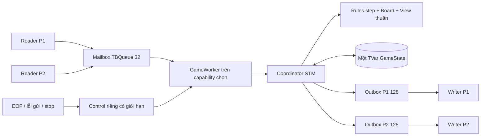

# NM-09 — Phân tích kết quả và báo cáo kiến thức

**Ngày:** 2026-10-12 · **Nhánh:** `Update_NUMA` · **Nền Git hiện tại:** `788f8396638344e7a38fd2428d84feac2a9b5e38`.

Đây là hồ sơ tổng hợp NM-03 đến NM-08, bổ sung phép đo cấu hình kết hợp ở NM-09. Nền Git không đồng nghĩa toàn bộ working tree đã commit: NM-07/08/09 còn thay đổi cục bộ. Manifest từng loạt ghi source hash, binary hash, HEAD nền và tình trạng chưa commit. Commit dùng để nộp và xác nhận A/B/C/D/R **chưa được cung cấp**; xem mục 12. Không dùng test xanh thay chữ ký của nhóm.

## 1. Kết luận và phạm vi đã đạt

Đồ án đã nối kiến thức về lập trình hàm, thread, STM, supervision, mailbox, affinity, locality và metadata bất biến với một trò chơi có luật thực. Hệ thống vẫn có một nguồn luật Haskell và một `GameState` cho một trận. Những thay đổi về tài nguyên phục vụ cách thực thi, không tạo luật chơi mới.

Các kết luận có bằng chứng:

- **Tính đúng:** NM-08 chạy cùng ba seed và cùng transcript dưới sáu cấu hình được môi trường hỗ trợ. Hồi quy bao gồm trận web đầy đủ, riêng tư, reconnect, client chậm, hàng đợi đầy, cancel worker và shutdown.
- **Metadata Fleet:** phép đo lõi trước/sau có ghép cặp của NM-06 cho thấy thời gian giảm khoảng 7,4–7,7%, allocation giảm 3,32%. Chi phí là giữ thêm khoảng 900 byte/Fleet trong fixture đo retained heap. Đây là kết quả cho gói thay đổi metadata, không tách riêng ảnh hưởng của mảng khỏi Set/strictness.
- **Worker:** đã kiểm chứng quyền xử lý, capability và đường kết thúc. Timing NM-05 không đạt ngưỡng ổn định; không kết luận worker làm game nhanh hơn. Chi phí allocation trong harness worker tăng khoảng 5,6–5,7% so coordinator trực tiếp cùng source.
- **Affinity:** đã kiểm chứng CPU mask và thread thực tế. Chưa có phép đo hiệu năng riêng trước/sau affinity đủ kiểm soát để kết luận tăng tốc.
- **NUMA:** đã kiểm chứng CPU/RAM node 0 ở VM Linux được cấp, kể cả `membind` khi cấp quyền phù hợp. Remote A→B chưa nghiệm thu vì chỉ thấy một RAM node được phép. GHC của image hiện tại báo không có NUMA support.
- **Cấu hình đề xuất cho báo cáo:** `-N1`, worker capability 0, không pin CPU/RAM, giữ hai service và metadata/worker hiện tại. Có override riêng để nhóm review; chưa đổi mặc định của package/base Compose.

Không tuyên bố đã áp dụng mọi nội dung của mọi slide. GPU/SIMD, Map–Reduce phân tán, NFS/DFS, replication và persistence không thuộc implementation hiện tại. Một host với hai trình duyệt không thay nghiệm thu hai thiết bị Wi-Fi vật lý.

## 2. Đọc các khái niệm trước khi đọc số liệu

| Khái niệm | Nghĩa trong đồ án | Điều không được suy ra |
|---|---|---|
| Concurrency | Reader/writer/worker có thể tiến triển xen kẽ; chờ mạng không giữ cả trận | Không có nghĩa hai nước dùng cùng lượt cũ được chấp nhận |
| Capability GHC | Tài nguyên runtime để thực thi Haskell; `-N` chọn số capability | Không phải số core vật lý hay NUMA node |
| CPU logic | ID CPU mà Linux cho phép scheduler dùng | SMT siblings không thành hai core vật lý |
| Affinity | Giới hạn CPU được phép chạy; `-qa` thử mapping thread runtime | Không dành độc quyền CPU, không bảo đảm OS luôn cấp thời gian chạy |
| Locality thực thi | Một worker xử lý liên tiếp dữ liệu của cùng trận | Chưa chứng minh trang RAM luôn ở cùng node sau GC |
| Spatial locality | Dữ liệu lân cận được bố trí gần nhau; thử UArray 100 ô | Mảng nhỏ không tự chứng minh L1/L2/L3 hit rate tăng |
| NUMA | CPU có chi phí truy cập RAM khác nhau tùy node | Một node VM nhìn thấy không chứng minh host vật lý một node |
| Allocation | Byte được cấp phát trong khoảng accounting của benchmark | Không phải toàn bộ byte còn sống hoặc RSS |
| Retained/live heap | Byte còn sống khi đo sau GC, theo fixture đã mô tả | Không phải kích thước object Fleet chính xác ở mọi chương trình |
| Median/p95/CI | Trung vị, phân vị 95 và khoảng bất định của mẫu | CI đẹp không khắc phục loạt đo bị drift vượt ngưỡng |

Trong game một trận, lượt là quan hệ tuần tự: kết quả lệnh trước quyết định lệnh sau có hợp lệ hay không. Vì vậy mục tiêu đầu tiên là bảo toàn state, thứ tự và đường kết thúc. Chỉ sau đó mới xét chi phí CPU/RAM. Tăng số capability không tạo thêm việc tính toán độc lập nếu workload chỉ replay một trận nối tiếp.

## 3. Cấu trúc đã sửa và lý do lựa chọn



### 3.1 Topology và preflight — NM-02

[inspect-topology.mjs](../scripts/inspect-topology.mjs) đọc CPU online, CPU được phép, core/socket/SMT, node CPU/RAM, cache sharing và giới hạn/quyền Linux có thể cung cấp. Launcher dùng dữ liệu này trước khi tạo trận. Không lấy số CPU của Node Windows làm mask Linux và không cố định CPU/node của máy đang viết báo cáo.

Lý do: ID CPU không nhất thiết liên tiếp; container có thể được cấp một phần CPU/RAM host. Chọn CPU offline hoặc RAM node không được phép phải thất bại trước listen, thay vì chạy sai cấu hình rồi gắn nhãn affinity/NUMA. Test giả lập một/nhiều node, SMT, CPU rời rạc, dữ liệu thiếu/sai và VM/container một phần nằm ở [topology.test.mjs](../scripts/test/topology.test.mjs).

Thông tin không đọc được có lý do và trạng thái riêng. Không điền số 0 cho một metric chưa hỗ trợ. Đó là điều kiện để người đọc phân biệt “không có cache miss” với “không đo cache miss”.

### 3.2 Affinity — NM-04

[compose.affinity.yaml](../compose.affinity.yaml) giới hạn CPU hai service; [start-affinity.mjs](../scripts/start-affinity.mjs) kiểm tra mask, số capability, cấu hình Docker sau create và task runtime sau start. RTS truyền bằng argv, không ghép chuỗi shell từ input.

`-N1` nói về số capability; `cpuset` nói về CPU scheduler được phép dùng. `-qa` là lựa chọn runtime riêng và chỉ được launcher chấp nhận khi mapping CPU phù hợp. Test cấu hình sai/thực tế khác yêu cầu ngăn báo thành công chỉ vì tham số đã được truyền.

Game hưởng lợi trước hết ở khả năng tạo điều kiện thí nghiệm nhất quán và kiểm chứng nơi thực thi. Đổi lại, pin quá hẹp có thể làm mất khả năng OS cân bằng tải khi CPU đó bận. Không mặc định pin máy người dùng vì chưa có benchmark chứng minh lợi ích phổ quát. Quyền được chạy trên CPU khác với quyền sử dụng độc quyền CPU. Cơ chế cpuset và RTS được đối chiếu [Docker](https://docs.docker.com/engine/containers/run/#cpuset-constraint) và [GHC 9.10.3](https://downloads.haskell.org/ghc/9.10.3/docs/users_guide/using-concurrent.html).

### 3.3 Worker sở hữu xử lý và evaluation — NM-05

[GameWorker.hs](../src/Battleship/GameWorker.hs) dùng `withAsyncOn`, khởi tạo coordinator/state trong worker rồi xử lý request. Reader đưa WELCOME, payload, parser error, dòng quá dài và wire Quit qua worker; không trực tiếp submit coordinator trong đường server production. API coordinator cũ được giữ cho test/benchmark và caller tương thích.

Tách reader khỏi xử lý cho phép reader chịu trách nhiệm socket/framing, worker chịu trách nhiệm trận, writer chịu trách nhiệm gửi. Một worker phù hợp quan hệ lượt tuần tự và tạo nơi thực thi rõ để nghiên cứu locality. Tạo nhiều worker cùng sửa một trận sẽ thêm tranh chấp/thứ tự mà không tạo thêm lượt hợp lệ.

Mailbox thường có 32 slot. Mỗi reader chờ ack trước frame tiếp theo; đây là backpressure đầu vào. EOF/lỗi gửi dùng control riêng Set chỉ chứa tối đa P1/P2; stop dùng tín hiệu riêng, không phải chen vào queue đang đầy. Stop được ưu tiên, disconnect pending xử lý trước request thường; khi cả hai pending thì P1 trước P2. Wire Quit vẫn FIFO để giữ nghĩa của thứ tự lệnh đã nhận.

Worker lỗi/cancel làm trạng thái sống của worker kết thúc và đánh thức ack waiter; không tự tạo người thắng khi lỗi nội bộ chưa phải Quit hợp lệ. `withAsyncOn`, `mask`, `finally` và chờ có giám sát quản lý vòng đời. Test dùng TMVar gate để đặt đúng điểm queue đầy/cancel, không dùng `sleep` đoán race.

Haskell lazy nên tạo một biểu thức trong worker chưa bảo đảm mọi tính toán chạy tại đó. Phần digest/ép state và batch cần dùng được thực hiện trên đường worker/coordinator. Benchmark ép kết quả workload thành checksum đủ duyệt state/view/event; không đo riêng việc tạo thunk. Strict field chỉ ép đến mức field quy định, không phải tuyên bố mọi graph luôn fully evaluated. Chi tiết ép và phạm vi có trong [worker_locality.md](worker_locality.md) và [bench/Main.hs](../bench/Main.hs).

Giới hạn: capability là nơi thực thi Haskell; OS/GC vẫn quản lý trang nhớ, thread scheduling và pool. Worker placement không đủ làm bằng chứng RAM physical locality. Không tạo một TVar mới bên ngoài worker để lưu “bản chính” song song.

### 3.4 STM và giới hạn outbox giữ nguyên — C-04/C-07

[Coordinator.hs](../src/Battleship/Coordinator.hs) giữ một TVar. Trong một `atomically`: đọc state → `step` → encode toàn batch → kiểm tra chỗ của tất cả người nhận → ghi state và frame. Writer gửi sau commit; socket IO không chạy trong STM vì transaction có thể retry.

Outbox từng người có 128 slot, 126 dành cho phản hồi thường, 2 cho `GAME_OVER` và marker. Thiếu chỗ thì không commit nước/batch gây tràn; xử lý Quit đúng **người nhận bị quá tải** qua lõi từ state cũ. Điều này tránh state đã bắn nhưng client chưa nhận SHOT/TURN. Không bỏ âm thầm event và không chờ writeTBQueue đầy trong giao dịch giữ tiến triển của cả trận.

Mailbox và outbox là hai giới hạn khác nhau, không cộng thành “160 lệnh người chơi được gửi”. Mailbox chứa request chưa xử lý; outbox chứa frame chưa gửi. Control/reserved terminal path giúp shutdown tiến triển khi queue thường đầy; watchdog socket vẫn cần vì writer có thể kẹt ngoài STM. Khoảng 5 phút resume web chỉ áp dụng khi bridge giữ TCP, không biến mọi lỗi TCP thành chờ 5 phút.

### 3.5 Metadata bất biến và mảng — NM-06

[Internal/Fleet.hs](../src/Battleship/Internal/Fleet.hs) giữ geometry Map/Set, occupied Set và UArray `Int Word8` 100 ô. [Board.placeFleet](../src/Battleship/Board.hs) kiểm tra năm ID, độ dài, trong bàn và không giao nhau trước khi tạo cả ba phần. Constructor/module private ngăn caller package đưa metadata sai vào luật.

Trước thay đổi, mỗi tra cứu có thể duyệt tàu; tập occupied phải hợp các tập ô khi dùng. Sau thay đổi, hình học không đổi nên tính một lần rồi đọc lại. Bảng dùng code nước/ShipId nội bộ; hai tàu dài 3 vẫn có ID riêng. [Rules.hs](../src/Battleship/Rules.hs) dùng index/occupied cho tìm tàu và thắng, geometry cho chìm. Không thêm hit-counter hoặc lịch sử bắn thứ hai cần cập nhật song song.

Mảng unboxed giúp thử bố trí ô kế tiếp với phần tử nhỏ, tránh một object boxed cho mỗi giá trị code. Tuy nhiên Fleet vẫn giữ geometry phục vụ public API/logic chìm. Payload 100 ô không đồng nghĩa toàn Fleet chỉ tốn 100 byte: còn header, bounds, Map, Set, alignment và tham chiếu. Bản đo retained heap ở mục 6 cho thấy chi phí thực lớn hơn.

Giữ public API và metadata trong smart constructor được chọn thay thay toàn bộ geometry bằng bitset/mảng mutable. Cách đó bảo toàn caller, luật thuần và invariant, đồng thời đo được tác động. Bitset hoặc mô hình khác chỉ đáng mở task nếu có dữ liệu workload/chứng minh lợi ích và test tương thích. Không thay representation chỉ vì có thể viết code ngắn hơn.

[FleetIndexSpec.hs](../test/FleetIndexSpec.hs) đối chiếu toàn bộ 100 ô bằng mô hình geometry tham chiếu độc lập, kiểm tra 17 ô, thứ tự placement, A1/J10, ID tàu 3 riêng và ngoài bàn trước index arithmetic; năm property mới chạy ít nhất 1.000 trường hợp/property. Tests thắng/chìm và privacy vẫn là gate.

### 3.6 Bố trí CPU–RAM và kiểm chứng — NM-07

[start-numa.mjs](../scripts/start-numa.mjs) chọn CPU/RAM từ topology, áp dụng Docker `CpusetMems` trước khi start, rồi kiểm tra task CPU mask và resident private anonymous pages qua `/proc`. Không coi trang shared file cache là heap riêng. `numactl --membind` là lựa chọn cấp phát chặt hơn; lỗi quyền/kernel/compiler/RAM bị giữ nguyên và dừng thí nghiệm.

`compose.numa.yaml` không thêm một khóa Compose tự tưởng tượng cho RAM node. Docker update/create API có cơ chế cpuset-mems; wrapper dùng `exec` để tiến trình thật giữ PID 1 và nhận SIGTERM. `SYS_NICE` là quyền opt-in cho policy cần thiết, không bật privileged hoặc tắt seccomp toàn bộ.

So local/remote cần CPU A giữ nguyên, RAM A/B thay đổi, cùng binary/N/seed/workload/policy/RTS. Chạy `--numa` của GHC phải là thí nghiệm riêng vì thay memory pool/capability behavior có thể làm so sánh đổi nhiều biến. [RTS NUMA chính thức](https://downloads.haskell.org/ghc/9.10.3/docs/users_guide/runtime_control.html#rts-options-for-numa-support) mô tả cơ chế khi compiler hỗ trợ; binary hiện tại thực sự từ chối cờ này.

RAM node0 hợp lệ trong VM không tự bảo đảm locality trên CPU/RAM vật lý host. Bằng chứng chỉ đúng cho Linux guest nhìn thấy và chính sách kernel đã áp dụng. Không có node B thì không chạy remote giả hoặc ghi ca đó pass.

## 4. Môi trường, phiên bản và định danh kết quả

| Thuộc tính | Dữ liệu đo / giới hạn |
|---|---|
| Host | Windows kernel/build 10.0.26200; NM-03 ghi Windows 11; edition không được đọc lại trong NM-08 |
| Linux đo | amd64, WSL2 kernel `6.18.40.1-microsoft-standard-WSL2`; Docker VM/container |
| CPU Linux báo | Intel Core i7-1355U; online/allowed 0..11; 6 core IDs, 1 socket, 2 SMT siblings/core theo VM |
| RAM Linux | Node 0 nhìn thấy khoảng 7,61 GiB; RAM nodes được phép chỉ `{0}` |
| Cache topology | Có 19 cache groups trong topology; không có counter PMU cache-miss/cycles/instructions được nghiệm thu |
| Docker | Desktop 4.94.0 (241994), Engine 29.8.2, Compose 5.5.1 theo evidence đã thu |
| GHC/Stack | GHC 9.10.3, `lts-24.59`; Stack 3.11.1 trên host |
| Node | Host runner v24.19.0; image/bridge v24.21.0 |
| Cgroup baseline | Namespace root được kiểm chứng; cpu.max `max 100000`, memory.max `max`; không có nghĩa VM có RAM/CPU vô hạn |
| Flags benchmark | Library/server/benchmark `-O2`; production functional binary có fingerprint riêng |
| Seeds game | 424242, 8675309, 20261011; bootstrap 20261011 |
| Workload v1 | 3 trận, mỗi trận 25 command; đặt tàu, lỗi, trượt, trúng, chìm, thắng, view hai người |

CPU vật lý host hybrid/SMT không được suy ra từ số core IDs guest. CPU0/1 trong topology đo là siblings cùng core theo VM; không gọi mask đó “hai core vật lý”. Số RAM là mức guest thấy tại thời điểm thu, không phải thông số RAM lắp trên Windows host.

Fixture canonical SHA-256: `24dfad3f17a6f75cf20b20d15faf9b2d637d73139607331bc004d1cd8bd64a53`. Checksum semantic của seed lần lượt là `3724987551376790105`, `18305205042670867969`, `658854099022739308`. Checksum phụ thuộc mode/repetitions khi lặp, nên đối chiếu cùng workload/count chứ không buộc mọi số checksum mọi mode bằng nhau.

Transcript đầy đủ của ba seed trong NM-08 có SHA-256 `f304d867c580fe47e620287cc35f68d13f6c1d0ee0865c2c5f1cea19a8dbb6f5`, giống nhau giữa sáu profile. Fixture hash và transcript hash dùng hai cấu trúc serialize khác nhau; không so chúng như hai phiên bản cùng file.

| Mốc | Git/source khi đo | Binary benchmark SHA-256 | Hồ sơ |
|---|---|---|---|
| NM-03 | Nền 94a7aaa, dirty sourceHashes | `24b5e6a5a74638482398df81bb61536dc13ebcbcc78c9be0c78936543096408a` | [baseline](performance_data/nm03_2026-10-11/manifest.json) |
| NM-05 | Nền 94a7aaa, dirty sourceHashes | `6f29e1e68b6e4dd6d9a6cc76a1bd129e1aaf896ceaa81a5ea00cc38907626c9b` | [worker](worker_data/nm05_2026-10-12/first/manifest.json) |
| NM-06 sau | Nền 94a7aaa, dirty source; sau đó nằm trong 788f839 | `6d1e7b2511ce96251637e17c502744b44b585fa3f911236685c0e559b8941c91` | [Fleet](fleet_data/nm06_2026-10-12/README.md) |
| NM-07 | Nền 788f839 + thay đổi wrapper/harness | Cùng benchmark NM-06; packaging image khác | [NUMA](numa_data/nm07_2026-10-12/evidence.json) |
| NM-08 | Nền 788f839 + source/harness hash | Server functional `5adeea78495c3ae1c85d73126d625d4ccb23c28c6d5b0a5db7a09d8c280c2644` | [hồi quy](runtime_data/nm08_2026-10-12/acceptance.json) |
| NM-09 kết hợp | Nền 788f839 + manifest mới; Haskell benchmark không đổi | Cùng benchmark NM-06, flags -O2 | [loạt mới](numa_acceptance_data/nm09_2026-10-12/combined/manifest.json) |

Image ID, source hash đầy đủ, lệnh, timestamp UTC và topology từng lần nằm trong manifest/evidence liên kết. Bảng chỉ rút gọn HEAD để đọc, không dùng tag image có thể đổi làm bằng chứng duy nhất. Server benchmark `-O2` và server functional không có cùng hash; thời gian full test không trở thành số liệu hiệu năng game.

## 5. Phương pháp đo và điều kiện kết luận

NM-01 chốt trước khi có số liệu: 5 warm-up, ít nhất 30 measured/group, luân phiên thứ tự profile/cặp trước–sau, giữ toàn bộ mẫu/outlier, không chạy build nặng song song phép đo. Summary lấy median thời gian/sample chuẩn hóa theo command; block stability dùng ba block 10 mẫu. Spread `(max blockMedian - min blockMedian) / overallMedian` phải ≤10%. Ngưỡng cải thiện thực dụng là 5%; CI 95% bootstrap 2.000 lần với seed cố định bổ sung mức bất định.

Một series lỗi ổn định được giữ và có thể chạy lại **cả nhóm** theo protocol. Không chọn vài sample nhanh, không đổi seed, không lặp đến khi có kết quả thuận lợi. Một CI không chứa 0 vẫn chưa đủ nếu stability gate sai. Cross-batch so source khác ngày chỉ là quan sát, không cô lập nguyên nhân.

Các layer:

| Layer | Phần được tính | Loại kết luận hợp lệ |
|---|---|---|
| core | Replay Rules/Board/View và digest đánh giá kết quả | Chi phí lõi thuần workload game cố định |
| coordinator | Replay qua STM/coordinator, đọc private batch | Thêm queue/STM so với phạm vi lõi, không phải độ trễ UI |
| worker | Vòng đời worker, mailbox/request/ack và coordinator mỗi trận | Tổng overhead mô hình worker theo harness, không riêng thân step |
| tcp | Gửi command/chờ toàn batch đúng người qua TCP thật | Đường phản hồi loopback gồm socket/scheduler/batch |
| web | TCP server + bridge/WS peer, không React render trong benchmark | Đường WS/TCP loopback, không hai máy Wi-Fi |
| Fleet micro | Tra cứu 100 ô/hợp occupied/constructor/retained fixture | Tác vụ dữ liệu riêng, không cả game hoặc CPU-cache counters |
| NUMA page probe | Replay game dài hơn để có private pages quan sát được | Placement guest heap, không latency/bandwidth RAM remote nếu thiếu node |

Clock benchmark dùng thời gian đơn điệu; digest/checksum đi cùng kết quả đã tính. Allocation/GC accounting có thể bao gồm final GC ngoài clock như manifest mô tả. RTS maxMemory/maxLive không được đổi tên thành RSS. Node RSS snapshot gồm peer harness/bridge trong orchestrator sống xuyên các sample, không peak bridge riêng.

## 6. So sánh từng thay đổi riêng

### 6.1 Baseline trước tối ưu — NM-03

12 nhóm, 360 measured + 60 warm-up. Tất cả nhóm đạt spread ≤10%. Median µs/command:

| Layer | N1 | N2 | Mặc định đo được N12 |
|---|---:|---:|---:|
| core | 8,201 | 11,048 | 25,029 |
| coordinator | 12,167 | 15,771 | 31,837 |
| tcp | 33.592,727 | 33.631,557 | 33.638,212 |
| web | 33.585,198 | 33.655,897 | 33.724,988 |

Một dấu phẩy là phần thập phân theo cách viết Việt Nam; 33.585 µs ≈33,585 ms. Lõi N2 chậm khoảng 34,72%, N12 chậm khoảng 205,20% so N1 trong series này. Với web, N2/N12 chỉ khác +0,21%/+0,42%, thấp hơn 5%. Allocation core khoảng 52.835,75 byte/command; max RTS memory N1/N2/N12 khoảng 6/11/53 MiB.

Workload tuần tự không đủ computation độc lập để N2/N12 tận dụng parallelism. Overhead runtime/GC là lời giải thích khả dĩ; chưa tách scheduler/GC/cache nên không quy mọi chậm hơn cho một nguyên nhân. [Baseline đầy đủ](performance_baseline.md) giữ CI/p95/accounting và giả thuyết batch TCP/Nagle cần phép thử riêng.

### 6.2 Worker — NM-05

Series đầu 450 measured/75 warm-up; repeat worker 90/15. Trong repeat, median worker N1/N2/N12 là 14,340/22,195/55,808 µs/command, spread tương ứng 17,39%/16,76%/20,76%: **cả ba chưa ổn định**. Không sử dụng các số này để bảo vệ tuyên bố worker tăng tốc.

Allocation worker khoảng 64.549–64.614 byte/command so coordinator 61.115 byte/command cùng source, tăng 5,62–5,72%. Mailbox, envelope, ack và supervision có chi phí. Luật tuần tự được giữ, lợi ích ownership/cleanup đã được test thay vì dựa vào timing.

TCP/web sau worker so NM-03 khác dưới 1%; chưa đạt ngưỡng cải thiện. Core NM-05 thấp hơn NM-03 khoảng 30% dù code lõi chưa thay theo worker: dấu hiệu các batch/điều kiện runtime khác nhau. Không lấy số đó làm “worker tăng tốc lõi 30%”. Worker đợt này cũng đi cùng ép state và SO_SNDBUF; chưa có ablation tách từng yếu tố. [Hồ sơ worker](worker_locality.md) nêu toàn bộ lần đo, kể cả loạt không ổn định.

### 6.3 Metadata Fleet — NM-06

Phép đo có hai phạm vi: micro tác vụ và replay lõi game trước/sau. Tổng hồ sơ gồm 960 measured +160 warm-up, không cộng vào số unit test.

**Cặp lõi game trong cùng container, thứ tự luân phiên, cùng 1.024 replay (3.072 trận/76.800 command mỗi sample):**

| Profile | Trước µs/command | Sau µs/command | Thay đổi | CI 95% | Stability |
|---|---:|---:|---:|---|---|
| N1 | 9,058 | 8,357 | -7,74% | [-8,56%; -6,44%] | Hai nhóm đạt |
| N2 | 11,942 | 11,061 | -7,38% | [-8,83%; -5,60%] | Hai nhóm đạt |
| N12 | 24,959 | 23,028 | -7,73% | [-9,65%; -4,59%] | Hai nhóm đạt |

Ngưỡng median 5% và CI không chứa 0 được đáp ứng cho package thay đổi trong workload đo; cận CI N12 không bảo đảm cải thiện luôn ≥5%. Allocation giảm từ 52.835,75 xuống 51.082,04 byte/command (-3,32%). GC N1 trong accounting tăng từ khoảng 0,0125 lên 0,0143 giây, nên “allocation ít hơn” không được diễn giải thành “mọi GC đều ít hơn”. RTS peak memory vẫn khoảng 6/11/52 MiB cho cặp này.

**Micro và chi phí giữ lại:**

| Phép thử | Quan sát | Diễn giải |
|---|---|---|
| occupied union → đọc tập tính sẵn | 1,599 →0,424 µs/op, -73,47%; hai nhóm stable | Giảm tái tính tập trong workload này |
| scan → index | 0,107 →0,018 µs/op; nhóm indexed spread 11,40% | Có median thấp hơn nhưng chưa đủ stability để kết luận tốc độ |
| Allocation lookup | 289,16 →63,48 byte/op (-78,05%) | Allocation tác vụ, không đo cache-miss |
| Allocation occupied | 4.597,37 →1.684,02 byte/op (-63,37%) | Dùng lại dữ liệu bất biến giảm cấp phát |
| Allocation constructor | 15.736,13 →20.585,60 byte/Fleet (+30,82%) | Tốn thêm việc tạo metadata một lần |
| Retained fixture 12.000 Fleet | 1.352,66 →2.252,66 byte/Fleet (+900; +66,54%) | Live heap theo fixture gồm overhead giữ tham chiếu; không object size tuyệt đối |

Constructor timing trước/sau chạy các batch riêng và các tác vụ tham chiếu cùng drift; không quy toàn bộ chênh lệch timing constructor cho mảng. Với một trận chỉ hai Fleet, thêm 900 byte/Fleet trong fixture là chi phí nhỏ so tài nguyên runtime, nhưng không nhân ra mọi deployment hay nói “RAM không đáng kể” nếu mở nhiều phòng. Chọn metadata vì dữ liệu hình học không đổi, test invariant đầy đủ và phép đo lõi ghép cặp có lợi; không vì tên “cache”. [Phân tích Fleet](fleet_index.md), [comparison máy đọc](fleet_data/nm06_2026-10-12/comparisons.json).

### 6.4 Affinity riêng — NM-04

Đã chạy singleton CPU11/N1, CPU0,1/N2 với `-qa` theo mapping được chấp nhận và kiểm chứng ghc_worker/task mask thực. Game/readiness/shutdown qua. **Chưa có series timing affinity ablation** cùng binary/N/workload giữ mọi biến khác cố định, nên không có phần trăm tăng tốc affinity trong báo cáo. Số giây shutdown thuộc deadline tính đúng, không thay benchmark throughput.

### 6.5 CPU–RAM local/remote — NM-07

Series đầu và repeat được giữ: 120 measured +20 warm-up. Series đầu default-memory spread khoảng 59%, không dùng để kết luận. Repeat CPU0/N1 cùng binary/workload:

| Policy | Median µs/command | Spread | Allocation byte/command | Nghiệm thu |
|---|---:|---:|---:|---|
| Default RAM policy, CPU/N kiểm soát | 5,227 | 0,62% | 51.082,04 | Qua đo |
| CPU0, cpuset-mems node0 | 5,437 | 4,12% | 51.082,04 | Qua đo/placement |
| CPU node A, RAM node B | N/A | N/A | N/A | Chưa đủ hai RAM node |
| GHC `--numa=1` | N/A | N/A | N/A | Compiler từ chối; chưa nghiệm thu |

Local median chậm khoảng 4,02% so default-memory, dưới ngưỡng 5% và không chứng minh lợi ích NUMA. Cả hai đều có private pages node0 trong guest một node; đây không phải local-vs-remote vật lý. Tránh so 5,227 với core 8,357 ở batch khác rồi gọi NUMA nhanh hơn: CPU mask, điều kiện batch/repetition khác nhau.

`membind` node0 có bằng chứng pages bound và PID1/SIGTERM/cleanup, nhưng chưa có benchmark formal membind so cpuset/default. Không gộp gate functional của membind vào bảng timing. Xem [NUMA experiments](numa_experiments.md) để biết lỗi quyền, compiler và các lần probe chưa đủ resident pages đã giữ lại.

## 7. Cấu hình kết hợp hiện tại — phép đo NM-09

Sau NM-05/06, server thực dùng worker và Fleet metadata. Loạt NM-09 dùng binary `-O2` cùng checksum NM-06, runner hiện tại, năm layer và N1/N2/default. Mỗi nhóm có 5 warm-up/30 measured. Không chạy compiler/full test trong thời gian đo. Dữ liệu lưu mới, không ghi đè NM-03..08.

<!-- nm09:combined:start -->

Series mới gồm **450 measured +75 warm-up**, 15/15 nhóm đạt stability. Thời điểm và calibration ở manifest.

| Layer/profile | Median µs/command | p95 response µs | Spread | Stability | Allocation byte/command |
|---|---:|---:|---:|---|---:|
| core/N1 | 5,977 | N/A | 1,519% | Đạt | 51.082,032 |
| core/N2 | 7,950 | N/A | 2,690% | Đạt | 51.082,032 |
| core/default | 18,675 | N/A | 2,508% | Đạt | 51.082,032 |
| coordinator/N1 | 9,067 | N/A | 3,844% | Đạt | 59.362,024 |
| coordinator/N2 | 12,208 | N/A | 0,851% | Đạt | 59.362,273 |
| coordinator/default | 25,629 | N/A | 2,340% | Đạt | 59.362,116 |
| worker/N1 | 21,127 | N/A | 8,007% | Đạt | 62.795,492 |
| worker/N2 | 66,155 | N/A | 7,290% | Đạt | 62.843,149 |
| worker/default | 72,683 | N/A | 4,923% | Đạt | 62.855,723 |
| tcp/N1 | 33.610,008 | 44.408,647 | 0,403% | Đạt | 40.250,080 |
| tcp/N2 | 33.617,325 | 44.505,831 | 0,144% | Đạt | 41.016,480 |
| tcp/default | 33.633,693 | 44.507,598 | 0,566% | Đạt | 47.098,080 |
| web/N1 | 33.626,724 | 44.601,931 | 0,398% | Đạt | 40.309,920 |
| web/N2 | 33.595,633 | 44.546,487 | 0,240% | Đạt | 40.975,360 |
| web/default | 33.612,750 | 44.495,452 | 0,178% | Đạt | 47.000,640 |

Core/coordinator/worker không có p95 response socket nên ghi N/A. p95 response mạng khác p95 của sample mean.

| NM-03 →NM-09 | Baseline µs/command | Kết hợp µs/command | Thay đổi median | CI bootstrap cross-batch | Gate hai nhóm |
|---|---:|---:|---:|---|---|
| core/N1 | 8,201 | 5,977 | -27,118% | [-28,497%; -25,843%] | Hai nhóm đạt |
| core/N2 | 11,048 | 7,950 | -28,044% | [-28,933%; -26,562%] | Hai nhóm đạt |
| core/default | 25,029 | 18,675 | -25,388% | [-26,402%; -24,058%] | Hai nhóm đạt |
| coordinator/N1 | 12,167 | 9,067 | -25,474% | [-27,122%; -24,319%] | Hai nhóm đạt |
| coordinator/N2 | 15,771 | 12,208 | -22,593% | [-23,774%; -20,161%] | Hai nhóm đạt |
| coordinator/default | 31,837 | 25,629 | -19,500% | [-20,406%; -17,871%] | Hai nhóm đạt |
| tcp/N1 | 33.592,727 | 33.610,008 | 0,051% | [-0,342%; 0,226%] | Hai nhóm đạt |
| tcp/N2 | 33.631,557 | 33.617,325 | -0,042% | [-0,367%; 0,084%] | Hai nhóm đạt |
| tcp/default | 33.638,212 | 33.633,693 | -0,013% | [-0,333%; 0,229%] | Hai nhóm đạt |
| web/N1 | 33.585,198 | 33.626,724 | 0,124% | [-0,184%; 0,415%] | Hai nhóm đạt |
| web/N2 | 33.655,897 | 33.595,633 | -0,179% | [-0,335%; 0,086%] | Hai nhóm đạt |
| web/default | 33.724,988 | 33.612,750 | -0,333% | [-0,481%; 0,034%] | Hai nhóm đạt |

Mọi nhóm loạt đầu đạt stability; điều đó không biến cross-batch comparison thành ablation nhân quả.

Dữ liệu máy đọc và phép tính lại: [analysis.json](numa_acceptance_data/nm09_2026-10-12/analysis.json). Dương là chậm hơn, âm là nhanh hơn trong series; không cộng phần trăm các thay đổi.

<!-- nm09:combined:end -->

So sánh NM-03 →NM-09 là so phiên bản tổng thể **khác batch**, gồm worker/strictness/socket buffer/metadata và điều kiện runtime theo manifest. Nó không cô lập một nguyên nhân. Cặp NM-06 mới là bằng chứng mạnh hơn cho riêng gói metadata. Chưa có ma trận đo hiệu năng đủ kiểm soát mọi tổ hợp worker×index×affinity×RAM, nên không cộng phần trăm từng hàng để dự đoán cấu hình kết hợp.

**Diễn giải series mới:** worker N1 21,127 µs/command so coordinator trực tiếp N1 9,067 µs/command trong các layer của cùng series. Phạm vi worker gồm vòng đời/envelope/ack nên có chi phí rõ; không nói đó là overhead riêng của mỗi FIRE production. N2 worker 66,155 µs/command còn cao hơn N1 trong series ổn định này, nhưng chưa có profiler tách scheduler/STM/GC để quy hết cho một nguyên nhân. Allocation N1 worker 62.795,49 so coordinator 59.362,02 byte/command, tăng khoảng 5,78%.

Core N1 mới 5,977 µs/command thấp hơn baseline 27,12%, nhưng batch/cách calibration khác; không gán 27,12% này cho worker/index hay CPU cache. TCP/web thay đổi median so baseline nằm trong khoảng -0,33% đến +0,12%, CI đều gồm 0 và thấp hơn ngưỡng 5%. Kết hợp vẫn giữ kết quả/riêng tư, không cho cải thiện đường phản hồi đủ để quảng bá tốc độ chơi. Worker có thể tốn CPU hơn mà game network vẫn tương tự vì computation nhỏ so phạm vi socket/batch; chưa đo packet trace để kết luận thành phần mạng nào chi phối.

## 8. Game thật, workload đo và NUMA memory probe

Kịch bản game thật là người đặt tàu, chờ lượt, nhập/bấm và nhận kết quả. Khoảng nghĩ của người chơi thường lớn hơn nhiều µs tính lõi; benchmark cố ý bỏ thời gian nghĩ để lặp và đo được. Workload v1 vẫn đi qua luật thật, có lỗi và thắng, không tạo state giả để bỏ qua logic.

Benchmark lõi replay rất nhiều trận có seed, đánh giá đầy đủ kết quả. Đây là **workload game nhân lên**, không thực tế có hàng nghìn phòng chạy đồng thời. Worker benchmark còn tạo/đóng worker mỗi trận; production một worker sống hết một trận. Do đó không lấy tổng µs harness thành latency click UI.

NM-07 probe kéo dài replay để có heap private pages quan sát được, rồi đọc CPU/RAM placement. Guard yêu cầu resident page đủ và ghc_worker đã chạy. Workload đó không phải STREAM, pointer chasing hay phép đo độ trễ RAM remote; chưa có một workload synthetic RAM lớn riêng được nghiệm thu. Khi chạy trên host hai node, phải đo riêng game và workload bộ nhớ với manifest/metric riêng, giữ cùng CPU và policy có thể so. Không trình bày số từ synthetic workload (nếu thêm sau) như fps/latency của Battleship.

Coregame có hai Fleet và history tối đa 100 ô/người; lượng working data nhỏ. Nếu cache/NUMA không cải thiện trong game này, đó phù hợp giới hạn workload, không có nghĩa kiến thức sai hoặc nên tăng dữ liệu giả trong game để tạo số đẹp. NUMA task thành công về placement có thể độc lập với task chứng minh tăng tốc.

## 9. Hồi quy tính đúng và phạm vi nghiệm thu

Nguồn chuẩn là [runtime_regression.md](runtime_regression.md) và [acceptance NM-08](runtime_data/nm08_2026-10-12/acceptance.json). Kết quả ngày 2026-10-12:

| Gate | Kết quả thật | Phạm vi |
|---|---|---|
| Native Haskell N1/N2 | Mỗi profile 943 functional +18 fixture, 0 failures | Build/Werror, GHC snapshot hiện tại |
| Linux sáu profile đủ điều kiện | Mỗi profile 944 functional +18 fixture, 0 failures | Linux thêm ca SIGTERM |
| Frontend/bridge/helper | 51/51 +11/11 integration; TypeScript/Vite xanh | Framing, private, resume, LAN và build |
| Script final | 119/119 | Config/measurement/profile/cleanup và redaction |
| Compose/runtime | 13×6 =78 pass; 0 skip/fail/cancel | HTTP/WS, slots, game, restart, chậm, stop/down |
| Transcript | Cùng SHA-256 ở cả sáu profile | Ba seed, 25 command/seed, frame đúng người/thứ tự |
| React UI | Hai browser process/profile độc lập mỗi cấu hình | Chrome/Edge, desktop/mobile cùng Windows host |
| Đồng thời/control | 100 round/ca quan trọng với TMVar gate | Full mailbox, stop/cancel, coordinator full-batch/terminal |

Sáu cấu hình: N1, N2, affinity singleton, affinity `-qa`, NUMA local cpuset và NUMA membind. Remote/GHC NUMA **unaccepted riêng**, không tính pass hoặc skip che điều kiện. Clock kiểm soát thử resume 299.999/300.000 ms; không nhận là đã chờ đúng 5 phút mạng thực tế.

Hồ sơ gồm logs, source/image hash, transcript và 12 ảnh masked; không ghi SESSION/token vào output. Một số native/Linux gate được dùng lại có kiểm tra cùng Haskell source/argv/image và thời điểm gốc được lưu; không nói mọi gate được chạy lại ở cùng một thời điểm. NM-09 sửa tài liệu/cấu hình tùy chọn, không chạy lại toàn bộ ma trận như thể có source luật mới.

Test xanh chứng minh các ca và lịch trình được dựng đã qua. Không là chứng minh mọi race/OS/network không còn lỗi. Chưa nghiệm thu hai thiết bị vật lý trên Wi-Fi, remote NUMA, GHC NUMA pools, cache PMU hoặc workload nhiều phòng.

## 10. Chọn cấu hình dùng báo cáo và triển khai

### 10.1 Quyết định có thể review

Đề xuất `-N1`, worker0, không CPU/RAM pin, giữ metadata và worker. Lý do:

1. Đúng game/riêng tư/shutdown đã kiểm chứng ở NM-08 N1.
2. Một trận có logic lượt tuần tự; N2/default-N12 không cho lợi ích mạng ≥5% ở baseline. N1 dùng ít bộ nhớ RTS hơn trong workload đo và không phụ thuộc topology cụ thể.
3. Worker giữ ownership/backpressure/supervision; metadata có lợi trong phép đo ghép cặp và chi phí RAM minh bạch.
4. Không cần `SYS_NICE`, nhiều node hay compiler NUMA để thành viên nhóm chạy. Affinity/NUMA để riêng thí nghiệm có preflight.
5. Cấu hình CPU/RAM không thay Origin/Host, public port, token hay grace period.

Đây là lựa chọn cho **MVP một trận**, không khẳng định N1 tốt nhất mọi máy/tải. Nếu thêm nhiều phòng hoặc computation độc lập, cần benchmark mới và review. Không dùng số core lớn làm lý do tự chọn N lớn.

### 10.2 Phân biệt mặc định đang có với đề xuất

`package.yaml` vẫn có `-with-rtsopts=-N`; base `compose.yaml` không ghi đè N, nên trên VM đo default=12. NM-09 không âm thầm đổi package và làm profile `default` lịch sử đổi nghĩa. [compose.report.yaml](../compose.report.yaml) là override opt-in `-N1`, capability0, không thêm service/cpuset/membind. Nhóm xem diff, chốt revision rồi mới đổi base nếu muốn.

Từ gốc repo, sau chuẩn bị `.env` và thư mục LAN theo [Docker deployment](docker_deployment.md):

```powershell
docker compose --env-file .env -p battleship-report -f compose.yaml -f compose.report.yaml config --quiet
docker compose --env-file .env -p battleship-report -f compose.yaml -f compose.report.yaml up -d --build --wait
docker compose --env-file .env -p battleship-report -f compose.yaml -f compose.report.yaml logs --tail 80
docker compose --env-file .env -p battleship-report -f compose.yaml -f compose.report.yaml down --timeout 10 --remove-orphans
```

Chỉ chạy một deployment dùng cùng public port. Profile không đổi giữa trận; dừng/mở trận mới khi đổi. LAN động dùng helper `-WatchOnly` với cùng env-file để cập nhật IP, không khởi động thêm Compose default. Mở trận mới trong profile đã chọn: chờ Haskell Exited, `start haskell` với **cùng chuỗi -p/-f/--env-file**, chờ healthy rồi tạo phiên mới. Không restart process giữa trận để đổi N.

## 11. Tái hiện và kiểm tra bằng chứng

### 11.1 Loạt hiện tại từ source

Từ repo, chuẩn bị dependency frontend theo lockfile, Docker Engine chạy Linux container, rồi:

```powershell
docker build --target test -f docker/haskell.Dockerfile -t battleship-haskell-test:current .
docker build -f docker/web.Dockerfile -t battleship-web:local .
docker build --build-arg HASKELL_BENCH_BASE=battleship-haskell-test:current --build-arg WEB_BENCH_BASE=battleship-web:local -f docker/benchmark.Dockerfile -t battleship-benchmark:reproduce .
node scripts/benchmark-runtime.mjs --prepare .stack-work/nm09/provenance-new.json
$taskRoot = (Get-Location).Path
$taskOutput = Join-Path $taskRoot '.stack-work/nm09/combined-new'
New-Item -ItemType Directory -Path $taskOutput | Out-Null
docker run --rm --network none --read-only --tmpfs /tmp --mount "type=bind,source=$taskRoot,target=/probe,readonly" --mount "type=bind,source=$taskOutput,target=/results" battleship-benchmark:reproduce --bench /usr/local/bin/battleship-benchmark --server /usr/local/bin/battleship-server --bridge-module /app/bridge.mjs --build-manifest /usr/local/bin/build-source-sha256.txt --provenance /probe/.stack-work/nm09/provenance-new.json --build-flags=-O2 --output /results
```

Output directory mới phải chưa có mẫu cũ. Binary hash có thể khác nếu compiler/dependency/build flags thay đổi; ghi manifest mới, chạy gate checksum/functional trước so. Không yêu cầu người khác được cùng thời gian tuyệt đối. Để chạy hồi quy: `node scripts/test-runtime-profiles.mjs --output .stack-work/nm09/regression-new`, xem đủ prerequisites/flags ở [NM-08](runtime_regression.md).

NM-06 trước/sau: dùng [prepare-before.py](fleet_data/nm06_2026-10-12/prepare-before.py), source archive, paired driver và lệnh trong [fleet_index.md](fleet_index.md). NM-07: [benchmark-numa.mjs](../scripts/benchmark-numa.mjs) và `.env.numa.example`, chọn CPU/node thực sau inspect; remote chưa đủ điều kiện phải xuất trạng thái unaccepted.

### 11.2 Khả năng phục hồi baseline lịch sử

NM-03 đo source chưa commit; HEAD94a7aaa một mình không phục hồi đúng phiên bản. NM-09 đã lấy nguyên trạng source từ compiler image cache, so với manifest NM-03: **24/25 file khớp hash**, gồm toàn bộ Haskell/build inputs đã liệt kê. `scripts/benchmark-runtime.mjs` trong cache **khác hash** script ghi trong manifest đo. Bản cache thiếu xử lý CLI `--key=value` và đường setup bridge port0 đã thất bại khi smoke. Giữ nguyên cả lỗi và snapshot, không sửa file lịch sử để vượt hash hoặc gọi snapshot này exact historical harness.

[Source cache](numa_acceptance_data/nm09_2026-10-12/baseline-source/README.md), [hash report](numa_acceptance_data/nm09_2026-10-12/snapshot.json) và [prepare-baseline.py](numa_acceptance_data/nm09_2026-10-12/prepare-baseline.py) giúp dựng source game baseline trong context mới từ Git94a7aaa +24 file khớp và một harness cache được ghi rõ. Script từ chối target tồn tại/ngoài `.stack-work`, xác minh mismatches chính xác, không sửa checkout hoặc artifact NM-03.

Context có file **mới** `scripts/remeasure-baseline.mjs`, sao chép runner hiện tại, hash riêng trong provenance và nhãn remeasurement. Runner thêm `--baseline` để chạy bốn layer mà binary trước worker hỗ trợ; default vẫn năm layer. Dockerfile re-measure dùng file mới này; không thực thi hoặc sửa harness cache lỗi. Test giữ default có worker và baseline không gọi mode worker. Source script chạy series NM-09 trước thay đổi flag có hash trong manifest và trùng file tại HEAD788f839.

```powershell
python docs/numa_acceptance_data/nm09_2026-10-12/prepare-baseline.py .stack-work/nm09/baseline-new
docker build --build-arg BENCH_COMPILER=battleship-haskell-test:current --build-arg BENCH_WEB=battleship-web:local -f docs/numa_acceptance_data/nm09_2026-10-12/baseline.Dockerfile -t battleship-benchmark:baseline-reproduce .stack-work/nm09/baseline-new
```

Mount context vừa tạo thành `/probe`, output mới thành `/results`; entrypoint đã chọn `remeasure-baseline.mjs --baseline`. Truyền `--provenance /probe/provenance.json --build-flags=-O2` và các đường `/usr/local/bin/...`, `/app/bridge.mjs`, build manifest như mục 11.1. Có thể thêm `--smoke` trước formal. Kết quả mới có nhãn **re-measure**, không đổi số liệu 2026-10-11. Phục hồi exact harness NM-03 và chạy lại trên máy khác vẫn là giới hạn provenance, đã ghi rõ thay vì che bằng một SHA nền.

## 12. Hợp đồng, commit báo cáo và xác nhận nhóm

NM-09 không đổi domain ADT, luật, framing TCP v1, public fleet privacy, mailbox 32/outbox 128/126/2 hoặc resume300000ms. Override báo cáo chỉ tác động RTS/capability; flag benchmark `--baseline` phục vụ re-measure, không có trong luồng chơi. Các API/config đã thêm ở NM-04..07 phải được review theo [shared_contract.md](shared_contract.md), không coi NM-09 là giấy xác nhận hồi tố.

| Vai trò | Cần xác nhận trên cùng revision | Hiện trạng |
|---|---|---|
| R | Kết luận/số liệu/giới hạn, commit nộp, lựa chọn default | CHỜ tên/SHA/ngày/link thật |
| A | Fleet private/shipAt/fleetCells, memory cost, property oracle | CHỜ tên/SHA/ngày/link thật |
| B | Step/View unchanged, privacy/transcript, benchmark scope/CI | CHỜ tên/SHA/ngày/link thật |
| C | Worker runtime API, FIFO/control/ack, affinity/NUMA/shutdown | CHỜ tên/SHA/ngày/link thật |
| D | Origin/Host/LAN/port/resume/UI, khả năng tái hiện | CHỜ tên/SHA/ngày/link thật |

Mẫu xác nhận: `<vai trò> — <tên/GitHub>, <SHA báo cáo>, <ngày>, <link review>: đã kiểm tra <phần>, đồng ý cấu hình N1 opt-in/giới hạn và hợp đồng tương ứng`. Chưa tạo commit NM-09 trong task này; bản review định danh bằng HEAD nền +hash source/artifact, chưa phải commit dùng báo cáo. Khi commit thực sự được tạo, điền SHA thật và nhóm xác nhận cùng SHA; không tự đoán commit tương lai.

### Các phần còn chờ

- Hai RAM node được Linux cấp để nghiệm thu remote, cùng CPU và private-page placement thật.
- Compiler hỗ trợ GHC NUMA rồi chạy lại baseline/gate riêng; không chỉ cài libnuma.
- Counter PMU và permissions nếu muốn kết luận về cache-miss, migration/context-switch.
- Ablation worker/affinity/metadata riêng nếu cần kết luận nhân quả sâu hơn; series worker NM-09 đã stable nhưng không cô lập mọi thành phần overhead.
- Exact harness NM-03 và kết quả tái hiện trên môi trường độc lập; lịch sử source dirty đã được giữ nguyên.
- Hai thiết bị Wi-Fi thật và review nhóm/commit nộp.

Các điểm này không bị đổi thành pass. Phần mã/test/tài liệu hỗ trợ nghiệm thu đã có; **NM-09 chưa khóa theo tiêu chí nhóm xác nhận** cho đến khi có thông tin thật. Phần NUMA nhiều node chưa nghiệm thu phần cứng; đồ án vẫn chơi được trong cấu hình thông thường.

## 13. Liên kết kiến thức với code và bằng chứng

[slide_mapping.md](slide_mapping.md) chứa đủ 14 tài liệu/trang. Rút gọn các kiến thức thêm ở đợt này:

| Slide | Cơ chế đã dùng | Bằng chứng | Giới hạn |
|---|---|---|---|
| Buổi 02 lazy; Chap5 tr.43–44 profiling | Ép digest/state đúng phạm vi, RTS allocation/GC/manifest | Fixture checksum, core/worker benchmark | Strict field ≠ deep evaluation tự động |
| Chap2 tr.4/9–12 NUMA; tr.6/12 cache | Inspect CPU/RAM/cache; cpuset-mems/membind; UArray | Topology tests, NUMA pages, Fleet paired data | VM một node; chưa PMU/remote |
| Chap4 tr.7–8 cache/coherence | Metadata immutable dùng lại; phân biệt bố trí dữ liệu/cacheCPU | Oracle 100 ô/property, memory/allocation | Không cài cache coherence hardware |
| Chap5 tr.27–30 forkOn/capability | withAsyncOn, config capability +CPU mask verify | Worker capability/test runtime | Không đồng nhất capability với CPU/node |
| Chap5 tr.35–40 STM/batch | Một TVar +toàn batch commit | Coordinator/race/outbox gates | STM cần policy queue/cleanup riêng |
| Chap6 race/deadlock/livelock | Mailbox/control riêng, reservation, TMVar gates | 100 vòng, cancel/full/slow client | Không chứng minh mọi lịch trình |
| Chap7 tr.2–6 supervision | Scoped async, propagation, finally/timeout, exec PID1 | Worker cancel/SIGTERM/down | Lỗi nội bộ không bịa kết quả thắng |
| Chap8 tr.12–15 Hspec/QuickCheck | Generator độc lập, FleetIndex/view properties ≥1.000 | Full Werror suite với A-06/B-06/NM-06 | Property test không proof tuyệt đối |
| Chap9 tr.5–11 bounded pipeline | Reader→mailbox→worker→outbox→writer | FIFO/backpressure/terminal tests | Một trận tuần tự, không nhiều phòng |

Lợi ích học thuật không nằm ở tuyên bố “dùng NUMA là nhanh”: đồ án đã biến nguyên lý thành cơ chế, kiểm tra điều kiện thực thi, đo chi phí, giữ số liệu không có lợi và giới hạn kết luận. Đây là cách bảo vệ lựa chọn bằng yêu cầu game và bằng chứng, đồng thời chỉ rõ những phần môi trường hiện tại chưa thể chứng minh.

## 14. Kiểm tra mới trong NM-09

- Benchmark kết hợp Linux `-O2`: 450 measured +75 warm-up, 15/15 nhóm stable; fixture/transcript/checksum được assert trên đường chạy.
- Phép tính lại từ raw đúng từng summary; unit test runner 7/7, phép phân tích 3/3, Compose reporting profile 1/1. Test kiểm tra dấu ratio/CI/nhóm thiếu, không chấp nhận timing khi stability sai, và override chỉ đổi RTS/capability.
- `stack test --ghc-options=-Werror --test-arguments="--match S-01"`: 11 examples, 0 failures; hai block domain-api/owners khớp HEAD. Domain/ownership không đổi vì viết báo cáo.
- Recipe baseline source historical build `-O2 -Werror` qua; smoke re-measure 12/12 tổ hợp core/coordinator/TCP/WS với ba fixture khóa qua. Lần smoke cache cũ lỗi PORT0 được lưu, không gọi là pass và không sửa raw cache.
- Kiểm tra link cục bộ, code fence và `git diff --check` qua. [Evidence](numa_acceptance_data/nm09_2026-10-12/evidence.json) ghi source/artifact hash, log và phiên bản; không dùng smoke một mẫu thay formal 30 mẫu.

Ma trận full Haskell/frontend/Compose được dẫn từ NM-08 với ngày/source đúng; NM-09 không sửa code luật/worker và không chạy lại toàn bộ ma trận chỉ để có số đếm mới. Google Docs có thẻ con NM-09 và được đọc lại để kiểm tra nội dung/cha, đồng thời bảo tồn các thẻ trước. Tài liệu Word/Bao_cao cục bộ không đưa vào Git hoặc upload trong task này.
