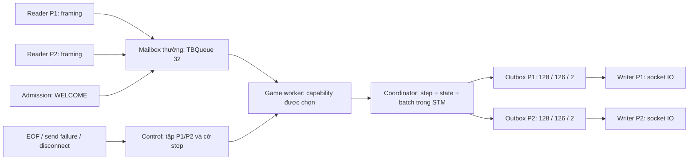

# NM-01 — Hợp đồng kiến trúc NUMA, locality, cache và affinity

**Cập nhật hiện trạng NM-05 (2026-10-12):** phần mô tả source nền và API dự kiến
bên dưới là quyết định tại mốc NM-01. Worker/mailbox/runtime đã được triển khai;
xem [hồ sơ NM-05](worker_locality.md) để đọc mã, gate và đánh đổi hiện hành.
Phần duyệt của nhóm vẫn chờ xác nhận thật.

Ngày lập: **2026-10-11**, Asia/Saigon. Phụ trách: **R**; A/B/C/D review.
Revision nội dung: **NM-01 v1**. Nhánh: **`Update_NUMA`**, tách từ
`Update_docs_report` tại **`94a7aaaf68860a55cb7528c76f7c30f8fc1b6023`**.

**Trạng thái: bản hợp đồng kỹ thuật để review; chưa khóa và chưa có xác nhận
A/B/C/D.** NM-01 lập quyết định, giới hạn, API dự kiến và phương pháp đo. Các cơ
chế worker/affinity/cache/NUMA dưới đây thuộc NM-04..NM-07, chưa được cài đặt chỉ
bằng việc thêm tài liệu này. Kết quả kiểm tra bản tài liệu ghi tại mục 11.

## 1. Phạm vi, căn cứ và hiệu lực

Người dùng đã yêu cầu bổ sung kiến trúc sau mốc S-04. Yêu cầu đó cho phép lập
phần mở rộng này; lịch sử và chữ ký của S-04/DK-09 tiếp tục giữ nguyên.

| Phụ thuộc | Căn cứ kỹ thuật đang có | Điều kiện còn phải xác nhận |
|---|---|---|
| S-04 | [Hồ sơ khóa tính năng](s04_feature_freeze.md); lõi thuần, một trận và cleanup | Bảng xác nhận nhóm trong hồ sơ còn trống |
| C-07 | [Hợp đồng outbox](shared_contract.md#giới-hạn-và-chính-sách-client-chậm-c-07); preflight batch, 128/126/2, Quit đúng người quá tải | Review API C-07 còn chờ trong hợp đồng chung |
| DK-09 | [Hồ sơ bàn giao](dk09_handover.md); hai service, readiness, LAN và resume | Review nhóm còn chờ; nghiệm thu hai thiết bị vật lý chưa được ghi là đạt |

Các nguồn tiếp tục có hiệu lực: [luật R-01](game_spec.md), [wire v1](protocol.md),
[API chung](shared_contract.md), [Docker](docker_deployment.md). Khi có đề nghị
đổi các nguồn đó, R phải ghi thay đổi và lấy xác nhận đúng revision trước hợp
nhất. Việc người dùng giao task hoặc test xanh không tạo chữ ký cho A/B/C/D.

Mục tiêu bổ sung là kiểm soát nơi xử lý và nơi cấp phát, giảm chia sẻ không cần
thiết, dùng lại dữ liệu bất biến và đo tác động. Hiệu năng tăng, giảm hoặc không
khác biệt đều phải báo cáo nếu phép đo hợp lệ. Kiến trúc game vẫn là một trận,
hai người; runtime production vẫn có hai service `haskell` và `web`.

## 2. Ma trận kiến thức → cơ chế → bằng chứng

Trang dưới đây là **trang vật lý PDF, tính từ 1**. Slide là tài liệu học; các
con số minh họa tốc độ trong slide không phải số đo của đồ án.

| Kiến thức và nguồn slide | Cơ chế đã chọn | Bằng chứng nghiệm thu | Task |
|---|---|---|---|
| Chap2.pdf tr. 4, 9–12: local/remote RAM, topology NUMA | Đọc topology thực tế; ghép tập CPU và node RAM; kiểm tra placement | Topology, CPU mask, phân bố trang nhớ; local/remote trên ít nhất hai node | NM-02, NM-07 |
| Chap5_Thread.pdf tr. 27–30: locality, pinning, capability | Worker xử lý trận trên capability chọn trước; CPU affinity ở Linux/container | Kiểm tra capability và CPU affinity thực tế riêng biệt | NM-04, NM-05 |
| Chap5_Thread.pdf tr. 31, 39–41: giảm chia sẻ, mailbox, read/write set | Reader gửi yêu cầu có giới hạn tới một worker; một state, hai outbox | Test định tuyến, đồng thời, giới hạn và kết thúc; so sánh chi phí với baseline | NM-05, NM-08 |
| Chap2.pdf tr. 6, 12; Chap4_Parallel-process.pdf tr. 7–8: cache CPU/coherence | Dữ liệu fleet bất biến được tính sẵn; thử bảng ô gọn; giảm đổi nơi xử lý | Đối chiếu 100 ô, allocation/GC; counter cache có tên sự kiện khi PMU hỗ trợ | NM-06, NM-09 |
| Chap5_Thread.pdf tr. 35–40: STM, contention, transaction nhỏ/batch | Giữ nguyên state + toàn bộ frame trong một atomically; IO mạng ở writer | Rollback, batch thiếu chỗ, lệnh đồng thời, Quit và marker không bị chặn | NM-05, NM-08 |
| Chap5_Thread.pdf tr. 43–44: false sharing, GC, profiling | Ghi ảnh hưởng scheduler/GC; đo cache/migration khi có công cụ | Log RTS, cấu hình, metric và giới hạn công cụ; không suy ra false sharing chỉ từ thời gian chạy | NM-03, NM-09 |

Snoop/write-invalidate và việc tổ chức cache phần cứng do CPU đảm nhiệm.
Ứng dụng áp dụng nguyên lý bằng bố trí truy cập và đo tác động; không tự cài
giao thức coherence của CPU. Bảng tra cứu của Fleet là dữ liệu tính sẵn trong
phần mềm; cache L1/L2/L3 là phần cứng. Hai khái niệm phải được gọi đúng tên.

`forkOn`/`withAsyncOn` chọn capability của GHC. CPU affinity chọn tập CPU logic
của hệ điều hành. NUMA placement chọn node bộ nhớ. Chứng minh một tầng không
đủ chứng minh hai tầng còn lại. [GHC SMP](https://downloads.haskell.org/ghc/9.10.3/docs/users_guide/using-concurrent.html)
và [async](https://hackage-content.haskell.org/package/async-2.2.6/docs/Control-Concurrent-Async.html)
là nguồn kiểm tra API ở NM-04/05.

## 3. Hiện trạng mã và kiến trúc đã chọn

### 3.1 Hiện trạng tại revision nền

`Server.runServerWithConfig` tạo coordinator trước khi accept. Reader gọi
`handleFrame`, rồi `atomically submitPayload/submitTooLong`; EOF và lỗi gửi
đi qua `clientLeft` để `submitCommand Quit`. Hai reader hiện có thể cùng submit
STM. Coordinator sở hữu một `TVar GameState`, hai `TBQueue` và cờ transport
`slowClients`; writer đọc FIFO riêng và thực hiện `sendAll` ngoài STM.

`package.yaml` đã có `-threaded`, `-rtsopts`, `-with-rtsopts=-N`. `compose.yaml`
chưa có CPU affinity hoặc memory-node placement. Có `libnuma1` trong image
Haskell không đồng nghĩa runtime đã bật hay đã kiểm chứng NUMA.

### 3.2 Kiến trúc NM-05



Một worker chịu trách nhiệm áp dụng các yêu cầu trận. Nó khởi tạo coordinator
và dữ liệu cần xử lý trong phạm vi thực thi của mình. Reader tiếp tục framing;
parser/rule/encode dùng các hàm chung trong coordinator. Worker không có socket
hoặc tham chiếu tới Lobby/MVar để chờ writer. Writer và watchdog vẫn độc lập.
Phép đọc phase phục vụ lifecycle/diagnostic được phép; chỉ worker của phiên
được submit các thay đổi state trong luồng server.

Lựa chọn này phù hợp tính tuần tự của luật một trận: kết quả lệnh sau phụ thuộc
lệnh trước. Nó tạo điểm sở hữu dữ liệu rõ và áp dụng mailbox trong slide. Đánh
đổi là thêm queue/ack và một worker; cần đo chi phí ở game nhỏ. NM-03 phải lấy
baseline trước khi NM-05 sửa đường xử lý.

### 3.3 Khởi tạo, evaluation và giám sát

- Dùng `withAsyncOn` để giữ supervision có cleanup và chọn capability; không
  tạo luồng rồi bỏ quên handle hoặc exception.
- Số capability lấy từ RTS khi khởi động. Chỉ số phải thỏa `0 <= index < N`;
  giá trị sai báo lỗi trước listen. Không đổi N giữa trận.
- Việc tạo biểu thức trên worker chưa chứng minh biểu thức đã được tính tại
  đó. NM-05 cần kiểm soát evaluation cần thiết bằng cơ chế thuần/strictness;
  không gọi `evaluate`, socket IO hoặc `unsafeIOToSTM` trong STM.
- GHC GC có thể ảnh hưởng vị trí heap. Capability đúng là bằng chứng nơi thực
  thi; vị trí RAM vật lý phải kiểm chứng ở NM-07.
- Readiness chỉ được công bố khi worker đã khởi tạo thành công và listener đã
  listen. Vẫn dùng marker/HTTP healthcheck, không probe cổng chơi để chiếm slot.

## 4. Quyền sở hữu và bất biến bắt buộc

| Thành phần | Sở hữu/thao tác | Điều kiện |
|---|---|---|
| Reader | Buffer framing mỗi socket; danh tính được server gán; gửi request | Buffer giới hạn như wire v1; không tự quyết định luật |
| Game worker | Tiêu thụ request, gọi coordinator, trả kết quả xử lý | Một worker sống cho phiên; không giữ socket/Lobby lock |
| Coordinator | Một GameState, hai outbox, metadata transport | State và cả batch cùng giao dịch; giữ API STM cho test |
| Writer | Một consumer FIFO/socket cho mỗi người | Chỉ đọc frame đã lọc; mạng ngoài STM; timeout như C-07 |
| Supervisor | Worker/readers/writers/listener và sự sống phiên | Lỗi nội bộ propagate; cancel đóng tài nguyên và đánh thức người chờ |
| Board/Rules/View | Fleet hợp lệ, hàm thuần, dữ liệu được phép nhìn | `step`, `placeFleet`, `viewFor` và kiểu miền giữ hợp đồng hiện hành |
| Bridge | Token, WebSocket, TCP đang giữ và thời hạn resume | Haskell tiếp tục quyết định luật và Quit khi hết hạn |

Các bất biến NM-I01..NM-I10 là hard gate:

1. **NM-I01:** một `GameState` là nguồn sự thật; không tạo state theo core/node
   hoặc lưu hai lịch sử shot phải cập nhật song song.
2. **NM-I02:** `step` thuần; luật nằm ở Rules, hình học Fleet qua Board.
3. **NM-I03:** lỗi parser/rule không ghi state hoặc tiêu lượt; lỗi vận chuyển
   quá tải có thể tạo chuyển trạng thái Quit riêng theo C-07.
4. **NM-I04:** state + toàn bộ batch encode được + terminal marker cùng commit.
   Encode failure/exception/retry không để lại phần batch đã ghi.
5. **NM-I05:** giữ wire v1: LF/CRLF, payload 256 byte, tọa độ A1..J10 và thứ tự
   frame; danh tính từ socket, không từ payload.
6. **NM-I06:** chỉ frame theo recipient hoặc view được lọc; không gửi/log
   GameState, fleet đối thủ chưa lộ hoặc token phiên thật.
7. **NM-I07:** outbox giữ 128/126/2, preflight cả hai người, Quit đúng recipient
   quá tải; cùng batch cả hai quá tải chọn P1 như C-07.
8. **NM-I08:** Finished chỉ chốt một lần; EOF/QUIT muộn không đổi winner hoặc
   thêm GAME_OVER/marker. Lệnh chờ sau Finished nhận kết quả dừng, không đi Step.
9. **NM-I09:** không IO mạng trong STM; đường control/kết thúc không đợi chỗ
   trống của mailbox thường hoặc peer đọc hết socket.
10. **NM-I10:** resume production giữ **300.000 ms** ở bridge. Mất WebSocket
    chưa làm Haskell Quit khi TCP vẫn giữ; không đặt timeout chờ người nhập.

## 5. Mailbox: dung lượng, thứ tự và đường control

### 5.1 Mailbox thường

Dung lượng production cố định **32 request chờ**, dùng `TBQueue`. Request là
envelope transport có actor, loại yêu cầu và ack; nó không định nghĩa thêm
`Coord`/`Command` hoặc serialize ra wire. Payload tối đa 256 byte. Các yêu cầu
admission, payload, dòng quá dài và **QUIT người chơi gửi trên wire** đi FIFO
thường; QUIT tường minh không vượt các lệnh trước nó của cùng socket.

Giới hạn 32 tính phần tử đang trong queue; không tính request worker đang xử
lý, buffer socket/bridge hoặc overhead heap. Với payload, phần byte thô trong
queue tối đa khoảng 8 KiB; đây không phải giới hạn toàn bộ RAM process.

Mỗi reader chờ ack xử lý trước khi submit frame kế tiếp; ack không phải đợi
frame được gửi qua mạng. Trong production hai reader thường chỉ có tối đa hai
request chưa ack; 32 là giới hạn transport dự phòng, không lời hứa sẽ quan sát
được 32 request khi chơi thường. Test nội bộ có thể dùng producer có gate để
lấp queue. Một reader chỉ giữ chunk/buffer framing theo giới hạn hiện có.

Queue đầy áp dụng backpressure có thể hủy: dừng nhận thêm để chờ slot hoặc
trạng thái worker/phiên dừng. Không bỏ command hoặc tăng queue; đầy đầu vào
không tự xử thua. Outbox đầy vẫn dùng chính sách C-07. NM-05 cho test constructor
dung lượng nhỏ `>= 1`; production không thêm biến env đổi dung lượng ở NM-01.

### 5.2 Control độc lập và hữu hạn

Đường control gồm cờ stop toàn phiên và tập người mất TCP/gửi lỗi, tối đa P1/P2
trong TVar riêng. Báo disconnect chỉ thêm actor bằng phép hợp nhất set nên lặp
lại không tăng bộ nhớ. Nó không cần slot của mailbox 32 và không phải GameState.

Ở mỗi điểm chọn yêu cầu, worker kiểm tra theo ưu tiên: **stop của supervisor →
disconnect đang chờ → FIFO thường** trong STM. Nếu hai disconnect cùng hiện
diện, chọn P1 trước để quy tắc tái hiện được; winner do `step P1 Quit` quyết
định. Nếu lệnh thường đã commit trước khi control được quan sát, kết quả đó
có hiệu lực. Control không hủy ngược giao dịch đã commit.

Disconnect thật có thể vượt request thường đang chờ. Trận chưa Finished thì
gọi `submitCommand core actor Quit`; sau Finished chỉ ack/dọn. Stop toàn phiên
(SIGTERM/cancel/lỗi nội bộ) là dừng dịch vụ; không tự công bố thắng/thua mới.
Control đánh thức worker đang đợi queue rỗng bằng `orElse`/cờ STM.

### 5.3 Ack và kết thúc

Mỗi envelope thường có một `TMVar` ack private. Kết quả coordinator vẫn là
`Either ProtocolError Bool`: True cho phép tiếp tục, False cho dừng; Left là
lỗi hợp đồng nội bộ. Kết quả đó không thêm frame wire. Người đợi ack đồng thời
quan sát trạng thái worker dừng/lỗi, nên không cần worker đặt ack cho từng
request sau khi nó đã chết. Sau terminal, worker trả dừng cho request còn chờ,
dọn tối đa 32 phần tử rồi kết thúc; không gọi Step lần nữa.

Admission chờ ack WELCOME trước khi mở reader/writer như hiện tại; worker không
đợi Lobby. Supervisor đánh dấu dừng, đánh thức waiter, đóng listener/socket rồi
join luồng theo cơ chế hiện hành. C-07 giữ send watchdog **2 giây**, reader
grace **200 ms**; test kết thúc phiên có deadline **10 giây**.

## 6. Rà tất cả đường vào và kết thúc

| Đường hiện có | Chuyển sang worker ở NM-05 | Điều kiện phải giữ/test |
|---|---|---|
| Accept P1/P2 → welcomePlayer | Request admission FIFO, ack trước reader | WELCOME đầu tiên; xóa frame cũ của slot chưa có socket; identity từ accept |
| Payload hợp lệ → handleFrame → submitPayload | Reader framing, worker gọi submitPayload | Parse/Step/encode cùng API; đọc state mới nhất lúc xử lý, không snapshot ở reader |
| Payload sai → preparePayload/rejection | Cùng request payload | Không gọi Step cho lỗi parser; lỗi chỉ actor; lỗi không đổi state |
| Dòng quá 256 byte → submitTooLong, reader dừng | Request quá dài rồi reader báo disconnect qua control | LINE_TOO_LONG trước GAME_OVER khi còn chỗ; đầy outbox thì Quit theo C-07 |
| Wire QUIT → parseCommand → Quit | FIFO thường như các command khác | Giữ thứ tự socket; step quyết định winner; không tạo luật ở worker |
| EOF hoặc recv IOException → clientLeft | Báo actor mất kết nối qua control | Đánh thức worker dù mailbox đầy; Step Quit đúng actor, bỏ tail chưa đủ frame |
| sendFrame thất bại/watchdog → clientLeft | Writer đóng socket, báo control | Không ngắt nhầm người; writer đối thủ vẫn chạy; finalizer lặp không kết thúc hai lần |
| wouldOverflow → Quit recipient trong transact | Coordinator giữ nguyên fallback cùng giao dịch | Hủy nước bắn dự kiến; GAME_OVER + Nothing đủ chỗ; không vòng qua mailbox thường |
| Bad core/encode failure → reportFailure | Worker báo lỗi nội bộ tới supervisor | Rollback; dừng session rõ; không đổi thành lỗi nhập hoặc Quit giả |
| Finished → writerDrained/marker | Worker dừng nhận gameplay, writers drain như hiện tại | Không frame sau marker; không đợi drain mạng của socket đã hỏng |
| TCP thứ ba → ERROR SERVER_FULL | Server từ chối trực tiếp, không request miền | Không slot/worker/state; kết nối từ chối không đi Step |
| WebSocket mất, TCP còn giữ | Bridge giữ logic hiện có | Resume đúng token trước 300.000 ms; Haskell chưa nhận EOF |
| Bridge expire → tcp.end('QUIT\n') | QUIT FIFO rồi EOF control | Chỉ một kết quả cuối; actor gắn với TCP; Haskell quyết định thắng |
| SIGTERM/cancel server | Supervisor stop, đóng/join và dọn readiness | Thoát sạch; không chờ queue/rỗng/ack vô hạn; restart mất trận như DK-09 |

Các điểm mã đã đọc: `Server.runServerWithConfig`, `acceptClients`, `handleFrame`,
`clientLeft`, `closeSlowClient`, `writeFrames`, `writerDrained`, `reportFailure`,
`readFrames`, `sendFrame`; `Coordinator.welcomePlayer`, `preparePayload`,
`prepareCommand`, `transact`, `validateBatch`, `wouldOverflow`, `commitBatch`;
`frontend/bridge.mjs` tại `attach`, `expire`, resume và TCP cleanup.

Khi kiểm tra hai lệnh đồng thời phải xét **thứ tự tuần tự hợp lệ**: hai Hit khác
nhau của P1 có thể đều hợp lệ vì trúng giữ lượt; P1 Miss rồi P2 Fire có thể đều
hợp lệ. Ca “chỉ một lệnh hợp lệ” phải chọn hai Miss khác nhau của cùng actor
hoặc bắn lặp, không áp dụng một kỳ vọng sai cho mọi cặp lệnh.

## 7. API, cấu hình và trách nhiệm triển khai

### 7.1 API hiện hành và API dự kiến

NM-01 không đổi code/API. NM-05 giữ chữ ký và ngữ nghĩa của `runServer`,
`runServerWith`, `runServerConfigured`, `defaultServerConfig`, `parseServerConfig`
và callback port thực tế. Toàn bộ API thuần/STM của Coordinator tiếp tục dùng
trực tiếp trong test. Step được tiêm vẫn là core duy nhất; worker không bỏ seam
kiểm thử. Types, các chữ ký step/placeFleet/viewFor và wire v1 giữ nguyên.

API runtime bổ sung **dự kiến để nhóm duyệt**, chưa có trong source nền:

```haskell
-- Battleship.Server; GameRuntimeConfig abstract, constructor không public.
defaultGameRuntimeConfig :: GameRuntimeConfig
parseGameRuntimeConfig :: Int -> Maybe String -> Either String GameRuntimeConfig
runServerWithRuntime :: GameRuntimeConfig -> ServerConfig -> Step -> GameState
  -> PortNumber -> (PortNumber -> IO ()) -> IO ()
```

Int của parser là số capability thực tế từ getNumCapabilities; Maybe String là
chỉ số worker. Nothing chọn 0. Chuỗi rỗng/không phải số nguyên thập phân không
âm, count <= 0 hoặc index >= count là lỗi. Runner kiểm tra lại count trước
listen. Main đọc cấu hình và khởi chạy, không cài luật. Runner cũ dùng default
runtime; library không đọc env toàn cục để làm test đổi hành vi ngoài ý muốn.

GameWorker/request/ack/control là chi tiết library private. Nếu test cần API
bổ sung, C/R ghi helper đó để nhóm review; không phá encapsulation Fleet.

| Phần | Tác động dự kiến | Chủ trì/review |
|---|---|---|
| GameWorker, Server, Main | Module, runtime API, lifecycle/caller mới | C; B/D/R review |
| Coordinator | Giữ API/constructor abstract; helper mới nếu cần phải ghi | C; B review STM |
| Internal.Fleet/Board/Rules | Index private và read helper ở NM-06 nếu được duyệt | A/B theo file; A/B/C/D review API |
| package.yaml | Đăng ký module/benchmark; dependency array/eventlog nếu cần | C; A/B review |
| Spec tổng/SharedContractSpec | Đăng ký suite và ownership cùng lúc thêm source | R; C review |
| Overrides/scripts Docker | CPU/node/RTS, hai service, non-root và SIGTERM | C; D review |
| Benchmark/report | Workload, seeds, kết quả và giới hạn | B/R; nhóm review |

Block contract:domain-api và contract:owners trong shared_contract mô tả mã
**hiện có**. GameWorker chỉ được thêm vào ownership khi NM-05 thực sự thêm file;
không làm gate S-01 lệch source bằng một file dự kiến chưa tồn tại.

### 7.2 Ba chế độ chạy

| Chế độ | Cấu hình | Điều kiện |
|---|---|---|
| Mặc định | Lệnh hiện hành; sau NM-05 worker capability 0, mailbox 32; chưa ép CPU/node | Native Windows/Linux/container chạy; không bắt buộc numactl/nhiều node |
| Affinity | Compose override cpuset; N rõ qua +RTS -Nn -RTS; chỉ số worker tùy chọn | Mask nằm trong tập effective, index < N; sai dừng trước mở phiên |
| NUMA thực nghiệm | CPU mask + chính sách RAM node; GHC --numa hoặc numactl theo từng ca | Kernel/runtime/quyền phù hợp; local/remote cần >= 2 node; thiếu điều kiện báo chưa nghiệm thu |

Env **dự kiến NM-05**: BATTLESHIP_GAME_CAPABILITY, do ServerMain đọc, mặc định
0. Chỉ số capability khác CPU ID và node ID. Script NM-02/04/07 đọc topology,
không cố định CPU/node của máy hiện tại. cpus là quota, cpuset là CPU mask;
không cấp độc quyền CPU/cache. Quota giữa hai biến thể benchmark phải giống
nhau. Không tự đặt một khóa memory-node Compose chưa được hỗ trợ; launcher
NM-07 dùng Docker API/CLI phù hợp và kiểm chứng trước khi mở phiên.

Không đổi CPU/node giữa trận. Đổi profile khởi động lại và mất trận theo DK-09;
auto-update origin LAN tiếp tục giữ process/phiên như hiện tại. GHC NUMA mask
là bitmap, không phải danh sách CPU; launcher phải chuyển đúng node IDs.

Nguồn: [Docker cpuset](https://docs.docker.com/engine/containers/run/#cpuset-constraint),
[Compose](https://docs.docker.com/reference/compose-file/services/),
[GHC NUMA](https://downloads.haskell.org/ghc/9.10.3/docs/users_guide/runtime_control.html#rts-options-for-numa-support),
[numactl](https://github.com/numactl/numactl/blob/master/numactl.8).

## 8. Phương pháp đo chốt trước kết quả

### 8.1 Workload và điều kiện

NM-03 cố định ba seed **424242, 8675309, 20261011**, sinh Fleet qua generator
độc lập A-06 và trạng thái qua step. Lưu fixture/checksum trước NM-04..07;
mọi biến thể dùng cùng dữ liệu, không chọn lại seed theo kết quả có lợi.

| Workload | Thực hiện và phạm vi tính giờ |
|---|---|
| W-core | Đặt hai fleet, lỗi, Miss/Hit/Sunk/Win, view P1/P2; nhiều trận độc lập tuần tự offline; đánh giá đầy đủ kết quả/checksum, không chỉ WHNF của Either |
| W-server | Hai peer tự động, transcript trọn trận/lỗi; từ gửi command tới OK/ERROR/SHOT tương ứng; queue/processing time ghi riêng nếu instrument được |
| W-web | Hai WebSocket qua bridge thật, cùng origin/port mapping; tách thời gian mạng/UI; mỗi trận mới theo lifecycle DK-09 |
| W-memory | Dữ liệu lớn để quan sát local/remote; ghi kích thước/tác vụ; không dùng số này để suy ra game 10x10 tăng tốc tương tự |

Không tính thời gian chờ con người nhập. Client chậm/resume là test đúng đắn,
không trộn vào latency client đọc bình thường. Benchmark nhiều trận offline
không thêm nhiều phòng production. Fixture chuẩn bị ngoài vùng tính giờ.

Cùng compiler/snapshot, image, release flags (kể cả -O), CPU/RAM/quota; ghi SHA
của từng biến thể. Profiling build có overhead được đo riêng. Ghi warm/cold
status, công cụ và tải nền. Không chạy build/test nặng cùng benchmark.

Chạy từng biến thể tuần tự, luân phiên/ngẫu nhiên thứ tự A/B với seed cố định
và lưu thứ tự. W-core hiệu chỉnh số vòng trên baseline để mẫu đo khoảng ít
nhất 1 giây, rồi cố định số vòng cho mọi biến thể. W-server/web lấy một trận
đầy đủ mỗi mẫu, lưu mọi mẫu phản hồi; không lặp lệnh trên state đã Finished.

### 8.2 Số lần lặp, metric và nhiễu

- **5 warm-up + 30 mẫu đo/biến thể/workload**, chia 3 block mỗi block 10.
  Ghi số vòng/trận mỗi mẫu và tổng command, không cộng warm-up vào số mẫu đo.
- Baseline 3 block: `(max(median_block) - min(median_block)) / median_all`
  phải **<= 10%**. Vượt ngưỡng thì kiểm tra tải/thermal/quota và chạy lại cả
  loạt, vẫn lưu dữ liệu cũ. Còn nhiễu: **chưa đủ kết luận**; không chỉ bỏ outlier
  bất lợi. Đây là ngưỡng ổn định được chọn cho đồ án.
- Metric chính: median thời gian/command hoặc trận; **p95 phản hồi** của
  server/web. Metric hỗ trợ: allocated bytes/op, GC time, max residency/RSS
  kèm đơn vị/cách đo; CPU time, migration/context switch khi công cụ cho phép.
- Cache counter phải ghi event, CPU model, quyền PMU và running/enabled ratio
  khi multiplexing. Counter cache miss phổ thông không tự chứng minh remote
  RAM hoặc false sharing. Không hỗ trợ là **N/A**, không phải 0.
- Báo khoảng tin cậy **95%**, phương pháp và seed tái hiện. Chỉ gọi cải thiện
  khi metric chính giảm **>= 5%** và khoảng tin cậy cho thay đổi không cắt 0.
  Trường hợp khác ghi không rõ khác biệt/chưa đủ bằng chứng.
- Median/p95 xấu đi ổn định **> 10%** phải điều tra và nhóm review đánh đổi
  trước chọn mặc định NM-09. Ghi cả RAM tăng; giảm allocation không tự chứng
  minh max residency/RSS giảm. Các ngưỡng không là assertion timing trong CI.

Ghi RTS flags khi lấy GC stats/eventlog; ThreadScope/perf/numastat dùng khi
môi trường cho phép. Không thêm privileged cho production chỉ để đọc counter;
thiếu quyền/phần cứng được ghi riêng. [GHC RTS](https://downloads.haskell.org/ghc/9.10.3/docs/users_guide/runtime_control.html)
là nguồn đọc stats và cấu hình GC.

### 8.3 So sánh chỉ thay một yếu tố

| So sánh | Giữ cố định | Biến thay đổi |
|---|---|---|
| Baseline N1/N2 | Source, fixture, host, build flags | Số capability |
| Không pin/pin | Cùng N, source, workload, quota | CPU affinity |
| Reader submit/worker | Cùng N/mask/RAM, fixture | Ownership/đường xử lý |
| Fleet reference/index | Cùng runtime/topology/workload | Dữ liệu tính sẵn/layout |
| NUMA local/remote | Cùng CPU trên node A, workload/N/GC | RAM ở A hoặc B |
| Kết hợp cuối/baseline | Workload, môi trường có manifest | Tập thay đổi đã có phép đo riêng |

Local/remote dùng chính sách RAM được xác nhận; không bật một cơ chế GHC làm
thay đổi placement và mất điều kiện so sánh. --numa của GHC là biến thể riêng,
kiểm chứng như thực tế. Một node trong container/VM không xác định topology
vật lý Windows; nó chỉ nghiệm thu affinity/locality trong phạm vi nhìn thấy.

## 9. Gate kiểm thử và task tiếp theo

| Task | Phụ thuộc hợp đồng | Bằng chứng |
|---|---|---|
| NM-02 | Mục 2/7 | Topology một/nhiều node, ID rời rạc, offline/SMT, file/quyền thiếu |
| NM-03 | Mục 8 | Fixture/seed/checksum, evaluation đủ, baseline/manifest |
| NM-04 | NM-02/03, mục 7 | Mask/capability thực tế, config sai trước listen, game/cleanup |
| NM-05 | NM-03/04, mục 3–7 | FIFO/ack, worker failure, full queue + control, WELCOME, C-07/API cũ |
| NM-06 | NM-03, mục 2/4/8 | 100 ô đối chiếu độc lập, QuickCheck >= 1.000/property, luật/view |
| NM-07 | NM-02/04/05/06 | CPU/RAM placement, local/remote >= 2 node, thiếu điều kiện báo rõ |
| NM-08 | NM-04..07 | Đồng thời >= 100 lần/ca có gate, socket chậm, resume/restart/stop/down |
| NM-09 | NM-03..08 | Số liệu/revision, giới hạn phần cứng và review hợp đồng |

Test control dùng gate: lấp queue dung lượng nhỏ, giữ worker ở điểm đồng bộ,
publish disconnect/stop và chứng minh không chờ slot; thả worker, chờ kết thúc
trong deadline. Worker chết khi reader chờ ack phải đánh thức reader. Outbox
đầy vẫn test đúng recipient, rollback shot và terminal marker như C-07.

Đã đối chiếu suite hiện có: SharedContractSpec (API/ownership), ProtocolSpec,
BoardSpec/ViewSpec (QuickCheck), CoordinatorSpec (Step/atomicity/rollback/race/
C-07), ServerSpec (slots/readiness/cleanup/socket chậm), IntegrationSpec và
frontend reconnect/integration/LAN/Compose. Đây là gate hồi quy, chưa test một
GameWorker chưa được cài. NM-01 dùng gate hợp đồng hiện có, kiểm tra link và
fixture; không thêm test chỉ so sánh tài liệu với chính câu chữ mới.

## 10. Review và điều kiện khóa

| Vai trò | Phần phải duyệt | Tên/GitHub, revision, ngày, link |
|---|---|---|
| A | Fleet/index private, generator, luật/API không đổi vì benchmark | **CHỜ XÁC NHẬN** |
| B | Step/View, thứ tự, error/Finished, benchmark/evaluation/privacy | **CHỜ XÁC NHẬN** |
| C | Mailbox/control/ack, runtime API, STM/capacity/cleanup/NUMA | **CHỜ XÁC NHẬN** |
| D | Wire/WELCOME/TooLong, bridge resume, origin/port và web fixture | **CHỜ XÁC NHẬN** |

R ghi bằng chứng thật cùng nội dung; bảng này là nguồn review NM-01. Trước
commit dùng checksum hai file tại mục 11; sau commit ghi SHA và link diff.
Mẫu: `<vai trò> — <tên/GitHub>: xác nhận NM-01 v1 tại <SHA/checksum hai file>;
đã review <phần>; đồng ý API dự kiến, mailbox/control và phương pháp đo;
<ngày/link>.`

Chỉ khóa khi nội dung/gate kỹ thuật đầy đủ, đủ A/B/C/D xác nhận cùng revision
và các điều kiện còn chờ của phụ thuộc được ghi nhận/duyệt rõ. Đổi quyết định
sau xác nhận thì tăng revision và duyệt lại. Commit/push/test không thay chữ
ký. NM-02/03 có thể chuẩn bị topology/baseline; API/layout/worker phải được
review trước hợp nhất. Thiếu phần cứng không chặn viết cấu hình, nhưng chặn
nghiệm thu local/remote thực tế.

## 11. Bằng chứng NM-01

- Đã tạo nhánh Update_NUMA từ SHA nền ở đầu tài liệu.
- Đã đối chiếu các đường vào/kết thúc với source/test tại mục 6/9.
- Đã lập worker/mailbox/control, API dự kiến và phương pháp đo.
- **Kiểm tra thực tế 2026-10-11, Windows x64, lts-24.59/GHC 9.10.3:**
  `stack build` exit 0; `stack test --ghc-options=-Werror` exit 0,
  **907 examples, 0 failures**, thời gian Hspec **127,6776 giây**. Có gate
  SharedContractSpec/API/ownership, QuickCheck A-06/B-06, STM/C-07 và TCP/CLI
  thật trong full suite; không dùng con số Linux lịch sử cho lần này.
- Link nội bộ/code fence qua; so sánh với HEAD xác nhận hai block
  `contract:domain-api`/`contract:owners` không đổi. `git diff --check` qua.
- Chưa chạy lại frontend/Compose hoặc benchmark phần cứng trong NM-01;
  các gate đó thuộc NM-03/NM-08. Test xanh của mã nền chưa chứng minh
  GameWorker/affinity/index/NUMA chưa được triển khai đã hoạt động.
- Kết quả lịch sử S-04/C-07/DK-09 không là số đếm của lần chạy NM-01.
- A/B/C/D: **chưa được cung cấp xác nhận**. Runtime NM-04..07 và phép đo
  baseline/local/remote: **chưa thực hiện trong NM-01**.
- Log/checksum bản review cục bộ: `.stack-work/nm01/{build.log,test.log,
  document-check.json,review-snapshot.json}` (ignored); checksum định danh
  nội dung trước commit, không thay chữ ký. Bản mô tả trên Google Docs được
  ghi vào thẻ con của Update NUMA sau kiểm tra và được đọc lại để xác minh.

## 12. Lý do và đánh đổi

| Quyết định | Công dụng | Chi phí/giới hạn |
|---|---|---|
| Một worker trận | Áp dụng mailbox/locality, quyền cập nhật rõ, tuần tự theo luật | Queue/ack tăng overhead; chưa chứng minh nhanh hơn |
| Mailbox 32 + control riêng | RAM đầu vào hữu hạn, disconnect/stop tiến triển khi đầy | Supervise ack/waiter; QUIT FIFO khác disconnect ưu tiên |
| Một state, STM batch | Bảo toàn luật/riêng tư/atomicity và gate C-07 | Không loại bỏ mọi contention hoặc GC cost |
| Fleet bất biến tính sẵn | Dùng lại hình học, giảm tra cứu/tính tập lặp | Tăng RAM; cần test invariant và đo |
| Profiles có preflight | Cấu hình theo máy thật, tái hiện, default vẫn chạy | Capability/CPU/node khác nhau; VM/quyền giới hạn |
| Baseline, 30 mẫu, ngưỡng trước đo | Tránh chọn dữ liệu có lợi; kết luận định lượng | Cần ổn định và có PMU/multi-node khi nghiệm thu phần cứng |
| Review cùng revision | Nhóm thống nhất API/thứ tự/cleanup | Chưa khóa toàn bộ nếu chưa có xác nhận thật |
