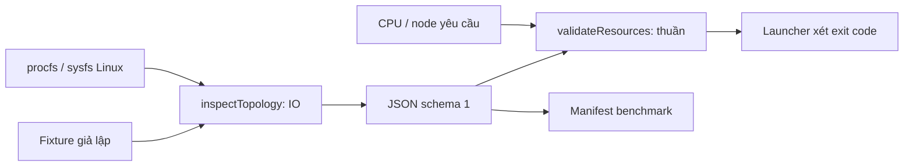

# NM-02 — Topology Linux và kiểm tra cấu hình tài nguyên

Ngày nghiệm thu tự động: **2026-10-11**, Asia/Saigon. Nhánh **`Update_NUMA`**,
nền Git `94a7aaaf68860a55cb7528c76f7c30f8fc1b6023`. Phụ trách C; R review.
Phụ thuộc [hợp đồng NM-01](numa_design.md). Schema đầu ra **1**.

**Đã thực hiện:** đọc topology, kiểm tra mask yêu cầu, phân loại khả năng và
kiểm thử trong Linux/container. Chưa áp dụng pinning cho Haskell, chưa đặt RAM
trên node cụ thể và chưa đo hiệu năng game. Xác nhận C/R của thành viên nhóm
cần ghi sau khi review cùng revision; kết quả tự động không thay chữ ký nhóm.

## 1. Vấn đề cần giải quyết trong hệ thống Battleship

Game hiện có một lõi luật thuần, coordinator STM và hai service Docker. Khi bổ
sung affinity/NUMA, không thể chọn CPU hoặc node theo số đếm của máy lập trình.
Một máy có thể cấp CPU `2,6,21`; container chỉ được dùng CPU `6`; node RAM có
thể mang ID `3,9`. CPU ID, core ID, socket ID, capability GHC và NUMA node ID
là những hệ đánh số khác nhau.

NM-02 cung cấp bước **preflight**: đọc môi trường và kiểm tra yêu cầu trước khi
launcher mở trận. Nó giúp các task NM-04/NM-07 chọn tài nguyên có căn cứ và
NM-03 lưu bối cảnh benchmark. Script độc lập không tự khởi động server hay tự
gắn vào Compose hiện hành. Launcher các task sau phải gọi kiểm tra, xét exit
code và đọc lại trong đúng môi trường tài nguyên của Haskell.

Nếu bỏ bước này, cấu hình có thể tham chiếu CPU offline, RAM node không được
cấp hoặc chạy benchmark local/remote trên VM chỉ thấy một node. Những lỗi đó
có thể làm lệnh khởi động thất bại hoặc làm kết luận hiệu năng không có căn cứ.

## 2. Kiến thức bài giảng được vận dụng

Trang là trang vật lý PDF, tính từ 1; đối chiếu chi tiết ở NM-01.

| Nội dung đã học | Áp dụng cụ thể ở NM-02 | Bằng chứng và giới hạn |
|---|---|---|
| `Chap2.pdf`, tr. 4, 9–12: CPU/node và RAM local/remote | Ghép CPU với node, đọc RAM từng node, kiểm tra node được cấp | Fixture nhiều node; máy hiện tại chỉ nghiệm thu một node nhìn thấy |
| `Chap5_Thread.pdf`, tr. 27–30: locality, pinning, capability | Phân biệt CPU online, mask tiến trình và SMT; chuẩn bị tập CPU cho launcher | Container bị giới hạn CPU thật; chưa cài `forkOn` hoặc đặt affinity của game |
| `Chap4_Parallel-process.pdf`, tr. 7–8; `Chap2.pdf`, tr. 6, 12: phân cấp cache | Đọc level/type/size/line size và CPU dùng chung cache | Test cache chia sẻ, ID rời rạc và dữ liệu thiếu; không tự cài coherence |
| `Chap5_Thread.pdf`, tr. 43–44: profiling và ảnh hưởng cache/scheduler | Probe từng counter; ghi thiếu công cụ/quyền hoặc chưa kiểm tra | PMU trong sysfs không được coi là bằng chứng counter hoạt động |
| Buổi 01–03: hàm, dữ liệu đầu vào/đầu ra, hàm bậc cao | Parser/validator thuần; tiêm hàm đọc file và probe vào inspector | Cùng fixture cho kết quả kiểm tra giống nhau, không cần phần cứng nhiều node |
| `Chap8-Module Programming.pdf`, tr. 3–5, 12–15: module và kiểm thử | Tách API script, suite fixture và tài liệu; test kỳ vọng quan sát được | `node:test` là công cụ JavaScript bổ sung; không thay Hspec/QuickCheck của lõi Haskell |

Linux procfs/sysfs, Docker cpuset, `perf`, Node ESM và JSON schema là chi tiết
kỹ thuật dùng để hiện thực nguyên lý của slide. Việc dùng những công cụ này
không có nghĩa mọi API đều được dạy trực tiếp trong slide. Không suy ra NUMA
được nghiệm thu chỉ vì runtime có `libnuma1` hoặc hệ thống dùng Docker.

## 3. Cấu trúc xử lý và lý do lựa chọn



| Thành phần | Công việc |
|---|---|
| [inspect-topology.mjs](../scripts/inspect-topology.mjs) | ESM, chỉ dùng thư viện chuẩn Node; đọc file, phân tích, kiểm tra, xuất JSON |
| [topology.test.mjs](../scripts/test/topology.test.mjs) | Fixture không phụ thuộc số CPU/node của máy; kiểm tra parser, inspector, validator, perf và CLI |
| Tài liệu này | Hợp đồng đầu ra, cách chạy, căn cứ lựa chọn và kết quả thật |

**Đọc file thay vì phân tích chuỗi hiển thị của `lscpu`/`numactl`.** Nguồn file
Linux cho phép dùng số ID và danh sách có cấu trúc trực tiếp, không phụ thuộc
ngôn ngữ terminal và không yêu cầu cài thêm hai lệnh trong runtime nhỏ. Công
cụ đó vẫn hữu ích để đối chiếu thủ công. Các ABI CPU/node/cache do Linux cung
cấp là căn cứ triển khai. [Topology kernel](https://docs.kernel.org/admin-guide/cputopology.html),
[ABI sysfs CPU/cache](https://www.kernel.org/doc/Documentation/ABI/testing/sysfs-devices-system-cpu).

**Mask tiến trình thay vì mặc định đọc cgroup root.** `/proc/self/status` cho
CPU/RAM node được phép của tiến trình đang kiểm tra. Cách này tránh nhầm root
cgroup với cgroup con hoặc đường dẫn đã đổi do namespace. Tập sử dụng được
là giao của `online` và `allowed`. Không tự dùng toàn bộ CPU nếu không đọc được
mask. Cgroup `cpuset.cpus.effective`/`cpuset.mems.effective` là nguồn tham khảo
để đối chiếu; script không tự nối đường cgroup v1/v2 hoặc đo quota CPU.
[procfs](https://www.kernel.org/doc/Documentation/filesystems/proc.txt),
[cgroup v2](https://docs.kernel.org/admin-guide/cgroup-v2.html#cpuset).

**Tách IO và kiểm tra thuần.** `parseIdList` và `validateResources` không đọc
file, không mở socket. `inspectTopology` nhận hàm đọc file/liệt kê thư mục/probe
có thể thay bằng fixture. Test kiểm tra kết quả CPU/node/cache và quyết định
chấp nhận/từ chối; không cần đổi cấu hình máy thật để tạo mọi ca lỗi.

**Không thêm service production.** Container tạm chỉ chạy script kiểm tra,
mount source chỉ đọc, không có mạng, tự xóa sau khi thoát. Kiến trúc production
hai service `haskell`/`web`, framing và thời hạn resume vẫn như DK-09.

## 4. Các nguồn dữ liệu và cách diễn giải

| Trường | Nguồn | Ý nghĩa |
|---|---|---|
| `cpu.online` | `/sys/devices/system/cpu/online` | CPU Linux nhìn thấy đang online |
| `cpu.allowed` | `/proc/self/status`, `Cpus_allowed_list` | Mask CPU của tiến trình inspector |
| `cpu.effective` | Giao hai danh sách trên | CPU online mà inspector được phép dùng |
| `cpu.details` | `cpuN/topology/{core_id,physical_package_id,thread_siblings_list}` | Core/socket theo kernel, nhóm CPU logic cùng core, node mapping |
| `memory.onlineNodes` | `/sys/devices/system/node/online` | Node online nhìn thấy trong Linux |
| `memory.allowedNodes` | `/proc/self/status`, `Mems_allowed_list` | Node bộ nhớ được phép của tiến trình |
| `memory.effectiveNodes` | Giao online/allowed | Node online thuộc mask bộ nhớ |
| `memory.nodes` | `nodeN/cpulist`, `nodeN/meminfo` | CPU thuộc node, giao với CPU effective, tổng RAM kernel báo |
| `caches` | `cpuN/cache/indexK/` | ID nếu có, level/type, size, line size và CPU chia sẻ |
| `environment` | Marker container, cgroup, kernel release, DMI vendor/product, hypervisor flag | Dấu hiệu các lớp môi trường; không đọc serial hoặc bí mật trận |
| `performanceCounters` | PMU sysfs, `perf_event_paranoid`, probe `perf stat` | Công cụ, policy và kết quả kiểm tra counter, không phải benchmark game |

`memoryBytes` là **MemTotal của node Linux**, không phải dung lượng còn trống,
RAM đã cấp cho Haskell hay giới hạn `memory.max` của container. Vùng RAM được
phép trong NM-02 là **tập NUMA node**, không phải dải địa chỉ vật lý. `cpuQuotaMeasured`
là false: mask CPU không cho biết quota, độ mạnh CPU hoặc quyền dùng độc quyền.
Các giới hạn quota/RAM và placement thực tế cần lưu riêng ở launcher/benchmark.

Hai CPU logic chung core được nhận diện qua socket/core và `threadSiblings`.
Core ID có thể lặp giữa hai socket. Không chia số CPU logic cho 2 để đoán số
core, không giả định máy có SMT và không dùng CPU0 làm mốc bắt buộc.

Cache được gộp theo **level + type + ID nếu có + sharing mask**; không gộp chỉ
vì cùng level. `sharedCpus` giữ đầy đủ tập kernel báo, `effectiveSharedCpus`
chỉ chứa CPU inspector được phép dùng. `observedFromCpus` giúp biết cache đã
được quan sát từ CPU nào. Nếu kernel không cung cấp ID, mask/type/level là
căn cứ gộp; dữ liệu cache là topology được công bố, không đo tốc độ cache.

## 5. Hợp đồng JSON và API script

```js
parseIdList(text)                       // Array<number> hoặc throw với lý do
inspectTopology(options)               // Promise<report>; IO có thể tiêm fixture
validateResources(report, options)     // { ok, requested, errors }; không sửa report
probePerformance(run)                  // Promise<{ usable, scope, events }>
runCli(args, { inspect, out })          // Promise<exitCode>
```

Import module không chạy CLI. CLI gắn thêm `validation` vào report và xuất
một đối tượng JSON trên stdout. Consumer phải kiểm tra `schemaVersion`,
`inspectionOk`, `validation.ok` và exit code; không lấy danh sách CPU rỗng
làm “tự chọn mọi CPU”. Mọi danh sách số được sắp tăng, loại trùng.

Các khóa ổn định của schema 1:

| Khóa | Hợp đồng |
|---|---|
| `schemaVersion`, `observedAt`, `scope`, `platform` | Phiên bản, thời điểm ISO UTC, phạm vi `linux-visible-current-process`, nền tảng |
| `inspectionOk` | Có tập CPU effective và node RAM effective không rỗng; không đồng nghĩa mọi nguồn phụ đầy đủ |
| `cpu`, `memory`, `caches`, `sources` | Dữ liệu topology và nguồn; Linux thiếu thông tin trả null, không tự điền giả |
| `environment` | `container`/`virtualMachine`: true khi có dấu hiệu, null khi chưa xác định; `physicalHostTopologyVerified` luôn false |
| `capabilities.affinity` | `eligible` + lý do: đủ mask CPU để chuẩn bị affinity; chưa áp dụng affinity |
| `capabilities.multiNodeNuma` | `eligible`, `usableNodes`, lý do; tối thiểu 2 node có RAM và CPU effective, mapping không mơ hồ |
| `capabilities.performanceCounters` | `usable`: true/false/null, `events`, policy/PMU nếu đọc được; lý do cho mỗi lỗi probe |
| `diagnostics` | Danh sách `{code, source, reason}`; lỗi file, quyền, dữ liệu hoặc mapping không đầy đủ |
| `validation` | `ok`, mask yêu cầu đã parse, danh sách lỗi cụ thể; chỉ do CLI gắn thêm |

Trên nền tảng không hỗ trợ, report vẫn có schema, topology null, diagnostic
`UNSUPPORTED_PLATFORM` và capability không xác nhận được; `sources` có thể vắng.
Lỗi cú pháp CLI/IO ngoài dự kiến xuất `{schemaVersion: 1, error: ...}` và exit
khác 0. Đây cũng là kết quả cần xử lý, không giả định mọi output đều có `cpu`.

Giới hạn parser: ID nguyên thập phân không âm <= 2147483647; mỗi danh sách tối
đa 65536 phần tử khi mở rộng, tối đa 262144 ký tự. Các giới hạn chống cấp phát
vô hạn do range sai, không cố định tài nguyên theo máy hiện tại. Chuỗi rỗng,
range đảo, ký tự lạ và tham số CLI lặp bị từ chối.

## 6. Kiểm tra cấu hình và phân loại khả năng

### 6.1 Mask yêu cầu

`--cpus`/`--mems` nhận số hoặc range, ví dụ `2,6-8`. Từng CPU phải online và
thuộc mask được cấp. Từng node phải online, được cấp và có RAM đọc được lớn
hơn 0. Node chỉ có RAM, không có CPU, vẫn có thể là đích `--mems` hợp lệ.
Thiếu thông tin cần thiết thì từ chối thay vì đoán.

`--require-numa` yêu cầu **môi trường** có ít nhất hai node CPU/RAM dùng được.
Nó không bắt mask yêu cầu phải trải đều trên hai node: thử local/remote có thể
chọn CPU trên A và chỉ chọn RAM trên B. Script xác nhận điều kiện topology;
quyền thực thi `set_mempolicy`, vị trí trang nhớ và GHC NUMA vẫn cần kiểm chứng
ở NM-07. GHC capability không được nhập vào `--cpus`.

### 6.2 Host, VM và container

Các lớp có thể cùng tồn tại: Docker container trong VM WSL2 trên Windows.
`container=true` và `virtualMachine=true` đồng thời là kết quả hợp lệ. Nếu
không thấy marker/DMI/flag, giá trị null nghĩa là chưa đủ bằng chứng; không
khẳng định bare metal. Chạy trực tiếp trên host Linux cho topology Linux của
tiến trình đó, nhưng script không có cách chứng minh không còn lớp ảo hóa.

Một node nhìn thấy ở VM/container chỉ cho phép kết luận một node **được công
bố ở lớp đang kiểm tra**. Không suy số node vật lý của Windows hoặc máy chủ
ngoài VM. Số CPU/cache báo ở VM cũng thuộc phạm vi đó.

### 6.3 Counter và quyền

Mặc định probe từng event `cycles:u`, `instructions:u`, `cache-references:u`,
`cache-misses:u` bằng `perf stat` trên tiến trình Node nhỏ, dùng locale C và
deadline **3 giây/event**, buffer tối đa 64 KiB. Không dùng shell hay chạy
workload Battleship. `--no-perf` bỏ probe, trả `usable=null`, không trả true.

`usable=true` chỉ khi cả bốn event trả số đếm nhận diện được; từng event có
kết quả riêng. Không có perf, thiếu quyền, timeout, `<not supported>` hoặc
`<not counted>` trả false và lý do, count null. Đây là kiểm tra counter user
space của tiến trình thử, không chứng minh event kernel/system-wide hoặc
event đo remote RAM dùng được. `perf_event_paranoid` và danh sách PMU chỉ là
bối cảnh; policy/capability/seccomp/phần cứng còn có thể chặn phép đo.
[Quyền perf](https://docs.kernel.org/admin-guide/perf-security.html).

Không có counter không làm chế độ affinity mặc định thất bại. Benchmark phải
ghi metric đó **N/A**; không ghi số 0 và không tăng quyền container production
chỉ để biến kiểm tra thành xanh. Kết quả NUMA nhiều node thiếu điều kiện cũng
không chặn trò chơi mặc định; nó chỉ chặn yêu cầu `--require-numa`.

## 7. Lệnh chạy và cách chặn cấu hình sai trước trận

Yêu cầu Node >= 24 theo dự án. Chạy từ gốc repository:

```sh
node --test scripts/test/topology.test.mjs
# Trong Linux/WSL:
node scripts/inspect-topology.mjs
node scripts/inspect-topology.mjs --no-perf
```

Ví dụ mask dưới đây là **giả định một máy cấp CPU 2,6 và node 3,9**. Phải đọc
report thực tế trước khi thay vào; đây không phải cấu hình của máy nghiệm thu:

```sh
node scripts/inspect-topology.mjs --cpus 2,6 --mems 3,9 --require-numa
```

| Exit code | Ý nghĩa/cách xử lý |
|---|---|
| 0 | Inspection đủ mask và yêu cầu hợp lệ; launcher có thể chuyển bước |
| 1 | Nền tảng/nguồn cần thiết không đủ hoặc IO ngoài dự kiến; dừng preflight |
| 2 | Cú pháp/mask/capability yêu cầu sai; sửa cấu hình trước khi khởi động |

Khi chạy Linux native trong cùng phạm vi CPU/RAM với server, mẫu gate:

```sh
if node scripts/inspect-topology.mjs --cpus "$CPU_IDS" --mems "$MEM_NODE_IDS" --no-perf > topology.json; then
  stack exec battleship-server -- 4000
else
  cat topology.json
  exit 1
fi
```

Hai biến là mask đã chọn từ môi trường, không để rỗng. Mẫu gate này **kiểm tra**
và chạy server; nó chưa áp dụng mask CPU/node mới. Đặt affinity/placement là
phần của NM-04/NM-07. Không lấy mask của một container kiểm tra không giới hạn
để cho phép Haskell container bị giới hạn khác. Kiểm tra lại sau khi áp dụng
cpuset, trước mở listener; CPU hotplug hoặc chính sách cgroup thay đổi có thể
làm snapshot cũ hết hiệu lực.

### Kiểm tra Linux bằng Docker trên Windows

Dùng image web local đã build theo DK-05/DK-09 vì có Node; không cần cài Node
vào Haskell runtime để nghiệm thu NM-02. Đặt `$nm02Docker` theo cài đặt máy hoặc
`docker` nếu có trong PATH:

```powershell
$nm02Docker = Join-Path $env:LOCALAPPDATA 'Programs/DockerDesktop/resources/bin/docker.exe'
$nm02Scripts = (Resolve-Path ./scripts).Path
$nm02Mount = "type=bind,source=$nm02Scripts,target=/probe/scripts,readonly"
& $nm02Docker run --rm --network none --read-only --mount $nm02Mount --entrypoint node battleship-web:local /probe/scripts/inspect-topology.mjs
& $nm02Docker run --rm --network none --read-only --mount $nm02Mount --entrypoint node battleship-web:local --test /probe/scripts/test/topology.test.mjs
```

Với CPU/node thực tế đã chọn, có thể thêm `--cpuset-cpus`/`--cpuset-mems` vào
lệnh Docker **trước tên image**, rồi đưa cùng mask vào CLI để xác nhận. Không
cần `--privileged`, publish port hoặc kết nối TCP chơi. Nếu dùng Node Windows
chạy inspector trực tiếp, nó xuất lỗi nền tảng exit 1; unit test fixture vẫn
chạy được trên Windows.

## 8. Unit test và ý nghĩa kiểm chứng

**48 test** chạy trên Windows và Linux. Fixture cố ý dùng CPU `2,6`/node `3`
và node thứ hai `9`; không lấy cấu hình máy hiện tại làm expected value.

| Nhóm test | Rủi ro được phát hiện |
|---|---|
| Một/nhiều node; CPU/node ID rời rạc | Đếm phần tử rồi coi index là CPU/node ID; tự khẳng định NUMA nhiều node |
| CPU offline, ngoài mask; mask effective rỗng | Cho phép CPU không dùng được hoặc fallback sang mọi CPU |
| SMT và core ID trùng giữa socket | Nhầm CPU logic với core vật lý hoặc gộp core khác socket |
| Node không tồn tại/ngoài mask, RAM 0/thiếu, memory-only | Chọn node RAM sai hoặc bắt mọi node RAM đều phải có CPU |
| Thiếu/sai file, EACCES, mapping CPU/node thiếu/mơ hồ | Đoán thông tin hoặc làm lỗi phụ thành mất dữ liệu không giải thích |
| Cache sharing, type, ID, size và dữ liệu thiếu | Đếm một cache nhiều lần, gộp sai cache, nhầm byte/KiB hoặc điền cache giả |
| WSL + container, VM thiếu DMI/cache, dấu hiệu cgroup | Nhầm topology VM/container với topology máy vật lý |
| Perf được/mất/thiếu quyền/timeout/unsupported/mixed; bỏ probe | Khẳng định có counter từ PMU/policy hoặc ghi thiếu metric thành 0 |
| CLI tham số sai/lặp, JSON/exit code, Windows, IO ngoài dự kiến | Khởi động tiếp dù preflight sai hoặc crash không có thông báo |

Expected values là tập ID, capacity byte, mapping và quyết định cho phép/từ
chối quan sát được; fixture không gọi inspector để tự sinh kỳ vọng. Ca NUMA
remote giữ CPU trên A, RAM trên B ngăn validator quá chặt khiến thí nghiệm
hợp lệ bị từ chối. Test không đổi luật hoặc API Fleet/GameState của Haskell.

## 9. Kết quả chạy thật ngày 2026-10-11

Môi trường: Windows 11 build **26200**; Docker Engine Linux **29.8.2**;
kernel nhìn thấy **6.18.40.1-microsoft-standard-WSL2**; runtime Node của image
web DK-05 **24.21.0**, user **node (UID 1000)**. Source script/test hiện tại
được mount read-only vào container tạm, không rebuild hai image production.

Image dùng kiểm tra: `battleship-web:local`, ID
`sha256:b01ac11fc67f9725546fe9969a9a070b532fe76f30501bab834a3e781bddf949`.

| Lần chạy | Kết quả thực tế |
|---|---|
| `node --test scripts/test/topology.test.mjs` trên Windows | 48 pass, 0 fail, exit 0 |
| Cùng suite trong container Linux non-root/read-only/network none | 48 pass, 0 fail, exit 0 |
| Inspector mặc định trong container | CPU online/allowed/effective `0-11`; node online/allowed/effective `0`; 19 nhóm cache; exit 0 |
| Phân lớp môi trường | Container=true, VM=true; nguồn marker Docker/kernel WSL/hypervisor flag; topology vật lý chưa xác nhận |
| Phân loại | Affinity eligible=true; multi-node NUMA=false; perf counter usable=false vì không có lệnh perf |
| Docker cpuset CPU `0`, RAM node `0`; CLI yêu cầu cùng mask | Effective CPU `[0]`, kiểm tra hợp lệ, exit 0 |
| Cùng container chỉ cấp CPU `0`, CLI yêu cầu CPU `1` | CPU1 vẫn online nhưng ngoài mask; exit 2, lý do rõ |
| Yêu cầu `--require-numa` ở môi trường hiện tại | Từ chối thiếu ít nhất hai node dùng được, exit 2 |
| Inspector chạy trực tiếp bằng Node Windows | Structured unsupported report, exit 1 |

CPU0/node0 ở bảng là **dữ liệu đo của lần chạy này**, không phải mặc định trong
script. `perf_event_paranoid=2`; PMU directory không có thiết bị `cpu` trong
lần đọc này. Kết luận chắc chắn là chưa có perf để đo ở image này; không suy
hardware Windows không có counter. 19 cache là nhóm Linux công bố, không
phải kiểm kê vật lý máy Windows.

Log local: `.stack-work/nm02/unit-windows.stdout`, `unit-linux.stdout`,
`linux-visible.stdout`, `linux-restricted.stdout`, `linux-disallowed.stdout`,
`linux-require-numa.stdout`, `windows-unsupported.stdout` và
`runtime-evidence.json`. Thư mục này bị Git ignore; bảng trên là bản ghi nghiệm
thu đi cùng source. Container tạm dùng `--rm`; không tạo thêm worker/game slot.

## 10. Đánh giá hoàn thành và bước tiếp theo

- Đã có đủ bộ đọc, validator, JSON/API, CLI/exit code, diagnostic và unit test
  yêu cầu của NM-02; đã đối chiếu bằng cpuset thật trong Linux/container.
- Tập tài nguyên không cố định theo máy; mọi cấu hình yêu cầu ngoài mask bị
  từ chối. Launcher phải dùng đúng context và chặn exit khác 0 trước mở trận.
- NM-03 dùng report làm manifest môi trường; NM-04 dùng CPU/core/SMT/cache để
  chọn affinity; NM-07 kiểm tra node/mempolicy/placement và đo local/remote.
- Chưa nghiệm thu trên Linux bare metal nhiều node, cgroup v1 thật hay PMU có
  perf. Các fixture xác nhận xử lý logic, không thay bằng chứng phần cứng.
- Chưa chạy lại Haskell/frontend/game/Compose end-to-end trong NM-02: không
  sửa các module đó. Gate 907 test Haskell ở NM-01 là hồ sơ trước đó, không
  được tính thành kết quả chạy mới. Không có kết luận game nhanh hơn.
- Chờ C/R review schema/cách tích hợp launcher theo quy trình NM-01. Review
  nhóm, benchmark, pin worker và RAM placement thuộc các mốc tiếp theo.
