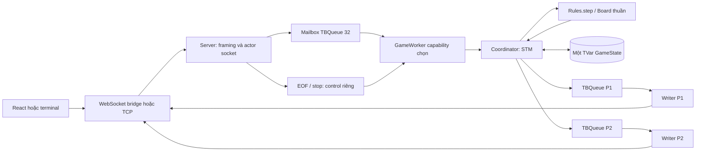

# Báo cáo tổng thể đồ án BattleShip Haskell

**Bản đối chiếu cập nhật:** 2026-10-12, nhánh `Update_NUMA`, nền `788f8396638344e7a38fd2428d84feac2a9b5e38` + các thay đổi NM-07..09 chưa commit. Bản trước ngày 2026-10-10 dùng nền `8bd7da9` trên `Update_docs_report`. Báo cáo tổng hợp yêu cầu, mã và hồ sơ kiểm thử; phần affinity/locality/cache/NUMA có kết quả chi tiết ở [numa_acceptance.md](numa_acceptance.md). Lý do thiết kế là căn cứ kỹ thuật kiểm chứng được: yêu cầu, phương án, đánh đổi và kết quả; không suy đoán lời xác nhận của thành viên hoặc ghi SHA nộp chưa tồn tại.

Hồ sơ nghiệm thu lõi thuần S-02 trước đây dùng tên `report_final.md` được bảo tồn tại [s02_acceptance.md](s02_acceptance.md). [Chỉ mục tài liệu](README.md) hướng dẫn đọc theo mục đích.

## 1. Bài toán, mục tiêu và phạm vi

Xây dựng Battleship hai người, lấy Haskell làm nơi quyết định luật và áp dụng kiến thức lập trình hàm, module, đồng thời, đồng bộ, truyền thông điệp và socket trong slide. Mục tiêu kiểm chứng: chơi một ván đầy đủ, lệnh sai không mất lượt, bí mật được giữ riêng và ngắt kết nối không khiến hệ thống chờ vô hạn.

Ban đầu là terminal/localhost. Sau S-04, người dùng yêu cầu ghép giao diện `frontend-ui`, chơi LAN, tự lấy IP trước trận, giữ phiên web 5 phút khi mất mạng, QuickCheck, giới hạn queue và Docker hai service. Đây là các đợt mở rộng sau mốc terminal; không gán ngược GUI/Docker vào phạm vi S-04 lịch sử.

### Sản phẩm hiện có

- Thư viện Haskell lõi thuần/server TCP; hai executable server và client terminal.
- React/TypeScript: bố trí tàu, hai bàn, bắn theo lượt, kết quả và khôi phục phiên.
- Bridge Node chuyển WebSocket–TCP, giữ một TCP cho mỗi phiên người chơi.
- Hai image/Compose `haskell` và `web`; Windows helper cập nhật origin LAN.
- Hspec, QuickCheck, test STM/TCP/frontend/bridge/runtime/Compose và log/ảnh nghiệm thu.
- GameWorker sở hữu xử lý, mailbox giới hạn, Fleet metadata bất biến và công cụ kiểm chứng CPU/RAM/runtime profile; benchmark có seed/source hash và số liệu chi phí.

Phạm vi: một phòng, hai slot cố định, một trận mỗi lần chạy Haskell. Không có AI, nhiều phòng, tài khoản, lưu trận, phục hồi sau restart hoặc chế độ Trinh sát. Tự bố trí tàu ở UI là hỗ trợ nhập, không phải AI chơi.

## 2. Luật được chốt và một nguồn luật

Nguồn chuẩn: [game_spec.md](game_spec.md). Bàn 10×10, `A1..J10`, năm ID CV/BB/CR/SB/DD dài 5/4/3/3/2, tổng 17 ô. Tàu ngang/dọc, không chồng/vượt biên, được chạm cạnh; xác nhận một lần. Hai đội tàu sẵn sàng thì P1 đi trước. Trượt đổi lượt, trúng/chìm giữ lượt, trúng ô cuối toàn đội tàu thắng ngay.

Mọi cách nhập đi qua `Rules.step` và `Board.placeFleet`. Viết luật lần nữa trong React/Node/server IO sẽ tạo nguy cơ một phía báo thắng trong khi phía khác chưa kết thúc. Client kiểm tra nhập để phản hồi sớm, nhưng chấp nhận, lượt và kết quả thuộc Haskell. Kiểm tra hình học UI là tiện ích nhập, không cấp quyền sửa `GameState`.

Lệnh lỗi trả `Left GameError`, không có state mới để IO ghi nhầm. Khi queue đủ chỗ coordinator giữ state cũ, gửi lỗi riêng người gọi. Khi queue quá tải, coordinator thực hiện **Quit riêng** của người nhận chậm: trận có thể kết thúc vì bỏ cuộc, không phải lệnh sai được chấp nhận.

## 3. Quá trình thực hiện và những điểm sửa

Task/phụ thuộc/commit đầy đủ: [development_history.md](development_history.md).

| Đợt | Đã làm | Vì sao / tác dụng |
|---|---|---|
| C-01/A-01/D-01/S-01 | Package, compiler, kiểu/chữ ký, wire và hai Main | Nhóm cùng cách build, cùng Coord/Command; không đoán định dạng hoặc trùng kiểu |
| A/B/C/D-02..03 | Board, luật bắn, parser, client, coordinator | Kiểm chứng từng phần trước IO đồng thời; lõi chạy độc lập server |
| S-02/B-03..05 | Thay fixture chơi giả bằng `step`, góc nhìn riêng | Test không bỏ qua luật/lịch sử; so sánh bí mật khác nhau với quan sát giống nhau |
| C-04..06/D-04..06/S-03/04 | TVar, kênh riêng, EOF/timeout, terminal/checkout sạch | Chặn dùng lượt cũ, kiểm chứng kết thúc và khả năng làm lại |
| UI/LAN | Ghép giao diện thật, sửa tọa độ/mã tàu, auto IP/resume | Prototype thành client chơi được; không cố định IP của Wi-Fi hiện tại |
| A-06/B-06 | Generator độc lập, property ≥1.000 trường hợp | Đa dạng hơn fixture thủ công; có coverage và phản ví dụ |
| C-07 | Queue 128, batch nguyên tử, chỗ kết thúc, Quit client chậm | Giới hạn bộ đệm và tránh chờ socket chậm trong giao dịch |
| DK-01..09 | Config, image Linux, helper host, Compose, nghiệm thu/hướng dẫn | Chạy cùng môi trường, đúng cổng public, healthcheck không chiếm slot, dừng sạch |
| NM-01..04 | Hợp đồng đo, topology, baseline, affinity có verify | Không cố định CPU/node; nối capability với thực thi thực tế, chưa mặc định pin |
| NM-05..06 | Worker ownership/control và Fleet occupied/UArray | Giữ một state, shutdown tiến triển; dùng lại hình học bất biến, đo cả chi phí |
| NM-07..09 | CPU–RAM placement, hồi quy profile, kết luận và default đề xuất | Không gắn nhãn remote/NUMA speedup khi thiếu phần cứng; phân biệt tính đúng và hiệu năng |

**Lỗi thật C-05:** đóng socket khi còn input chưa đọc có thể gây TCP reset và mất `GAME_OVER`. Sửa bằng gửi hết FIFO, half-close chiều gửi, reader hiện hữu đọc bỏ input bằng buffer hữu hạn, sau 200 ms đóng; watchdog gửi 2 giây vẫn hoạt động. Test trước/sau nằm trong [test_evidence.md](test_evidence.md). Không nuốt lỗi trong test để coi mất phản hồi là thành công.

**Prototype UI:** hàng/cột đảo, mã CG/SS lệch CR/SB, chỉ chuyển màn hình, có nút chức năng chưa cài. Đợt tích hợp thống nhất cột A..J/hàng 1..10, mã wire, khóa Trinh sát, bỏ nút âm thanh chưa hoạt động và chờ phản hồi server. [Hồ sơ UI](frontend_integration.md) giữ chi tiết.

## 4. Luồng xử lý thực tế

### 4.1 Đặt tàu

1. Chỉnh nháp cục bộ; UI/terminal báo lỗi trước khi gửi.
2. Kết nối nhận `WELCOME 1 P1/P2`; danh tính do server gán, không nằm trong PLACE.
3. Reader gửi payload qua mailbox; GameWorker xử lý parser/coordinator và trả ack. Parser giữ ID trùng để Board phát hiện; lỗi parser/dòng quá dài cũng đi cùng worker.
4. `step` kiểm tra phase/đã đặt; `placeFleet` kiểm tra năm ID, hình học/giao nhau rồi tạo geometry + occupied + UArray 100 ô nhất quán. Chỉ `Right Fleet` được gắn vào người chơi.
5. Người đặt đầu nhận `OK PLACE`, `WAITING OPPONENT`. Người đặt cuối nhận OK; cả hai nhận `START P1`, `TURN P1`.
6. State và toàn bộ frame commit cùng STM; writer từng socket gửi FIFO sau đó.

Đặt cả đội tàu trong một lệnh tránh state server nửa hoàn thành phải khôi phục; sửa nháp client không tạo thêm dữ liệu đồng bộ.

### 4.2 Bắn

1. UI đợi TURN, khóa click ngay bằng ref, gửi FIRE, chờ phản hồi. Cố gửi sai vẫn bị Haskell kiểm tra.
2. Reader gửi qua worker; parser kiểm tra cú pháp; Rules kiểm tra readiness → lượt → tọa độ → bắn lặp → fleet đích. Bảng tra cứu kiểm tra ngoài bàn trước index, không thay luật.
3. Thêm ô vào lịch sử **người bắn**; xét fleet đích và tập ô đã bắn để chọn MISS/HIT/SUNK/WIN. WIN ưu tiên hơn SUNK ở ô cuối toàn fleet.
4. `ShotResolved` thành SHOT cho người bắn, INCOMING cho đối thủ; TURN/GAME_OVER theo sau.
5. Coordinator encode batch và kiểm tra dung lượng cả hai queue trước khi ghi; không IO mạng trong STM.
6. UI dựng bàn mình từ fleet riêng/INCOMING; bàn mục tiêu dùng fleet rỗng và các SHOT công khai.

Chìm xét theo ShipId, không gom tàu chạm cạnh thành vùng liên thông. HIT cũ giữ nghĩa lịch sử của phát đó, không viết lại thành SUNK khi phát sau làm chìm.

### 4.3 Mất kết nối và kết thúc

| Tình huống | Cách xử lý | Lý do |
|---|---|---|
| TCP terminal EOF/lỗi socket | `step actor Quit`, đối thủ thắng, dọn trận | Không có tầng giữ phiên terminal |
| WebSocket mất, TCP còn sống | Giữ TCP/token, CONNECTION, chờ 300.000 ms | Reload/đổi IP có thể quay lại cùng người chơi |
| Resume trước hạn | Gắn WS mới vào TCP cũ, replay own fleet/frame | Không slot mới, không phát lại FIRE |
| Hết hạn web | QUIT qua TCP đúng phiên | Haskell vẫn quyết định bỏ cuộc |
| Bấm Rời trận khi đang kết nối | QUIT ngay | Chủ động bỏ cuộc, không dùng grace period |
| Queue thiếu chỗ | Bỏ batch/nước gây tràn; Quit người nhận chậm từ state cũ | Không để state mới mà thiếu SHOT/TURN |
| Mailbox đầy / worker cancel | Control EOF/stop riêng; supervise worker, đánh thức ack waiter | Không chờ slot thường để dọn, không bịa thắng do lỗi nội bộ |
| Restart/host tắt/Engine dừng | Phiên RAM mất, cần trận mới | Không có persistence GameState/token |

Hạn resume bắt đầu khi bridge **phát hiện** WebSocket mất; không đo chính xác từ thời điểm Wi-Fi ngắt. Ping 10 giây, mất im lặng thường phát hiện khoảng hai chu kỳ; scheduling/mạng có thể tăng độ trễ. Thiếu người thì bridge chặn PLACE/FIRE của các phiên web, vẫn cho QUIT. Đây là chính sách web, không thêm phase vào lõi.

## 5. Dữ liệu và trách nhiệm module

| File | Nội dung / lợi ích |
|---|---|
| [Types.hs](../src/Battleship/Types.hs) | ADT/record/chữ ký thống nhất người, tàu, phase, lệnh/sự kiện/lỗi/góc nhìn |
| [Internal/Fleet.hs](../src/Battleship/Internal/Fleet.hs) | Geometry + occupied + UArray private, tránh vòng import, ngăn caller dựng metadata sai |
| [Board.hs](../src/Battleship/Board.hs) | Constructor kiểm tra; Set phát hiện chồng, Map giữ ShipId; fleetCells/shipAt đọc metadata |
| [Rules.hs](../src/Battleship/Rules.hs) | `step` thuần, mọi Command/Phase, một nguồn luật |
| [View.hs](../src/Battleship/View.hs) | Phép chiếu chỉ dữ liệu cho phép; không copy hình học đối thủ |
| [Protocol.hs](../src/Battleship/Protocol.hs) | Codec ASCII/dòng 256 byte, framing, lỗi wire và recipient |
| [Coordinator.hs](../src/Battleship/Coordinator.hs) | TVar/queue, batch, commit hoặc Quit quá tải |
| [GameWorker.hs](../src/Battleship/GameWorker.hs) | Capability/ownership, mailbox 32/control/ack, supervision và evaluation |
| [Server.hs](../src/Battleship/Server.hs) | Listener/slot/worker/timeout/readiness/cleanup |
| [Client.hs](../src/Battleship/Client.hs) | Nhập nháp/bắn/hiển thị terminal, chờ event server |
| [App.tsx](../frontend/App.tsx), [game.ts](../frontend/game.ts), [connection.ts](../frontend/connection.ts) | Trình bày, nháp, wire/public view, resume/replay |
| [bridge.mjs](../frontend/bridge.mjs) | HTTP/static, Origin/Host, WS–TCP, token/heartbeat/allowlist |
| [Start-LanCompose.ps1](../scripts/Start-LanCompose.ps1) | IP Windows host, atomic file/origin, không IP container |
| [compose.yaml](../compose.yaml), [Haskell Dockerfile](../docker/haskell.Dockerfile), [web Dockerfile](../docker/web.Dockerfile) | Linux test gate, runtime non-root, health/start/stop/mapping |

`Maybe Fleet` thể hiện chưa đặt thay Fleet rỗng giả. GameState có hai PlayerState riêng. Lịch sử chỉ lưu một bản ở người bắn; `shotsReceived` đọc history người kia, tránh hai bản outgoing/incoming có thể lệch nhau.

Coord/GameState có constructor công khai nên caller Haskell vẫn tạo được tọa độ/state không nhất quán. Invariant được bảo vệ qua Board/Rules và pipeline production, **không phải mọi giá trị của type đều hợp lệ**. Riêng Fleet che constructor, có compile probe ngăn constructor/record update/coerce/import module private qua package công khai.

Luồng và hằng số: [architecture.md](architecture.md). Đánh đổi/phương án khác: [design_decisions.md](design_decisions.md).

## 6. Kiến thức slide và phần mở rộng

Đối chiếu đủ 14 PDF theo **trang vật lý tính từ 1**, vì số slide in trong tài liệu ADT không luôn trùng số trang. [slide_mapping.md](slide_mapping.md) ghi trang/source/mức áp dụng/giới hạn.

- Trực tiếp: pure function/immutable, lambda/higher order/composition, kiểu/ADT/Maybe/Either/pattern matching, module/package/snapshot, Hspec/QuickCheck, thread/MVar/STM, supervision/cleanup, producer–consumer/pipeline, message/file passing và TCP client–server.
- Đợt NM: capability placement tương ứng forkOn qua withAsyncOn, affinity có kiểm chứng, locality xử lý, metadata/mảng thử spatial locality, CPU–RAM node0 và profiling có phạm vi.
- Mở rộng: React/TypeScript/Vite/pnpm, WebSocket/token resume/Origin/Host, Dockerfile/Compose/healthcheck, atomic rename Windows/TTL allowlist và Playwright/test container.
- Chưa nghiệm thu: remote NUMA nhiều node, GHC NUMA pools, cache PMU, hai thiết bị Wi-Fi vật lý. Chưa triển khai GPU/SIMD, Map–Reduce, Kafka/RabbitMQ, Cloud Haskell, mmap/shared memory liên process, NFS/RPC filesystem/replication/consensus.

QuickCheck **có trong Chap8**, không ghi là hoàn toàn ngoài slide. C-07 dùng TBQueue của Chap9 nhưng chọn Quit khi quá tải thay chờ writeTBQueue đầy: yêu cầu giữ tiến triển của trận và đường kết thúc là lý do điều chỉnh.

## 7. Kiểm thử và ý nghĩa bằng chứng

[testing.md](testing.md) giải thích oracle/seed/coverage/race/cách chạy. [test_evidence.md](test_evidence.md) dẫn kết quả theo thời điểm.

| Mốc đã chạy | Kết quả | Kết luận trong phạm vi |
|---|---:|---|
| S-04 terminal, 2026-10-05 | 815 Haskell, 0 lỗi | Lõi/STM/TCP/terminal revision lịch sử qua test/demo |
| DK-08 source sạch Linux amd64, 2026-10-10 | 908 Haskell; 36 frontend; TS/Vite qua | Build Linux/snapshot, có A-06/B-06/C-07 |
| DK-08 Compose | 19/19, 0 skip | Health/slot/trận/lỗi/riêng tư/resume/restart/chậm/down |
| DK-08 Chrome/Edge cùng Windows host | 1/1 trận UI, reload, thắng/thua | Hai process/profile độc lập qua LAN IP cùng host |
| DK-09 build/bàn giao | 908 Haskell, 36 frontend; 8 vận hành; 10 S-01 | Lệnh helper/port 8082/trận mới/log/stop/down chạy lại |
| NM-08 native N1/N2, 2026-10-12 | Mỗi profile 943 functional +18 fixture, 0 lỗi | Werror, A-06/B-06/FleetIndex, worker/concurrency |
| NM-08 Linux sáu profile | Mỗi profile 944 functional +18 fixture; Compose tổng 78/78 | Affinity/local/membind, cùng transcript3 seed; remote/GHCNUMA chưa nghiệm thu |
| NM-08 frontend và UI | 51 unit/helper +11 integration; TS/Vite; hai browser process mỗi profile | Same-host UI, không hai thiết bị thật; script final 119/119 |

Không cộng các lần chạy hoặc dữ liệu QuickCheck thành “tổng unit test”. Một example property chạy nhiều dữ liệu; một ca integration chứa cả ván. Clock kiểm soát/hạn fixture ngắn không phải chờ 5 phút thời gian thực. Test chứng minh các trường hợp đã chạy, không chứng minh mọi lịch trình mạng không còn lỗi.

Bí mật không chỉ kiểm tra tọa độ có xuất hiện: ô tàu mình có thể trùng tên tọa độ đối thủ. Test so sánh **toàn view/event** khi bí mật khác nhưng thông tin công khai giống nhau, kể cả SUNK. Trạng thái sinh đi qua `step`, không ghép lịch sử tùy ý.

## 8. Công dụng và giới hạn Docker/LAN

Hai service tách Haskell khỏi Node. Bridge gọi `haskell:4000`; chỉ web publish **8081 → 8080**. Người chơi dùng IP host/cổng public; loopback web container không phải core container. Test stage bắt buộc trước khi copy executable/dist sang runtime; runtime không cần compiler/pnpm/source phát triển.

Probe Haskell đọc marker sau listen, web `/healthz`, không TCP game. Connect probe vào 4000 có thể chiếm P1 rồi đóng gây Quit. `service_healthy` chờ ready khi start, không bảo đảm backend sống mãi. Web còn healthy sau trận để phục vụ kết quả.

Helper lấy IP **host**, chọn adapter, ghi file cùng thư mục rồi rename; bridge poll 2 giây. Mount thư mục read-only nhìn thấy file mới; TTL loại LAN cũ khi helper chết/file lỗi. Đổi IP không restart giữ TCP/token; đổi port/restart mất phiên. Người chơi vẫn cần nhận URL mới/token, không có DNS tự tìm máy chủ trên mọi thiết bị.

`restart: no` phù hợp một trận/lần chạy. Trận mới: chờ core Exited, `start haskell`, healthy, tạo phiên mới; giữ web. Docker đóng gói/vận hành, **không giữ server chạy khi máy chủ tắt**. Luôn phục vụ cần host/VPS luôn bật; persistence/recovery cần thiết kế riêng nếu mở yêu cầu.

Lệnh chuẩn nằm trong README/DK-09; báo cáo không tạo một bộ lệnh khác làm lệch env-file/project.

## 9. Dự án tham khảo

Đã kiểm tra ngày 2026-10-10: [DKurilo/battleship](https://github.com/DKurilo/battleship). README nêu Haskell/Snap/MongoDB/TypeScript/React, bot, SSL và build Linux/Docker. Đồ án tham khảo ý tưởng game/Haskell–web, không tuyên bố sao chép nguyên kiến trúc hoặc mọi file.

Đồ án chọn lõi thuần/TCP/bridge, không dùng Snap/MongoDB/bot, để làm rõ socket/STM, giảm hạ tầng một ván và test độc lập IO. Database phù hợp khi cần lưu trận/tài khoản/lịch sử; hiện thêm schema, IO/recovery/service phải test. Compose hiện tại là hai service runtime có gate test, không suy diễn deployment hai repo tương đương.

Package hiện ghi `AllRightsReserved`. Khi lấy thêm mã/asset ngoài, nhóm ghi nguồn/điều kiện sử dụng tương ứng; chưa có bảng nguồn asset đầy đủ để kết luận mọi ảnh đã được kiểm toán.

## 10. Phần còn cần chốt trước khi nộp

| Việc | Hiện trạng / ảnh hưởng | Cách hoàn tất |
|---|---|---|
| Review contract/revision | A/B/C/D/R chưa xác nhận thật | Ghi tên, SHA, ngày, link review trong shared_contract |
| Hai thiết bị/Wi-Fi vật lý | Một host không kiểm tra client isolation/firewall giữa thiết bị | Checklist DK-08, log/ảnh đúng phạm vi |
| R9-S03-01 terminal 80 cột | TODO: câu kết thúc 81 ký tự wrap; luật vẫn đúng | Rút/chia dòng, regression renderer, chạy console lại |
| Thông tin bản nộp/nguồn asset | Chưa có đầy đủ tác giả/lớp/ngày/nguồn ảnh | R bổ sung thông tin thật |
| Persistence/Internet | Ngoài MVP; RAM mất, HTTP không mã hóa | Chỉ mở task nếu đổi yêu cầu, không mô tả đã có |
| NUMA/cache đo phần cứng | Guest chỉ một RAM node; compiler không NUMA, thiếu PMU | Host phù hợp/compiler mới, baseline/gate/placement riêng; không tính pass |
| Default/commit nộp NM-09 | Đề xuất N1 opt-in, base vẫn auto-N; chưa SHA nộp/xác nhận nhóm | Review cùng revision, chạy override hướng dẫn và ghi SHA thật |

Các gate kỹ thuật có bằng chứng xanh; không ghi nhận lỗi luật/riêng tư đang mở trong hồ sơ hiện có. Điều này không thay test thực địa/review. AI/nhiều phòng/lưu trận/TLS Internet là hướng phát triển có điều kiện, không cần thêm để hoàn thành phạm vi hiện tại.

## 11. Kết luận

Hàm thuần/ADT tổ chức lõi; module tạo hợp đồng; STM commit state/event; supervision quản lý socket; message passing nối client. UI/LAN/Docker thêm sau để thuận tiện chơi/triển khai, vẫn giữ Haskell quyết định luật. Lợi ích là dễ test, rõ trách nhiệm, client chậm không gây mất đồng bộ; đánh đổi là codec/bridge và phiên chỉ sống khi tiến trình còn chạy. Báo cáo hoàn chỉnh về hiện trạng kỹ thuật; chốt nhóm/bản nộp cần thông tin thật ở mục 10.

## 12. Đánh giá affinity, locality, cache và NUMA — NM-09

Lý do mở đợt NM không phải game cần nhiều CPU để bắn một ô, mà để biến kiến thức phần cứng/runtime thành cơ chế có thể kiểm tra và đo chi phí. Một trận tuần tự được giữ là bối cảnh đo, không mở nhiều phòng hoặc thêm dữ liệu giả để tìm kết quả thuận lợi.

### 12.1 Quyền xử lý và locality

Trước NM-05 các reader submit coordinator; sau thay đổi, reader chỉ tiếp nhận socket/framing và gửi request/đợi ack. Một GameWorker khởi tạo coordinator và xử lý trên capability chọn. Mailbox32 giới hạn request, control EOF/stop không chờ slot, outbox 128 có reserved terminal path. Đây là bounded producer–consumer và scoped supervision theo Chap5/7/9. STM vẫn commit state/batch vì writers/cleanup còn đồng thời; một worker không thay toàn bộ trách nhiệm transaction.

Lựa chọn này làm ownership rõ và có test failure/queue/full/100 vòng, nhưng thêm envelope/ack/vòng đời. Allocation worker harness tăng khoảng 5,6–5,7%; timing worker NM-05 bị drift vượt 10%. Vì vậy bảo vệ worker bằng tính đúng và khả năng kiểm soát thực thi, không bằng lời hứa tăng tốc chưa đo được. OS/GC có thể bố trí RAM khác nơi khởi tạo; capability placement chỉ là một mức của locality.

### 12.2 Dữ liệu bất biến thay việc tính lặp

Fleet geometry không đổi sau đặt nên occupied Set và index 100 ô tính một lần trong smart constructor rồi đọc nhiều lần. Constructor private bảo đảm geometry/metadata cùng hợp lệ; shipAt guard tọa độ trước arithmetic, chìm vẫn theo ShipId. Không thêm state bắn thứ hai hoặc counter mutable cần cập nhật song song.

Cặp replay lõi NM-06 cùng container/source flags cho median giảm7,4–7,7%, allocation giảm 3,32%. Chi phí constructor allocation tăng 30,82%, retained fixture tăng khoảng 900 byte/Fleet. Đây là sự đổi giữa chi phí một lần và dùng lại. UArray unboxed là thử spatial locality, không chứng minh cacheCPU L1/L2/L3: chưa có PMU/cache-miss counter. Chọn metadata có kiểm chứng và API tương thích thay viết lại toàn bộ Fleet/luật thành mảng mutable.

### 12.3 CPU/RAM có kiểm chứng và giới hạn môi trường

Topology lấy từ Linux được cấp, không cố định theo Windows host. Affinity override kiểm tra cpuset sau create và task mask sau start; N/capability không đồng nhất CPU/core/node, affinity không độc quyền. NUMA launcher đặt CpusetMems trước process, kiểm tra private resident pages; membind/node0 và signal/cleanup qua. Remote node B thiếu và GHCbinary không NUMAsupport nên còn unaccepted.

Loạt repeat NM-07 CPU0/N1, default RAM5,227µs/command so local node0 5,437µs (+4,02%), allocation bằng nhau. Cả hai trong guest một node nên không phải local/remote vật lý và không cho lợi ích tốc độ. Kết quả này được giữ nguyên; phù hợp workload nhỏ và chi phí runtime, chưa phân rã từng nguyên nhân.

### 12.4 Cấu hình và hồ sơ bảo vệ báo cáo

Đề xuất cho một trận là N1/worker0, không pinCPU/RAM; giữ worker/Fleet metadata, luật/bridge/resume không đổi. Có [compose.report.yaml](../compose.report.yaml) opt-in để nhóm kiểm tra; base/package vẫn auto-N cho tới thống nhất. N1 qua toàn bộ NM-08, ít bộ nhớ RTS hơn trong baseline; N2/N12 chưa cải thiện mạng ≥5%. Không suy lựa chọn này sang nhiều phòng/phần cứng khác.

[numa_acceptance.md](numa_acceptance.md) là chương bằng chứng mở rộng: số liệu từng layer, ghép cặp và combined, topology/OS/Docker/GHC/hash/seed/lệnh, stability, memory cost, metric N/A, sourcebaseline khôi phục 24/25 file và một harness cache kháchash. [slide_mapping.md](slide_mapping.md) nối từng kiến thức/trang với code/test. Phép đo game lặp để nhìn heap không phải syntheticRAM latency, loopback không phải hai máy Wi-Fi. Nhóm còn phải xác nhận cùng commit thật trước nộp; không ghi thay thành viên.
