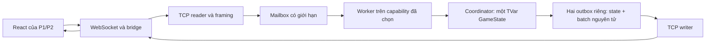

# NM-08 — Hồi quy hệ thống dưới các cấu hình runtime

Ngày thực hiện: **2026-10-12**, nhánh **Update_NUMA**, nền **788f839** và
working tree NM-07. B/D phụ trách theo kế hoạch, C hỗ trợ. Kết quả công cụ
không thay chữ ký review của các thành viên. Phụ thuộc NM-04..NM-07.

## 1. Câu hỏi nghiệm thu

Sau khi thêm affinity, worker sở hữu trận, Fleet tính sẵn và cấu hình RAM,
câu hỏi đầu tiên là hệ thống còn chơi đúng hay không. Một tối ưu có thể giữ
kết quả của một hàm đơn lẻ nhưng làm khác thứ tự sự kiện, bỏ một ack, làm
cleanup kẹt trên mailbox hoặc làm client phục hồi lịch sử không đúng.

NM-08 kiểm tra tính đúng của toàn bộ đường xử lý:



Tính đúng gồm luật, dữ liệu được phép thấy, số lần xử lý lệnh, thứ tự phản
hồi và khả năng kết thúc. Affinity và NUMA là điều kiện chạy khác nhau; chúng
không được thay luật, wire v1, dung lượng hàng đợi hoặc grace period 5 phút.
Tốc độ không phải điều kiện pass của các unit test. Benchmark và phân tích
nhiễu tiếp tục thuộc NM-03/NM-05/NM-06/NM-07.

## 2. Những phần đã sửa và vì sao

### 2.1 Bộ chạy ma trận

Thêm `scripts/test-runtime-profiles.mjs`. Script chạy build và hai suite
Haskell native với N1/N2, frontend unit/integration/TypeScript/Vite, unit
test các script, rồi bộ Haskell Linux và Compose cho từng profile khả dụng.
Mọi chương trình được gọi bằng executable và mảng tham số, không ghép lệnh
shell từ CPU/node do người dùng nhập.

Các profile chạy theo nhóm tối đa hai tác vụ độc lập, mỗi fixture có port,
project và thư mục riêng. Khi một tác vụ lỗi, runner đợi tác vụ còn lại dọn
xong rồi mới trả lỗi; không bỏ lại container đang chạy. Các run này kiểm
tra chức năng dưới tải, không dùng làm số đo hiệu năng so sánh profile.

Script dùng topology thực do NM-02 cung cấp, resolver của NM-04/NM-07 và
bộ kiểm chứng process đã có. CPU affinity một CPU chọn ID được phép từ
topology, không viết cố định CPU của máy này. Profile `-qa` chỉ chạy khi
mapping CPU 0/1 được cấp phù hợp. Node remote phải có RAM và quyền cấp phát
trong node đó. GHC NUMA có bước kiểm tra support trước khi chạy trận.

Không chỉ nhìn exit code: parser TAP yêu cầu có test thực sự pass, đủ
metrics, tổng số nhất quán và không có failure/cancel/todo. Các test Compose
được chọn trong một profile đủ điều kiện phải không skip. Profile thiếu
phần cứng hoặc compiler support dùng trạng thái `unaccepted`, có lý do
riêng; lỗi bất ngờ làm toàn bộ run thất bại.

### 2.2 Tái sử dụng test Compose

`scripts/test-compose.mjs` nhận profile JSON qua
`BATTLESHIP_RUNTIME_PROFILE_FILE`. Mặc định không có biến này vẫn chạy như
trước. `BATTLESHIP_RUNTIME_EVIDENCE_DIR` chọn chỗ lưu transcript và ảnh mới.
Đây là đầu vào của harness kiểm thử, không phải cấu hình mới của người chơi.

Fixture tạo override riêng cho RTS, worker capability, cpuset, policy RAM.
Nếu cần giới hạn RAM, fixture tạo container ở trạng thái chưa chạy, áp dụng
`docker update --cpuset-mems`, kiểm tra lại rồi mới start. Không thêm một
khóa Compose không được hỗ trợ. Nhiều override giờ có tên file riêng; một
clock fixture không ghi đè file cấu hình CPU trước đó.

Test hợp đồng Docker cập nhật biến `BATTLESHIP_GAME_CAPABILITY` đã có từ
NM-05. Nếu giữ kỳ vọng cũ, test sẽ báo sai cấu hình hợp lệ hoặc người đọc
tưởng worker không nhận cấu hình. Không thay Compose production chỉ để làm
test cũ xanh.

### 2.3 Cổng đồng bộ và 100 lần lặp

Test hai reader của GameWorker dùng lại `concurrentlyAtGate` từ
CoordinatorSpec. Mỗi tác vụ báo đã tới cổng, rồi cùng chờ TMVar; test mở
cổng khi đủ tác vụ. Cổng không ép scheduler phải chạy hai thread trong cùng
một nano giây. Nó bảo đảm các tác vụ đã được tạo và sẵn sàng cạnh tranh,
tốt hơn việc dựa vào `sleep` hoặc chỉ gọi hai async liên tiếp.

100 lần lặp kiểm tra xử lý mỗi lệnh đúng một lần và FIFO của từng reader.
Các ca mailbox đầy khi disconnect, stop khi producer bị backpressure và
cancel worker cũng chạy 100 vòng độc lập. Các test C-06/C-07 đã có tiếp tục
chạy 100 race bằng cổng đồng bộ: hit đúng người, gần đầy outbox, batch không
đủ chỗ, chọn đúng người bị quá tải và không kết thúc hai lần.

Test disconnect vẫn gửi nhiều control lặp trong một vòng để kiểm tra
idempotence. **100 control trong một worker không đồng nghĩa 100 thí
nghiệm độc lập**; NM-08 thêm vòng ngoài để kiểm tra cả việc tạo/dọn worker.
Hspec example count không tăng vì số lần lặp nằm trong cùng example.

Test FIFO dùng hàm `counting` nhỏ để mỗi yêu cầu có dấu vết dễ đếm. Nó chỉ
kiểm tra quyền xử lý/thứ tự, không cài thêm luật thắng thua. Các test luật,
ba workload khóa, TCP và browser dùng `Rules.step` thật. Cách phân lớp này
giúp biết lỗi nằm ở orchestration hay luật; một test double của worker
không được dùng làm bằng chứng đã chơi được trận production.

## 3. Các lớp kiểm thử và oracle

| Lớp | Nội dung | Kỳ vọng độc lập cần giữ |
|---|---|---|
| Board/FleetIndex | Hspec và QuickCheck, geometry và metadata | 5 tàu, 17 ô, trong bàn, không giao nhau, index đúng đủ 100 ô |
| Rules/View | Luật thuần, lỗi, thắng và tính chất riêng tư | Lệnh lỗi không đổi state; tàu còn bí mật thay đổi không đổi view khi thông tin công khai như nhau |
| Coordinator | STM, batch/outbox/reserved slots | Không commit nước bắn thiếu phản hồi; Quit đúng người quá tải |
| GameWorker | Capability, FIFO, mailbox/control, exception | Một lần xử lý, control tiến triển khi đầy, ack/producer không treo |
| Server | TCP thật, admission/framing/timeout/cleanup | P1/P2 riêng; người thứ ba bị từ chối; lỗi worker đóng socket |
| Bridge | Origin/Host, token, framing/resume | Không lấy nhầm slot hoặc tiết lộ lịch sử; hết hạn dùng Quit đúng người |
| Compose | Readiness, private port, restart, stop/down | Healthcheck không chiếm slot; restart mất trận rõ; tài nguyên được dọn |
| React | Hai browser process, desktop/mobile | Nhập tàu, lỗi, lượt, MISS/HIT/SUNK/WIN, reload/resume, thắng/thua đúng |

Các test strictness/lỗi worker vẫn được giữ: trong Haskell lazy evaluation,
một field chưa được tính có thể chứa exception dù outer constructor là
Right. Cần bắt lỗi trước khi publish state/frame và đánh thức mọi ack khi
worker hỏng. Gate này ngăn trường hợp state đã công bố nhưng writer/client
mới phát hiện exception khi dùng dữ liệu đó.

Ba workload dùng seed **424242, 8675309, 20261011** từ
`bench/fixtures-v1.json`. Mỗi workload có 25 lệnh với kỳ vọng P1/P2 đã khóa.
Suite FixturesSpec kiểm tra chúng với bộ sinh và lõi thuần; test NM-08 chạy
chúng qua HTTP/WebSocket → TCP → worker → Rules và so khớp **toàn bộ** frame.
Sau đó runner so ba transcript giữa các profile và tính SHA-256.

So toàn bộ danh sách bắt được cả frame dư, thiếu, sai thứ tự, sai người nhận
và sai kết quả. Chỉ chờ thấy `GAME_OVER` hoặc kiểm tra checksum trạng thái
cuối có thể bỏ qua những lỗi đó. Metadata bridge chứa token/deadline được
loại khỏi transcript luật vì mỗi phiên có giá trị riêng; chúng được kiểm
tra bằng test SESSION/CONNECTION/RESUME_ERROR riêng. Không bỏ SHOT,
INCOMING, TURN hay ERROR khỏi dữ liệu so sánh.

## 4. Ma trận cấu hình

| Profile | RTS / worker | CPU/RAM | Mục đích |
|---|---|---|---|
| N1 | -N1, worker 0 | Mask mặc định | Hệ thống vẫn có concurrency khi chỉ có một capability |
| N2 | -N2, worker 1 | Mask mặc định | Hệ thống đúng khi có nhiều capability; không vô tình phụ thuộc worker 0 |
| affinity-single | -N1, worker 0 | Một CPU logic được phép | Kiểm tra pinning ở mức process/cgroup |
| affinity-qa | -N2 -qa, worker 1 | CPU 0,1 khi phù hợp | Kiểm tra actual thread affinity GHC |
| numa-local | -N1, worker 0 | CPU A, RAM A; cpuset | Đúng chức năng khi giới hạn memory node |
| numa-membind | -N1, worker 0 | CPU A, RAM A; membind | Giữ signal/PID 1/cleanup khi có wrapper chính sách cấp phát |
| numa-remote | -N1, worker 0 | CPU A, RAM B | Chỉ nghiệm thu khi có hai RAM node được cấp |
| numa-ghc | -N1 --numa=bitmap | Node A | Chỉ nghiệm thu khi binary GHC hỗ trợ và placement được kiểm chứng |

Mỗi profile khả dụng chạy **toàn bộ hai test suite Haskell trên Linux**.
Các subprocess executable trong Hspec có cấu hình riêng theo harness của
chúng; RTS truyền qua Stack áp dụng trực tiếp cho test executable. Phần
Compose xác nhận server production thực sự có N/worker/mask như profile.
Không suy capability của mọi subprocess chỉ từ N của tiến trình Hspec.

Ở unit suite Linux, cgroup cpuset/mems áp dụng cho cả cây tiến trình Stack.
Policy membind và wrapper PID 1 được kiểm chứng ở server runtime trong
Compose; không tuyên bố compiler hoặc Stack launcher dùng membind chỉ vì
server runtime dùng nó.

## 5. Kiểm chứng cấu hình thật

Trước mỗi workload khóa, harness kiểm tra hai service healthy, command thực
tế, log số capability và worker capability. Khi có CPU mask, đọc status
của **mọi thread** của PID 1 và dùng verifier NM-04. Với `-qa`, cần quan sát
ghc_worker có mask một CPU tương ứng; tham số command riêng không đủ.

Log được giới hạn bằng `docker logs --since StartedAt` của lần khởi động
hiện tại. Container mở trận mới vẫn giữ log trận cũ; nếu đếm toàn bộ log,
verifier một lần khởi động sẽ báo sai vì thấy hai dòng capability. Ba seed
liên tiếp là regression test cho cả việc chọn đúng phạm vi log này.

Browser test chờ cả hai UI nhận START/TURN rồi mới kiểm tra WELCOME của
P1/P2. Click xong không đồng nghĩa WebSocket đã nhận phản hồi. Run -qa đã
bắt được assertion chạy quá sớm; sửa bằng trạng thái quan sát được, không
thêm sleep hoặc đổi kỳ vọng về danh tính người chơi.

Với NUMA, dùng verifier NM-07: Docker CpusetMems, allowed lists, CPU gần
nhất của các task và private anonymous resident pages từ numa_maps. Shared
file page cache không được tính thành heap riêng. Membind cần thấy policy
và trang private được bind. Bằng chứng này mô tả placement đã quan sát,
không chứng minh cache miss giảm hoặc hiệu năng tăng.

Sau một workload, Haskell phải kết thúc exit 0. Giữa ba workload, chỉ mở
lại Haskell theo hợp đồng một trận/lần chạy. Các test riêng kiểm tra restart
Haskell/web không giả vờ phục hồi trận cũ. Stop/down dùng deadline để phát
hiện treo, kiểm tra sockets đóng, container/network được xóa và có thể mở
lại cùng cổng. Fixture chỉ dọn project/thư mục do chính nó tạo.

## 6. Resume, hết hạn và client chậm

Suite Compose dùng bridge production. Clock fixture chỉ thay Date/timers
trong entrypoint kiểm thử; grace period production vẫn **300.000 ms**.
Kiểm tra tại 299.999 ms chưa Quit, 300.000 ms Quit đúng người. Khi resume,
timer cũ phải được hủy; một lần mất kết nối khác có deadline riêng.

Trong test resume thời gian thực, assertion được đổi thành deadline còn
hiệu lực trong khoảng grace period. Không ép xử lý metadata xong trong
1.000 ms trên một máy đang chạy nhiều container. Ranh giới chính xác do
test clock kiểm soát chịu trách nhiệm. Deadline chống treo socket/worker
vẫn được giữ; đó là điều kiện liveness, không phải benchmark latency.

Client chậm được kiểm tra hai lớp. STM với outbox nhỏ chứng minh giới hạn,
toàn batch và hai terminal slots. TCP thật dừng đọc P1, P2 hoặc cả hai,
flood input và dùng marker readiness/release để đồng bộ. Haskell phải thoát
trong deadline dù client còn pause. Writer đối thủ không bị socket chậm
kéo theo. Người chơi ngồi chờ nhập không bị xem là client chậm.

## 7. Kiến thức slide và phần công cụ bổ sung

Trang là trang vật lý PDF từ 1, đối chiếu bản slide đã đọc tại NM-01 và
file trích xuất cục bộ `.stack-work/slide-audit`.

| Kiến thức đã học | Áp dụng và bằng chứng NM-08 |
|---|---|
| Chap5 tr. 27–30: locality, thread pinning, capability | Worker chọn capability; matrix thay N/cpuset/-qa và kiểm tra process thực tế |
| Chap5 tr. 31, 39–41: giảm chia sẻ, mailbox và batch | Reader đi qua một worker; mailbox đầy vẫn có control; batch state + outbox không bị chia |
| Chap5 tr. 35–40: STM, conflict/rollback/retry | Cổng TMVar/TVar đồng bộ race; test batch không đủ chỗ giữ state cũ và Quit qua lõi |
| Chap6 tr. 2–6: race condition và deadlock | 100 vòng race và đường stop/disconnect/cancel; test tiến triển thay vì đợi sleep |
| Chap9 tr. 5–11, 32–36: producer–consumer, bounded pipeline và barrier | Reader/worker/writer cùng backpressure; one-shot gate mới cho mỗi vòng race, timeout và supervision khi tác vụ lỗi |
| Chap7 tr. 2–6: withAsync/link/bracket, exception và timeout | Cancel/lỗi worker phải đánh thức ack, kết thúc socket và propagate lỗi; kiểm tra cleanup |
| Chap2 tr. 4, 9–12: NUMA/local/remote | Node chọn từ topology; thiếu node ghi unaccepted; placement thật khác việc chỉ truyền option |
| Chap11: client–server, TCP/socket/IP/port | Trận qua hai service thật; admission, framing, exact Origin/Host và port mapping vẫn đúng |
| Chap8 tr. 12–15: unit test, Hspec, QuickCheck | Ví dụ cụ thể và tính chất sinh ngẫu nhiên cùng làm gate; seed/phản ví dụ giúp tái hiện |
| Lập trình hàm, ADT, module và dữ liệu bất biến | Rules/View giữ hàm thuần; oracle seeded và property test không cần mạng; Fleet metadata không làm đổi luật |

Hspec và QuickCheck có trực tiếp trong slide Chap8. Node test runner, mock
clock, Playwright, Docker/Compose, JSON/TAP và SHA-256 là công cụ bổ sung để
kiểm chứng các nguyên lý; không nhận các API này là nội dung trong slide.
STM giữ tính đúng nhưng không tự bảo đảm locality; affinity không dành
độc quyền CPU; một VM chỉ thấy node 0 không chứng minh máy vật lý một node.

Theo [GHC 9.10.3](https://downloads.haskell.org/ghc/9.10.3/docs/users_guide/using-concurrent.html),
N quyết định số capability và -qa dùng affinity OS. Chọn nhiều capability
không bảo đảm nhanh hơn. Test NM-08 thay N để phát hiện phụ thuộc scheduling;
phép đo tốc độ được tách riêng. [Node 24 test runner](https://nodejs.org/docs/latest-v24.x/api/test.html)
cung cấp mock Date/timers và reporter; harness dùng chúng để tái hiện thời
hạn phiên và ghi kết quả có cấu trúc.

## 8. Lệnh tái hiện

Cần Stack/GHC theo stack.yaml, Node phù hợp frontend/package.json, dependency
frontend đã cài bằng lockfile, Docker Linux hoạt động và Playwright Chromium
đã cài (hoặc Chrome/Edge đã cài trên Windows).

```powershell
pnpm --dir frontend install --frozen-lockfile
# Windows nếu dùng hai browser đã cài:
$env:BATTLESHIP_BROWSER_CHANNELS = 'chrome,msedge'
node scripts/test-runtime-profiles.mjs --output .stack-work/nm08/recheck
```

Lệnh mặc định build target test Haskell, runtime Haskell và web từ Dockerfile
production trước ma trận. Có thể chỉ định executable bằng `--docker`,
`--stack`; mọi giá trị vẫn được truyền thành argv riêng.

Nếu đã chuẩn bị image test từ đúng source và image runtime tương ứng:

```powershell
node scripts/test-runtime-profiles.mjs --prepared --test-image battleship-regression:nm08 --output .stack-work/nm08/recheck
```

`--prepared` bỏ bước build image, **không bỏ test**. Người chạy chịu trách
nhiệm không dùng tag cũ chứa code khác. Báo cáo lưu IDs image, hash source,
commit nền và trạng thái working tree; đây chưa phải SHA commit mới.

Nếu một run bị dừng ở bước sau native gate, thêm `--resume` với cùng output.
Runner chỉ dùng lại build/native N1/N2 đã exit 0 khi hash toàn bộ source
Haskell/package/snapshot không đổi và argv/executable khớp. Nó vẫn chạy lại
frontend và Compose. Gate Linux chỉ dùng lại khi source, argv/executable
và cả danh sách image ID khớp lần trước. Không dùng lại gate thất bại;
report ghi thời điểm gốc của gate dùng lại, không nhận nó vừa được chạy mới.

## 9. Kết quả chạy thực tế

Hồ sơ tại [runtime_data/nm08_2026-10-12](runtime_data/nm08_2026-10-12/README.md),
gồm report, acceptance, source/harness hash, log đầy đủ, transcript, ảnh và
lịch sử các lỗi đã sửa. Run chốt bắt đầu **08:59:33**, kết thúc **09:23:34**
ngày 2026-10-12, Asia/Saigon; các gate dùng lại có hồ sơ lần chạy trước.

| Gate | Kết quả thực tế |
|---|---|
| stack build native và build source Linux | Xanh |
| Native N1 / N2, Werror | Mỗi cấu hình 943 functional + 18 fixture examples, 0 failure |
| Linux mỗi profile khả dụng, Werror | 944 functional + 18 fixture examples, 0 failure; Linux có thêm ca SIGTERM |
| Frontend unit/bridge/LAN/helper | 51/51 pass, 0 skip |
| Frontend integration/resume | 11/11 pass, 0 skip |
| TypeScript / Vite | Xanh |
| Script unit trong ma trận | 118/118 pass; gate cuối sau thêm test redaction: 119/119 pass |
| Compose dưới 6 profile | 13/13 mỗi profile, tổng 78 pass; 0 fail/cancel/skip |
| Gate hợp đồng Compose mặc định bổ sung | 2/2 pass: cấu hình hai service và port mapping/required env |
| Transcript ba seed | Sáu profile cùng toàn bộ danh sách frame P1/P2 và SHA-256 |
| Container/network fixture sau chốt | Đã dọn; các deployment cũ không thuộc fixture được giữ nguyên |

| Profile | CPU/N quan sát được | Kết quả |
|---|---|---|
| N1 | N=1, worker 0, mask 0..11 | Full Linux + 13 Compose xanh |
| N2 | N=2, worker 1, mask 0..11 | Full Linux + 13 Compose xanh |
| affinity-single | Mask CPU 11, N=1, worker 0; web CPU 0 | Full Linux + 13 Compose xanh |
| affinity-qa | Mask 0,1, N=2, worker 1; ghc_worker có mask riêng 0/1 | Full Linux + 13 Compose xanh |
| numa-local | CPU 0, RAM node 0; private pages quan sát 154 trên node 0 trước từng seed | Full Linux + 13 Compose xanh |
| numa-membind | CPU 0, RAM node 0; private pages bound 153/151/152 tại ba lần kiểm tra | Full Linux + 13 Compose xanh |
| numa-remote | Chỉ một RAM node được cấp | **Chưa nghiệm thu**, không có test pass thay cho ca remote |
| numa-ghc | Binary báo compiled without NUMA support | **Chưa nghiệm thu**, probe exit 1; không chạy trận với nhãn GHC NUMA |

SHA-256 của ba transcript chung:

```text
f304d867c580fe47e620287cc35f68d13f6c1d0ee0865c2c5f1cea19a8dbb6f5
```

Các script không cố định CPU 11/node 0. Đây là kết quả topology **lần này**:
Docker Linux/WSL kernel **6.18.40.1-microsoft-standard-WSL2**, CPU được cấp
**0..11**, RAM node được cấp **0**. Host Windows kernel **10.0.26200**, Node
native **24.19.0**; không thu được edition Windows từ CIM trong sandbox.
Docker Engine **29.8.2**, Compose **5.5.1**, GHC Linux **9.10.3**, snapshot
**lts-24.59**, Node runtime web **24.21.0**. Browser: Chrome
**155.0.8059.39**, Edge **155.0.4283.45**.

Mỗi profile có ba game theo fixture khóa và một game thao tác qua React:
ít nhất **24 game đầy đủ** trong sáu profile, chưa tính các trận quit/
restart/disconnect của test khác. Browser dùng desktop 1440×1000 và mobile
390×844 trên cùng host; không suy từ viewport mobile rằng có điện thoại
vật lý tham gia. Token trong ảnh được mask; log có bộ lọc token và test cho
cả JSON raw/escaped, đồng thời giữ nguyên checksum binary.

Lần này build source Linux dùng image compiler/cache đã có
`battleship-haskell-test:dk04`, không đưa `.stack-work` Windows vào context.
Runtime được đóng gói từ executable vừa build và chính binary đó chạy trong
các profile. Hash server:

```text
5adeea78495c3ae1c85d73126d625d4ccb23c28c6d5b0a5db7a09d8c280c2644
```

Image web hiện có được đối chiếu: hash bridge khớp source,
`e9df2330051379ef34815781878e0312848cfc68e7dde280efe40e5964066efa`;
tên bundle JS/CSS/ảnh khớp build Vite hiện tại. IDs ba image nằm trong
report. Đây không phải thử cài compiler/dependency từ một máy trống;
lệnh mặc định trong mục 8 build Dockerfile production từ source khi cần
tái hiện đường đó.

Các lần đầu phát hiện và đã sửa: thiếu đường dẫn server ở harness LAN;
log của nhiều lần mở trận bị đếm chung; assertion WELCOME chạy trước phản
hồi browser. File attempt giữ nguyên để review, không tính thành lỗi còn
mở hoặc xóa khỏi lịch sử. **Kết quả chốt: passed-with-unaccepted-profiles**;
review B/D/C/R và nghiệm thu phần cứng nhiều node vẫn là việc riêng.

## 10. Phạm vi đã kiểm chứng và phần còn cần nhóm xác nhận

Test tự động bao phủ core, worker, TCP, bridge, Compose và hai browser
process trên cùng host. Nó không thay nghiệm thu bằng hai thiết bị vật lý,
Wi-Fi khác card mạng hoặc đổi mạng vật lý trong trận. Resume có test đúng
token, lịch sử và deadline; cập nhật origin có test bridge/LAN hiện hành.

100 vòng race tăng khả năng bắt lỗi theo lịch thực thi; chúng không phải
chứng minh hình thức mọi interleaving hoặc hệ thống không bao giờ treo.
Đường shutdown và giới hạn hàng đợi có assertions cụ thể nên bằng chứng
mạnh hơn chỉ chơi một ván thành công. Không dùng kết quả functional để
tuyên bố NUMA/cache tăng tốc. B/D/C/R cần review diff, lệnh và hồ sơ trước
hợp nhất; không ghi xác nhận nhóm khi chưa có phản hồi thật.
