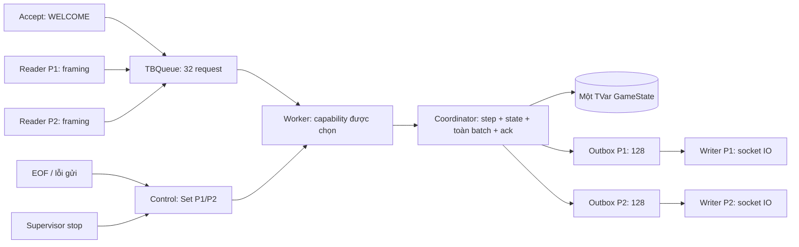

# NM-05 — Worker sở hữu xử lý trận và locality

Nhánh `Update_NUMA`. Đối chiếu source ngày 2026-10-12. C thực hiện, B review;
phần xác nhận của thành viên vẫn cần người phụ trách ghi, test không thay chữ ký.

## 1. Mục tiêu và kiến thức được áp dụng

Battleship có thể nhận dữ liệu từ hai socket đồng thời, nhưng một nước bắn phải
đọc kết quả nước trước. Ta giữ việc nhận/gửi mạng đồng thời và gom phần cập nhật
trận vào một worker. Đây là quyền sở hữu **việc xử lý**, không phải tạo thêm một
bản sao GameState hoặc ngăn writer đọc hàng đợi.

Đã đọc lại Chap5_Thread.pdf, trang vật lý tính từ 1:

- Trang 27–29: locality, giảm chia sẻ và `forkOn` chọn capability. Worker được
  tạo bằng `withAsyncOn`; capability được kiểm tra với RTS và `threadCapability`.
- Trang 31 và 41: message passing/mailbox tới worker cập nhật dữ liệu. Hai
  reader gửi envelope; không trực tiếp submit coordinator.
- Trang 35–40: STM, rollback, read/write set và batch commit. Coordinator vẫn
  cập nhật state và toàn bộ phản hồi trong một giao dịch; worker đặt ack trong
  giao dịch đó. IO mạng tiếp tục nằm ngoài STM.
- Trang 37–38: TVar trên heap và truy cập từ nhiều luồng có thể có chi phí NUMA.
  Ta giảm số nơi thực thi logic cập nhật, nhưng chưa đo RAM local/remote.

Các kỹ thuật bổ sung ngoài cách viết ví dụ trực tiếp trong slide: thư viện
`async` để quản lý phạm vi luồng, `TBQueue` hữu hạn, `TMVar` ack/completion,
Compose cpuset và bộ benchmark có checksum. Đây là công cụ triển khai các ý
tưởng đã học; không gọi chúng là kiến thức đã nằm nguyên văn trong slide.

## 2. Vì sao chọn một worker

Trước NM-05, reader P1/P2 đều gọi `atomically submitPayload`; STM đảm bảo luật
đúng nhưng cùng phần tính toán có thể được đánh giá từ hai luồng/capability.
NM-05 có một nơi parse, gọi step, encode và publish. Với một trận tuần tự,
worker sở hữu xử lý là cách trực tiếp để áp dụng mailbox và kiểm soát nơi chạy.

Ta không chia state thành shard theo người chơi: một phát bắn cùng lúc liên
quan đến lượt, lịch sử shooter, fleet đối thủ và kết thúc. Hai state độc lập
sẽ cần một cơ chế ghép giao dịch khác để giữ bất biến. Cũng không tạo worker
pool: nó có thể đưa hai lệnh về các capability khác nhau rồi phải thêm bước
tuần tự hóa kết quả. Một MVar chung quanh cả mạng và luật có thể giữ khóa khi
socket chậm; cấu trúc này chỉ giao tiếp bằng STM và không giữ socket trong worker.

Đánh đổi phải đo: thêm enqueue, ack, chuyển luồng, khởi tạo và supervision.
Không khẳng định nhanh hơn chỉ vì dùng locality; xem kết quả ở mục 8.

## 3. Cấu trúc thực thi



`GameWorker` chứa coordinator private, mailbox, tập disconnect và cờ stop.
Server chỉ dùng các API đọc state/outbox và gửi yêu cầu. Coordinator vẫn có API
STM cũ cho test và benchmark; server không import Coordinator để submit nữa.
Mailbox/control/completion là metadata vận chuyển, không phải GameState thứ hai.

`withGameWorker` kiểm tra capability, rồi `withAsyncOn` chạy khởi tạo coordinator
và các hàng đợi trên capability đó. Worker kiểm tra `threadCapability` trả đúng
index và cờ pinned trước khi công bố ready. Server mở listener sau worker ready;
readiness marker chỉ xuất hiện sau listen. Healthcheck không mở cổng chơi.

## 4. Hợp đồng request, backpressure và thứ tự

`GameRequest` có Admit, Payload, OversizedInput và CommandRequest. Nó dùng lại
PlayerId/Command của Types; không tạo Coord/Command thứ hai. Payload network đã
qua framing giới hạn 256 byte. Parser vẫn thuộc Protocol/Coordinator.

Mailbox production chứa tối đa **32 request đang chờ**, không tính request
worker đã lấy. Mỗi reader chờ ack trước khi nhận frame kế tiếp. Ack xác nhận
giao dịch xử lý đã xong, không chờ peer đọc TCP. Với hai reader bình thường,
thường có tối đa hai request chưa ack; test tạo nhiều producer để kiểm tra limit.

Khi đầy, `writeTBQueue` retry và producer dừng nhận thêm dữ liệu. Giao dịch
admission còn đọc cờ stop/completion: khi worker dừng/lỗi, STM thức dậy và trả
dừng hoặc ném lỗi. Không bỏ lệnh, không tăng queue và không xử thua vì người chơi
chưa nhập tàu hoặc nước bắn. Bộ đệm OS/bridge là tài nguyên khác với mailbox.

Thứ tự lựa chọn của worker: stop → disconnect đang chờ → FIFO thường. Disconnect
gộp vào Set hữu hạn tối đa P1/P2, nên lặp EOF/lỗi gửi không tăng bộ nhớ. Nếu cả
hai đã có trong cùng snapshot, P1 được xử lý trước; winner do `step P1 Quit`
quyết định. Nếu một disconnect đã được xử lý trước khi cái kia đến, kết quả đầu
có hiệu lực. Không hủy ngược nước bắn đã commit.

**QUIT gửi trên wire đi FIFO**, không được vượt FIRE trước nó của cùng socket.
EOF/lỗi gửi là control và có thể vượt request thường chưa xử lý. Dòng quá dài
được worker xếp ERROR LINE_TOO_LONG trước khi reader báo disconnect. Parser
lỗi, luật lỗi, WELCOME và Quit đều dùng coordinator hiện có. Socket thứ ba chỉ
nhận ERROR SERVER_FULL từ server; nó không thuộc một người chơi trong trận.

## 5. Tính nguyên tử và lazy evaluation

Worker gọi submitPayload/submitCommand/submitTooLong/welcomePlayer trong STM.
Coordinator đọc state mới nhất, parse/step, encode cả batch, kiểm tra dung lượng
của từng recipient rồi commit. Ack được đặt sau API coordinator trong cùng
atomically. Lỗi parser/luật không ghi state khi đủ chỗ; quá tải theo C-07 ở dưới.
Lỗi encode/core được throwSTM nên
không có state, một phần frame hoặc ack thành công lọt ra.

C-07 vẫn dùng outbox **128**, bình thường tối đa **126**, dành **2** cho GAME_OVER
và Nothing. Batch không đủ chỗ bị hủy; coordinator gọi Quit cho recipient quá
tải trên state cũ. Worker không chép luật thắng/thua. Cờ slow đánh thức watcher
đóng socket ngoài STM. EOF hoặc Quit muộn không thể đổi winner sau Finished.

Trong Haskell, tạo `Right (next, events)` có thể còn giữ thunk. Vì vậy Coordinator
duyệt cấu trúc state ban đầu và state được chấp nhận trước khi đưa vào TVar:
phase, hai PlayerState, mọi ship/cell, tọa độ và outcome trong lịch sử. Với frame
ByteString strict, buộc buffer và danh sách batch được xây trước publication.
Không dùng `show GameState` để ép tính, không thêm orphan NFData/đổi kiểu miền,
không gọi evaluate/unsafeIOToSTM trong giao dịch.

Duyệt state tối đa hai fleet 17 ô và lịch sử tối đa 100 ô/người. Đây là chi phí
thực, không miễn phí: đã đưa vào benchmark hiện tại. Writer chỉ gửi bytes đã
được xây; không nhận trách nhiệm tính luật bị trì hoãn. Test cố ý đặt lỗi trong
tọa độ chưa tính để chứng minh worker phát hiện và rollback trước publication.

## 6. Supervision và kết thúc

Worker ghi một completion TMVar kể cả khi lỗi/cancel. Đóng admission, flush
mailbox và công bố completion cùng một STM để producer không chen request
mới vào khoảng giữa flush và công bố dừng. Người chờ ack đồng thời
quan sát completion bằng orElse: worker chết không cần tự điền từng ack còn lại.
Sau Finished, request chờ nhận dừng và mailbox được flush hữu hạn; không gọi
step lần nữa. Stop được xét trước queue nên không cần chỗ trống để tiến triển.

Supervisor dùng `race` có phạm vi giữa callback sở hữu phiên và watcher lỗi
worker. Lỗi worker hủy callback; bracket/finally của server đóng listener và các
socket, rồi join reader/writer. Worker kết thúc bình thường **không** hủy phiên
sớm: writer còn phải gửi GAME_OVER/FIN trước khi server báo hoàn tất.

Trong lần viết đầu dùng link cho worker, test cancel phát hiện thông báo lỗi
đến muộn sau khi người chờ đã bắt lỗi completion. Đã thay bằng watcher có phạm
vi. Các link reader/writer hiện hành vẫn thuộc vòng đời server và giữ như trước.

Send watchdog vẫn **2 giây**, reader drain grace vẫn **200 ms**, gate shutdown
vẫn **10 giây**. Test Linux phát hiện finite flood có thể nằm hết trong kernel
buffer; gửi liên tục cũng có ca chưa tạo áp lực đủ nhanh vì tcp_wmem cho phép
auto-tune tới 4 MiB. Đã yêu cầu SO_SNDBUF **64 KiB** trên socket chơi để giới hạn
buffer ẩn phía kernel. OS có thể điều chỉnh/nhân đôi giá trị này; không coi 64
KiB là phép đo RAM toàn process. Test tạo áp lực liên tục bằng block hữu hạn,
có deadline và không dùng sleep để tạo race. Không đổi Nagle/luật/framing.

## 7. API và cách chạy

Giữ các runner cũ: runServer, runServerWith, runServerConfigured; default worker
capability 0. Thêm GameRuntimeConfig abstract, parser và runServerWithRuntime
theo NM-01. Parser nhận count thực tế và chuỗi index; runner kiểm tra lại trước
listen. Thư viện không tự đọc env. Main đọc `BATTLESHIP_GAME_CAPABILITY` và khởi
chạy, Rules vẫn giữ toàn bộ luật.

Native PowerShell, hai capability và worker thứ hai:

```powershell
$env:BATTLESHIP_GAME_CAPABILITY = '1'
stack exec battleship-server -- 4000 +RTS -N2 -RTS
```

Compose mặc định worker 0. Để thử worker 1, thêm `BATTLESHIP_GAME_CAPABILITY=1`
vào env triển khai và dùng affinity profile N2/cpuset 0,1/rts của NM-04. Script
start-affinity kiểm tra index < N và log worker actual. Đây là capability 1,
không phải yêu cầu trực tiếp CPU ID 1 trong mọi topology. Đổi profile phải stop
và mở trận mới; không đổi placement khi trận đang chạy.

```powershell
node scripts/start-affinity.mjs start
node scripts/start-affinity.mjs verify
node scripts/start-affinity.mjs stop
```

Origin/Host, cổng công bố khác PORT, token/phiên và resume 300.000 ms do bridge
giữ nguyên. Env mới chỉ vào Haskell, không chuyển cho web. API GameWorker có
constructor dung lượng nhỏ, enqueue/ack và diagnostic đọc để test; queue và
coordinator bên trong không được xuất ra. API bổ sung cần B/C/R review trước
hợp nhất, chưa ghi xác nhận thay nhóm.

## 8. Nghiệm thu và phép đo

### 8.1. Các gate đã chạy

Kết quả ngày **2026-10-12**, trên Windows 11 build 26200 và Linux amd64 của
Docker Desktop/WSL2. Snapshot **lts-24.59**, compiler **GHC 9.10.3**.

| Gate | Kết quả thật | Nội dung được kiểm chứng |
|---|---|---|
| Windows `stack build --ghc-options=-Werror` | Thành công | Toàn bộ component hiện tại biên dịch |
| Windows `stack test --ghc-options=-Werror` | **934 + 18** ví dụ, 0 lỗi | Suite chức năng và suite fixture riêng |
| Linux build/test `-Werror` | **935 + 18** ví dụ, 0 lỗi | Có thêm ca SIGTERM chỉ chạy trên Linux; không cộng nhầm thành test mới của worker |
| GameWorkerSpec trong các suite trên | **25** ví dụ | Capability thực, request, control, rollback, cancellation và socket cleanup |
| Node scripts | **80/80** | Topology, benchmark parser, affinity và validation worker capability |
| Frontend/bridge | **36/36** | Framing, riêng tư, token, Origin/Host và resume |
| Compose affinity | **3/3** | Hai profile và stop/restart khi hai peer đang kết nối |

Test worker có **100 vòng** hai producer gửi đồng thời, mỗi vòng kiểm tra
10 phát bắn, state, số frame và thứ tự từng recipient. Hspec đếm đây là một
ví dụ chứa vòng lặp, không phải 1.000 test độc lập. Test mailbox nhỏ lấp đầy
queue và công bố control trong cùng STM để tạo điều kiện xác định, không dựa
vào sleep đoán thứ tự scheduler. Pending ack và producer đang chờ queue đều
được đánh thức khi stop/fault; lỗi đặt bên trong tọa độ chưa tính rollback cả
state và batch. Các test C-07 giữ nguyên reserved terminal slots và deadline.

Compose đã chơi transcript đủ đặt tàu, lỗi, trượt/trúng/chìm/thắng qua server
thật; đối chiếu riêng tư, WELCOME P1/P2, người thứ ba, healthcheck, Origin/Host
và port mapping. Profile CPU logic **11 / N1 / worker capability 0** down trong
**877 ms**; profile CPU **0,1 / N2 / -qa / worker capability 1** trong **930 ms**;
stop/restart khi hai peer còn kết nối trong **944 ms**. Các số là thời gian
cleanup quan sát của ba ca, không phải cam kết mọi máy luôn đạt dưới một giây.
Test xác nhận cổng được giải phóng và trận mới nhận P1 sau restart.

Linux dùng cache compiler/dependency đã kiểm chứng ở DK-04, nhưng copy toàn
bộ source hiện tại và chạy lại build/test. Runtime được dựng bằng stage
production thật. Đây không phải build không cache từ đầu. Không có trận hai
thiết bị Wi-Fi thật trong NM-05; test mạng ở đây là các peer tự động.

### 8.2. Thiết kế phép đo

Baseline NM-03 tại [performance_baseline.md](performance_baseline.md) và dữ
liệu gốc được giữ nguyên. Runner hiện có thêm layer `worker`, so với
`coordinator` cùng source, cùng strictness, runtime và transcript. Mỗi replay
worker bao gồm khởi tạo/dừng một worker cho trận 25 lệnh, enqueue/ack, commit,
drain phản hồi, kiểm tra state và view. Do đó số đo không phải thời gian riêng
của thân `step`, cũng không phải tải nhiều trận song song.

Image benchmark dùng `-O2`, ba seed **424242 / 8675309 / 20261011** và fixture
hash giữ nguyên `24dfad3f17a6f75cf20b20d15faf9b2d637d73139607331bc004d1cd8bd64a53`.
Workload có lỗi không tiêu lượt, bắn trượt, trúng, chìm, thắng và view hai bên.
Checksum không đổi ở mọi sample. Binary/hash source có trong manifest; source
chưa commit ở HEAD `94a7aaaf68860a55cb7528c76f7c30f8fc1b6023`, nên SHA HEAD
một mình không mô tả đầy đủ phiên bản đo.

Môi trường nhìn thấy **12 CPU logic**, một NUMA node của VM/container. Ba
profile `-N1`, `-N2`, mặc định có 12 capability dùng cùng binary và tập CPU
được phép 0–11. Không bật cpuset riêng trong phép đo baseline này để giữ phạm
vi so sánh với NM-03. Test affinity ở mục 8.1 là phép kiểm tra cấu hình riêng.

Loạt đầu có **5 warm-up + 30 sample cho mỗi profile/layer**: 75 warm-up và
450 sample đo, 15 nhóm. Mỗi sample có nhiều replay: core 3.154, coordinator
2.100, worker 1.162 vòng; parser chuẩn hóa theo số lệnh. Sau khi cả ba nhóm
worker vượt ngưỡng nhiễu, đã đo lại nguyên layer worker: cùng binary, seed,
RTS và 1.162 vòng, thêm 15 warm-up + 90 sample. Không xóa sample hoặc chọn
seed theo kết quả. Tổng cộng lưu **540 sample đo và 90 warm-up**.

### 8.3. Số đo và mức nhiễu

Median, đơn vị **µs/lệnh**. Cột worker đầu/lặp đều là số liệu quan sát; cả hai
loạt worker chưa đạt điều kiện ổn định để dùng làm kết luận hiệu năng.

| Lớp | N1 | N2 | Mặc định N12 |
|---|---:|---:|---:|
| Lõi thuần, loạt đầu | 5,698 | 7,267 | 16,953 |
| Coordinator, loạt đầu | 8,456 | 10,506 | 22,599 |
| Worker, loạt đầu | 16,616 | 25,353 | 63,198 |
| Worker, loạt lặp | 14,340 | 22,195 | 55,808 |
| TCP, loạt đầu | 33.522,518 | 33.620,812 | 33.611,182 |
| WebSocket/bridge, loạt đầu | 33.593,716 | 33.609,523 | 33.631,258 |

Độ nhiễu là chênh median lớn nhất/nhỏ nhất giữa ba block 10 sample, chia
median cả nhóm theo NM-01; không gọi đây là độ lệch chuẩn.

| Nhóm worker | Nhiễu loạt đầu | Nhiễu loạt lặp | Ngưỡng |
|---|---:|---:|---:|
| N1 | 17,91% | 17,39% | ≤10% |
| N2 | 11,05% | 16,76% | ≤10% |
| Mặc định N12 | 30,73% | 20,76% | ≤10% |

Core/coordinator/TCP/web loạt đầu đạt ngưỡng ổn định. Worker vẫn không đạt
sau lần đo lại bắt buộc: **chưa đủ kết luận timing**, không tiếp tục chạy đến
khi tình cờ thu được nhóm đẹp. CI/p95 mẫu và toàn bộ raw data vẫn được lưu.
Số liệu cho thấy có chi phí thêm cần xem xét; chưa dùng ratio timing để chốt
default tối ưu hoặc ghi rằng locality tăng tốc.

Allocation median trong loạt lặp worker so với coordinator loạt đầu, byte/lệnh:

| Profile | Coordinator | Worker lặp | Chênh lệch quan sát |
|---|---:|---:|---:|
| N1 | 61.115,40 | 64.549,43 | +5,62% |
| N2 | 61.115,83 | 64.559,80 | +5,64% |
| N12 | 61.115,38 | 64.613,53 | +5,72% |

Thêm envelope/TMVar, worker và supervision có allocation thật. Đây là tổng
byte cấp phát của workload, không phải RSS hoặc dung lượng mailbox lúc đầy.
Worker lặp có median CPU time **1,176 / 1,847 / 4,740 s/sample**, GC CPU
accounting **0,0224 / 0,0472 / 0,2651 s/sample**, max live heap
**81.840 / 91.148 / 185.864 byte**, max RTS memory **6 / 11 / 62 MiB**.
Các total CPU/GC phụ thuộc số replay, không so trực tiếp tổng số giây với
layer có số replay khác. RTS memory không phải RAM vật lý trên NUMA node.
Context switch, migration, cache counter và peak RSS vẫn N/A, không điền 0.

### 8.4. So với baseline trước thay đổi

TCP/web hiện tại và NM-03 đều khoảng **33,5–33,7 ms/lệnh**; thay đổi median
nhỏ hơn **1%**, dưới ngưỡng cải thiện 5% đã chốt. Không có bằng chứng tăng tốc
đường chơi thực. Các điều kiện đo gồm loopback, nhiều frame và scheduler;
không suy độ trễ Wi-Fi hoặc chi phí riêng của React từ các số này.

Lõi thuần hiện thấp hơn NM-03 khoảng 30% dù thuật toán lõi không đổi. Điều đó
cho thấy so hai lần chạy khác nhau còn chịu ảnh hưởng môi trường/build/source;
không quy mức giảm này cho worker. Cùng source hiện tại có thể so coordinator
và worker để quan sát chi phí mailbox/scope, nhưng timing worker đang nhiễu.
So đường server với NM-03 còn có hai thay đổi đi kèm: ép state trước publication
và SO_SNDBUF. Chưa có thí nghiệm riêng từng biến để gán nguyên nhân.

**Kết luận nghiệm thu:** hành vi worker, nguyên tử, riêng tư và vòng đời đã qua
gate chức năng. Đã có phép đo so baseline và công bố chi phí/giới hạn. Chưa có
bằng chứng locality giúp nhanh hơn; B/C/R cần review đánh đổi và đo thêm trên
môi trường ổn định ở NM-09 trước khi chốt cấu hình hiệu năng. Quyền sở hữu và
placement đã được kiểm chứng; placement RAM vật lý thuộc NM-07.

### 8.5. Chạy lại và bằng chứng

Từ gốc repository, có Stack/GHC và Node/pnpm phù hợp:

```powershell
stack build --ghc-options=-Werror
stack test --ghc-options=-Werror
node --test scripts/test/topology.test.mjs scripts/test/benchmark.test.mjs scripts/test/affinity.test.mjs
pnpm --dir frontend test
```

Test hai container/affinity (cần Docker Linux engine, chọn CPU hợp lệ theo
topology thực tế; script test tự chọn từ tập được cấp):

```powershell
node --test scripts/test/affinity-compose.test.mjs
```

Benchmark đầy đủ với image riêng, không tác động trận production đang chạy:

```powershell
docker build -f docker/benchmark.Dockerfile -t battleship-benchmark:nm05 .
$nm05Root = (Get-Location).Path
$nm05Out = Join-Path $nm05Root '.stack-work/nm05/reproduce'
New-Item -ItemType Directory -Force -Path $nm05Out | Out-Null
node scripts/benchmark-runtime.mjs --prepare .stack-work/nm05/provenance.json
docker run --rm --network none --read-only --tmpfs /tmp --mount "type=bind,source=$nm05Root,target=/probe,readonly" --mount "type=bind,source=$nm05Out,target=/results" battleship-benchmark:nm05 --bench /usr/local/bin/battleship-benchmark --server /usr/local/bin/battleship-server --bridge-module /app/bridge.mjs --build-manifest /usr/local/bin/build-source-sha256.txt --provenance /probe/.stack-work/nm05/provenance.json --build-flags=-O2 --output /results
```

Runner mặc định 30 sample và 5 warm-up. Image build cần hai image nền DK-04/05
được ghi trong Dockerfile; xem cách tạo ở NM-03 nếu checkout chưa có chúng.
Command/image entrypoint và đường binary
chi tiết theo [hồ sơ phép đo](worker_data/nm05_2026-10-12/README.md); cần giữ
compiler/build flags và fixture khi so số liệu. Raw first/repeat, source hash,
image ID, tổng hợp test và log hash nằm trong
[evidence.json](worker_data/nm05_2026-10-12/evidence.json). Không đưa token hay
vị trí đội tàu vào log healthcheck; JSON artifact test chỉ lưu transcript/fixture
thử nghiệm. Kết quả test không thay xác nhận review của thành viên.

## 9. Giới hạn và phương án tiếp theo

Capability pinning chứng minh nơi thực thi của Haskell thread, cpuset/-qa là
bằng chứng CPU OS khác. Khởi tạo coordinator trên capability không chứng minh
toàn bộ heap nằm trên một NUMA node: initialGameState có thể là dữ liệu dùng
chung, runtime/allocator/GC và kernel quyết định trang RAM. Với các giá trị mới,
việc buộc tính tại worker giúp bố trí nơi thực thi/cấp phát nhưng vẫn cần NM-07
đo trang local/remote. Không báo cache hit, migration giảm hoặc tốc độ NUMA tăng
khi chưa có counter và phần cứng phù hợp.

Hai reader/writer và outbox vẫn chia sẻ metadata STM; đây không phải actor
không chia sẻ bộ nhớ hoàn toàn. Giao dịch với writer có thể retry khi queue
thay đổi; một worker loại cạnh tranh cập nhật gameplay từ hai reader nhưng
không loại mọi conflict STM. Một trận nhỏ cũng không tận dụng nhiều core để
tính luật song song; NM-06/NM-07 là các phép thử riêng, không thêm nhiều phòng.

Nguồn chính thức:
[async: withAsyncOn, race và phạm vi luồng](https://hackage-content.haskell.org/package/async-2.2.6/docs/Control-Concurrent-Async.html),
[GHC 9.10.3: capability và runtime](https://downloads.haskell.org/ghc/9.10.3/docs/users_guide/using-concurrent.html).
